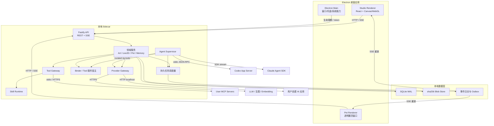
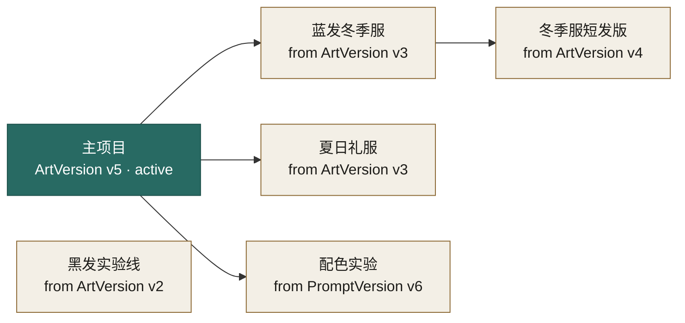
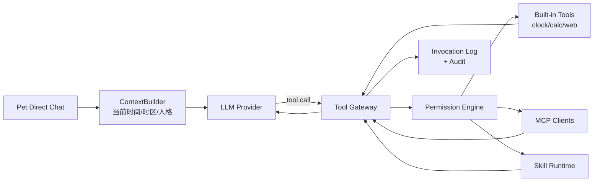

# agent2live 技术方案

> 状态：架构基线 v1.6（单用户本地工作区）
> 日期：2026-11-15
> 前提：完全从 0 开始设计，产品以开源方式发布。已有项目只作为可行性证据与风险清单参考，不构成目录、技术栈或产品边界的依赖。
> 阶段流程图：[2026-11-08-stage-workflows.md](./2026-11-08-stage-workflows.md)
> 数据模型：[2026-11-08-data-model.md](./2026-11-08-data-model.md)  
> 工具契约：[2026-11-08-tool-contracts.md](./2026-11-08-tool-contracts.md)  
> UI 系统：[2026-11-12-ui-system.md](./2026-11-12-ui-system.md)

## 1. 结论先行

### 1.1 产品定位

`agent2live` 是一个本地优先的“角色创作与运行套件”，角色是贯穿全链路的主实体：

```text
想法 / 素材
  → 颗粒化提示词草稿
  → 图片候选
  → 用户采纳的不可变立绘版本
  → 分层与差分素材
  → PSD
  → 自动绑定计划
  → Live2D 模型构建
  → 桌宠形象
  → 人格、聊天、记忆与 Agent 接入
```

三个制作子系统必须解耦：立绘管理不是生图聊天页，Live2D 管理不是通用图层编辑器，桌宠也不是把前两者塞进一个透明窗口。

### 1.1.1 首版发布边界：单机单工作区

首版是**单用户、单机、单本地工作区**的个人工作台，不是多用户 SaaS：

- 一个 OS 用户对应一个本地 workbench 和一个 SQLite 数据库。
- 不实现注册、登录、账号、组织、团队、共享、协作、多设备同步、云账号或 RBAC。
- sidecar 的本地 bearer token 只保护本机 HTTP 服务，不是用户身份、登录会话或权限主体。
- 审计中的 `local-user` 只是本地操作者标签，不是账号、用户外键或角色。
- 角色、项目、素材、Prompt、ArtVersion、Provider 配置、备份和记忆空间都按本地工作区管理，暂不增加 `user_id`/`tenant_id` 占位字段。
- 未来加入账号系统时必须作为独立阶段的显式迁移设计；不得让当前版本模型依赖未来账号体系。

完整决策见 [ADR 0006](../decisions/0006-single-user-workspace.md)。

### 1.2 推荐技术底座

| 层          | 选择                                                 | 原因                                                                                                                                                                            |
| ----------- | ---------------------------------------------------- | ------------------------------------------------------------------------------------------------------------------------------------------------------------------------------- |
| 桌面壳      | Electron + React + TypeScript                        | Chromium 版本可控，WebGL、透明窗口、置顶、点击穿透和多窗口行为一致；适合同时承载制作工作台与长期运行的桌宠窗口                                                                  |
| 前端构建    | Vite + React Router + TanStack Query + Zustand       | 服务端状态、局部编辑状态、实时任务状态分开管理                                                                                                                                  |
| 本地后端    | Node.js + Fastify，作为独立 sidecar                  | 与 Agent SDK、PSD 库、任务编排共享 TypeScript；不阻塞 Electron 主进程                                                                                                           |
| 跨端契约    | TypeScript 类型 + Zod Schema + JSON Schema 导出      | Web、后端、插件和 Agent Tool 共用同一份契约                                                                                                                                     |
| 本地数据库  | SQLite WAL + Drizzle ORM                             | 零部署、事务可靠、便于备份；元数据不与大文件混存                                                                                                                                |
| 文件资产    | 内容寻址 Blob Store，`sha256` 为键                   | 版本不可变、天然去重、可校验、可迁移到 S3/OSS                                                                                                                                   |
| 向量检索    | `sqlite-vec`，后续可替换 pgvector                    | 先在目标硬件上验证 10k / 50k 条记忆的 P95 延迟，再决定容量上限；超限时归档或迁移 pgvector                                                                                       |
| Live2D 渲染 | Cubism Web SDK，封装统一 Runtime                     | Studio 预览与桌宠使用同一核心版本，避免“预览能播、桌宠不能播”                                                                                                                   |
| PSD 处理    | `ag-psd` + `sharp`                                   | PSD 图层坐标、合成、裁切和缩略图处理可在 Node worker 内完成                                                                                                                     |
| 后台任务    | SQLite `jobs` 表 + 进程内持久任务调度器              | 首版无需 Redis 或独立 MQ；任务状态可恢复、可重试                                                                                                                                |
| 实时通道    | SSE + HTTP 命令                                      | 进度、聊天、Agent 事件本质上是服务端推流；审批和用户操作走普通 POST                                                                                                             |
| Agent 接入  | Codex App Server over stdio；Claude Agent SDK        | 使用官方控制面，不解析非稳定 transcript，不做 GUI 自动化                                                                                                                        |
| 桌宠工具    | Tool Gateway + 内置工具 + MCP Client + Skill Runtime | 每轮注入当前时间；搜索、MCP 和 Skills 按 Pet 授权，Schema 变化重新审批                                                                                                          |
| 平图分层    | See-through 本地推理适配器                           | Apache-2.0，可对单张动漫角色图输出最多 23 个预定义语义组的 PSD；“23”只是默认自动分解器的输出通道数量，不是系统 PSD 或 Live2D 层数上限；GPU 不可用时降级到外部执行或用户提供 PSD |
| 自动绑定    | PSD2Live GPL-3.0 默认 Binder                         | 可从 PSD 自动生成网格、变形器、参数、物理并导出 `.moc3` / `.cmo3`；通过独立进程/MCP 接入                                                                                        |

不建议在首版使用 Tauri 作为唯一桌面壳。Tauri 的体积优势明显，但 macOS WKWebView 与 Windows WebView2 的图形能力、透明窗口和合成行为存在更多平台差异。这个产品的主要风险是 Live2D 视觉一致性和长链路可靠性，Chromium 一致性带来的收益大于安装包体积收益。

工程主许可证采用 `GPL-3.0-only`。它避免闭源产品集成 GPL Binder 时的分发歧义，也符合“源码公开、允许用户研究、修改和再分发”的产品方向。各子依赖仍保留自己的许可证与 NOTICE；不能因为主项目是 GPL 就假设 Live2D Core 可以被重新分发。

### 1.3 “链路完全走通”的定义

“完全走通”不等于“每个生成步骤都全自动”。本方案将能力分成三档，并保证每一档都有明确出口：

| 能力             | 自动                       | AI 辅助                      | 人工兜底                      |
| ---------------- | -------------------------- | ---------------------------- | ----------------------------- |
| 参考图逆向提示词 | 结构化提取                 | 视觉模型分析 + 置信度        | 用户直接填写各颗粒块          |
| 立绘生成         | 生图 API                   | 候选图人工采纳               | 用户上传自己的立绘            |
| 分层与差分       | See-through 本地分层       | AI 层语义、闭眼/张嘴候选     | 用户上传 PSD 与闭眼、张嘴素材 |
| PSD 规整         | 自动裁切、对齐、合成       | 建议语义层名与补丁           | 工作台逐项修改                |
| Live2D 绑定      | PSD2Live 自动生成          | 参数、物理、动作和对话式修绑 | 导入外部模型或专业工具产物    |
| 动作与质检       | 自动校验、预览             | AI 给出动作建议              | 人工修正动作组和参数          |
| 桌宠             | 自动发布与加载             | 动作映射建议                 | 导入外部标准 Live2D 包        |
| 聊天             | 原生模型、HTTP 转发、Agent | 提示词和动作意图建议         | 仅显示状态或关闭聊天          |

必须守住两条底线：

1. 用户上传一张立绘和一个合格 PSD、本地 Binder 可用时，可以生成桌宠能加载的模型，不依赖任何生成式 AI。
2. 任何一个云端 AI Provider 失败，只降级对应能力，不阻断项目读取、版本回滚、模型预览和桌宠运行。

### 1.4 必须接受的第三方边界

1. Cubism 模型本体 `moc3` 不是普通开放格式。首个 Binder 明确选择 PSD2Live；它作为 GPL-3.0 独立进程构建和分发，仍须对产物做运行时 QC。
2. 截至本文日期，不把 Cubism Editor 的无人值守 CLI 当作可依赖的稳定接口。自动绑定采用独立 Binder；需要专业级网格、变形器微调时，提供 Cubism Editor 往返入口，而不承诺“完全无人工的专业绑定”。
3. See-through 源码为 Apache-2.0，但其模型权重仍需按权重发布页许可单独处理；安装器不默认静默下载未知版本权重。
4. Cubism Core 不进入 Git 仓库和发行包。开发安装脚本只检测官方 Core 是否存在，或在用户明确确认后打开官方下载页，不代为重新分发。
5. Cubism SDK 可用于开发和测试；公开发行使用 SDK 制作的内容前，应按 Live2D 当前发行许可确认适用条款。开源不自动豁免 Expandable Application 等限制。

## 2. 目标、非目标与不变量

### 2.1 目标

- 让不会画画的人可以从文字、设定或参考图开始，经过可控的多轮提示词版本形成可用立绘。
- 每个 PromptVersion 固化提示词与有序参考图；每个 ArtVersion 固化最终图片、生成参数和来源链。
- 用户可锁定颗粒块，AI 只能对未锁定块提出建议，不能直接覆盖当前版本。
- PSD 进入系统后可自动做语义识别、差分候选、规整、绑定、预览和质检。
- 每套模型拥有独立人格、动作映射、Provider 配置和记忆空间。
- 三种聊天模式的记忆边界由运行时策略强制保证，而不是只靠文案约定。
- Codex/Claude 既能作为被观察的外部活动，也能作为桌宠发起的受控任务执行者。

### 2.2 非目标

- 首版不实现用户系统、多人协作、社区市场、云端渲染农场和多租户。
- 首版不试图替代完整的 Photoshop 或 Cubism Editor。
- 不编辑已生成的 `moc3` 二进制内部网格；绑定微调作用于绑定计划和可编辑的 motion/physics 资产，然后重新构建。
- 不让生成模型直接执行 shell、访问任意文件或静默批准 Agent 权限。
- 不把 Agent 的完整推理轨迹复制进桌宠长期记忆。

### 2.3 系统不变量

1. 已采纳的立绘版本、提示词版本和模型构建都不可变；修正是创建新版本。
2. PromptVersion 是提示词与有序参考图的完整生成输入；服务端只从明确 PromptVersion 读取 references，不接受客户端传入任意旧 assetId 绕过版本链。
3. AI 建议不得修改锁定块；检查发生在服务端领域层，而非只做 UI 禁用。
4. 模型构建必须绑定明确的 ArtVersion、LayerSpecVersion、BindingReadyPsd、RigPlanVersion 和 CanvasTransform，不能使用“当前项目最新文件”这种漂移引用。
5. 只有通过 QC 的 ModelArtifact 才能发布给桌宠。
6. Forward 模式不得写入消息历史、语义记忆或摘要记忆。
7. Agent 模式只持久化任务投影摘要、状态和完成度；原始工作轨迹由 Codex/Claude 自身管理。
8. 外部模型、PSD、SVG、Hook 内容和 Agent 输出都按不可信输入处理。
9. PromptVersion 必须固化生成它的角色设定版本（如有）、PromptSpec、有序 references、可选要求快照和 input hash；角色设定、提示词、参考图或要求变化后旧建议不得静默复用。
10. Fork 只能引用已提交版本；父项目和子项目不共享可变 active 指针，谱系关系不因父项目删除而级联删除。
11. AI 修绑必须先产生用户可理解的预览，采用后才写正式 RigPlan；每次采用都生成可回退版本。
12. 工具调用必须同时通过 Pet 授权、当前 Schema hash 和风险策略，MCP/Skill 更新不得自动继承旧授权。
13. Direct Chat 每轮必须获得当前日期、时间和时区；模型记忆不能替代系统时间。

## 3. 总体架构



### 3.1 进程边界

- Electron Main 只负责窗口、托盘、系统目录选择、更新和 sidecar 生命周期。
- Studio 与 Pet 都是无 Node 权限的 sandbox renderer。
- Fastify sidecar 承载业务编排、数据库、文件系统和 Agent 子进程。
- CPU 密集型 PSD、图像压缩、SVG 栅格化在 Worker Thread 或独立子进程中执行。
- Binder、Claude native binary 和 Codex app-server 是独立进程。
- 渲染进程只拿短期本地 API token，不拿 Provider 密钥。

### 3.2 后端分层

后端采用模块化单体，而非一开始拆微服务：

```text
Transport      routes / controllers / SSE
Application    use cases / transactions / orchestration
Domain         versioning / locks / state machines / policies
Adapters       SQLite / Blob / Provider / Binder / Agent / OS keychain
Workers        image / PSD / rig / eval / memory curation
```

依赖方向只允许外层指向内层。`ArtVersionService` 不直接依赖某个生图厂商；`MemoryPolicy` 不依赖具体 Agent SDK。

### 3.3 工程契约与代码组织

跨进程边界先定义类型，再写实现。共享类型按职责放在唯一位置，不在页面、store、测试夹具和主进程中重复声明：

| 类型边界                             | 唯一归属                                       | 规则                                                                                   |
| ------------------------------------ | ---------------------------------------------- | -------------------------------------------------------------------------------------- |
| HTTP、SSE、Job、领域 DTO             | `packages/contracts`                           | Zod Schema 是运行时事实源，TypeScript 类型从 Schema 推导；未知字段策略在 Schema 中明确 |
| Electron Main ↔ preload ↔ renderer | `apps/desktop/src/shared/ipc-contracts.ts`     | 频道名、请求和返回值只声明一次；renderer 不直接复制 Main 的接口                        |
| renderer 全局探针与窗口扩展          | `apps/desktop/src/renderer/shared/global.d.ts` | 通过 `declare global` 声明，业务组件不得使用 `window as unknown as ...` 或 `any` 绕过  |
| renderer 专用视图模型                | 对应功能目录的 `types.ts`                      | 只放 UI 组合状态，不重复领域 DTO；能由 contracts 推导的类型不得手写第二份              |
| Provider 上游响应                    | `packages/providers/src/types.ts`              | Provider 原始响应先经过适配器校验，不泄漏到 renderer 或业务服务                        |

请求管线按安全边界各有一个稳定入口，而不是每个调用点自行拼接 `fetch`：

- Studio 与 Pet 访问 sidecar 时复用 `apps/desktop/src/renderer/shared/http/client.ts`。它统一处理 bearer token、JSON/FormData、取消信号、超时、`ProblemDetails` 解析、错误归一化和 blob 响应。
- Provider 访问外部 HTTP 服务时复用 `packages/providers/src/http.ts`。它统一处理 Provider 鉴权、超时、取消、响应大小和错误码，不复用 renderer 的本地 token 逻辑。
- Cubism 模型资源通过自有协议加载，资源读取和路径约束留在 `packages/live2d-runtime`。不得为了“统一”把文件系统协议塞进通用 HTTP 客户端。
- 业务 API 模块只声明端点、输入类型和响应类型，并调用统一客户端；禁止在组件、hook 或 Zustand store 中直接调用 `fetch`。

React 组件统一使用模块级 props 类型和 `React.FC<Props>`：

```tsx
export interface ProbePanelProps {
  probe: Live2DProbe
}

export const ProbePanel: React.FC<ProbePanelProps> = ({ probe }) => {
  return <pre>{JSON.stringify(probe, null, 2)}</pre>
}
```

- Props 类型命名为 `<ComponentName>Props`，声明在组件外；不要在函数参数中内联对象类型。
- 无业务 props 的组件使用共享的 `EmptyProps`，不写 `{}`、`object` 或可选的隐式参数。
- `forwardRef` 使用 `forwardRef<HTMLElement, ComponentProps>`，泛型组件保留显式泛型；这是 `React.FC` 无法表达引用和泛型时的有限例外。
- 类组件、render helper 和非组件函数不强行使用 `React.FC`。

TSX 文件按语义分组，组与组之间保留一个空行：

```text
外部依赖 imports

内部依赖 imports

类型、常量

组件与模块级函数

runtime mount / bootstrap
```

连续 imports 可以紧邻；imports 与声明、声明与声明、声明与 mount 调用之间必须留空行。Prettier 只负责机械排版，语义空行由代码风格检查保证。

代码注释只解释当前实现的设计原因、不变量、安全边界或易错点。注释不得引用计划章节、ADR 路径、任务编号、“按用户要求”或其他执行上下文；这些信息属于提交说明、计划或架构文档，不进入源码。能由类型和函数名表达的内容不写注释。

TypeScript 配置采用分层入口：`tsconfig.base.json` 只放共享编译规则；每个 workspace 的 `tsconfig.json` 负责自身源码边界；根 `tsconfig.json` 供 IDE 和一次全工作区检查使用；`tsconfig.e2e.json` 与 `tsconfig.spikes.json` 覆盖不属于 workspace 包的代码。`pnpm typecheck` 必须覆盖这些入口，不能依赖递归脚本偶然跳过目录。

#### 3.3.1 路径别名与模块公共出口

桌面应用内部使用受约束的路径别名，避免跨目录导入依赖 `../` 深度和文件位置：

| 别名                | 目标                               | 使用范围                                     |
| ------------------- | ---------------------------------- | -------------------------------------------- |
| `@desktop/shared/*` | `apps/desktop/src/shared`          | Main、preload、renderer 共用 IPC 契约        |
| `@renderer/*`       | `apps/desktop/src/renderer`        | renderer 内部共享模块                        |
| `@studio/*`         | `apps/desktop/src/renderer/studio` | Studio 功能模块、页面、API、hooks 和视图工具 |

别名通过 `tsconfig.paths.json` 提供 TypeScript 解析，并在 `electron.vite.config.ts` 与根 `vitest.config.ts` 中配置相同映射。Main/preload 只获得 `@desktop/shared`，renderer 获得 `@renderer` 与 `@studio`；不能只修改 TypeScript 配置而遗漏运行时构建或测试解析。

每个可被其他模块消费的目录通过 `index.ts` 提供稳定公共入口：

- `@studio/api`、`@studio/components`、`@studio/hooks`、`@studio/providers`、`@studio/routes`、`@studio/workbench` 和 `@studio/workbench/components` 是 Studio 公共入口。
- `@renderer/shared`、`@desktop/shared` 是跨应用或跨 Electron 进程的共享入口。
- `@studio/format`、`@studio/project-progress`、`@studio/live2d-view` 等单文件模块通过限定别名导入，不额外包装无意义目录。
- Electron `main/index.ts` 是启动入口，不作为业务 barrel；测试和内部 helper 默认不进入公共 API。

模块导入遵循以下边界：

```ts
import { queryKeys, getArtProject } from '@studio/api'
import { StudioError, StudioLoading } from '@studio/components'
import { Workbench } from '@studio/workbench'
```

- 模块外部只从公共入口导入，不导入 `@studio/components/StudioError` 这类深层路径。
- 模块内部使用直接相对导入，例如 `./StudioError`；任何模块不得引用自己的 `index.ts` 形成循环。
- 公共入口只做重导出，不执行注册、请求、样式注入或其他运行时副作用。
- 组件 barrel 使用显式命名导出并避免 `export *`。每个组件上方用一句 JSDoc 说明职责，Props 紧跟组件使用 `export type`。
- API、hooks 和工具模块可以按逻辑组使用 `export *`，但公共入口仍只暴露稳定能力，不泄漏内部 store、测试夹具和实现 helper。
- `packages/design-system` 遵循同一规则：子模块 barrel 为每个公开组件注明职责，包根入口继续作为唯一稳定导入路径。

`scripts/check-module-boundaries.mjs` 自动拒绝公共组件 barrel 的通配导出、缺少职责注释、公共入口深层导入、Studio 跨模块相对导入，以及 Main/preload 引用 renderer。Vitest 配置必须显式排除 `**/.packaged-server/**`、`dist`、`out` 等生成目录，避免打包副本被误识别为源码测试。

## 4. 数据模型

### 4.1 聚合关系

```text
Character
├── CharacterBriefVersion (immutable; active pointer on Character)
├── ArtProject
│   ├── PromptInputSubmission
│   ├── PromptDraft
│   ├── PromptVersion (immutable, DAG by parentId; owns ordered references)
│   ├── ArtVersion (immutable, points to PromptVersion + final artwork asset)
│   └── Live2DProject
│       ├── LayerSpecVersion
│       ├── SemanticPatchCandidate
│       ├── RigPlanVersion
│       └── ModelBuild -> ModelArtifact
├── ProjectFork (parent/child project lineage)
└── PetProfile
    ├── PersonaVersion (bound to ModelArtifact)
    ├── RuntimeSettings
    ├── Conversation / Message             (仅 Direct)
    └── MemorySpace
        ├── MemoryItem
        └── AgentTaskProjection           (仅 Agent)
```

一个 Character 可以有多个 ArtProject、ArtVersion 和 ModelArtifact。`ArtProject.active_version_id` 是立绘 active 指针的唯一事实源；`ArtProject.active_prompt_version_id` 是当前生成输入版本指针。`ArtVersion` 只保存最终图片和来源，参考图归属于不可变 `PromptVersion`。`Pet.active_model_id` 是该桌宠模型指针的唯一事实源；`runtime_bindings` 是可重建的运行投影，不持有第二个 active 指针。

### 4.2 颗粒化提示词

```json
{
  "schemaVersion": "prompt-spec/2",
  "fullPrompt": "银灰色短发的青年女性，碧绿色眼睛，正视半身，左上方柔和冷光，纯白背景。",
  "promptVersionId": "pv_01J...",
  "artProjectId": "artp_01J...",
  "characterId": "chr_01J...",
  "parentVersionId": "pv_01H...",
  "lockAll": false,
  "inputSubmissionId": "inp_01J...",
  "sourceRequirements": [
    {
      "id": "req_01",
      "text": "必须保留左眼下的泪痣",
      "strength": "must"
    }
  ],
  "materialRefs": [
    {
      "assetId": "ast_01J...",
      "role": "identity_reference",
      "note": "脸型和眼睛以这张为准",
      "weight": 1.0,
      "locked": true
    },
    {
      "assetId": "ast_01K...",
      "role": "outfit_reference",
      "note": "只参考服装结构，不参考人物",
      "weight": 0.7,
      "locked": false
    }
  ],
  "blocks": [
    {
      "id": "subject.identity",
      "category": "subject",
      "label": "人物主体",
      "text": "银灰色短发的青年女性，碧绿色眼睛",
      "weight": 1.0,
      "locked": true,
      "confidence": 0.96,
      "evidence": [
        {
          "assetId": "ast_01J...",
          "region": { "x": 0.3, "y": 0.1, "width": 0.4, "height": 0.3 }
        }
      ],
      "source": "user",
      "priority": 100,
      "requirementRefs": ["req_01"],
      "materialRefs": ["ast_01J..."]
    },
    {
      "id": "lighting.key",
      "category": "lighting",
      "label": "主光",
      "text": "左上方柔和冷光，右侧轻微轮廓光",
      "weight": 0.8,
      "locked": false,
      "confidence": 0.74,
      "evidence": [],
      "source": "vision-model",
      "priority": 20,
      "requirementRefs": [],
      "materialRefs": []
    }
  ],
  "negativeBlocks": [
    {
      "id": "negative.l2d",
      "category": "negative",
      "label": "Live2D 反例",
      "text": "文字，水印，复杂背景，头发遮眼，手脚裁切",
      "weight": 1.0,
      "locked": true,
      "confidence": 1,
      "evidence": [],
      "source": "user",
      "priority": 100,
      "requirementRefs": [],
      "materialRefs": []
    }
  ],
  "constraints": {
    "canvas": { "width": 1584, "height": 2816 },
    "background": "solid",
    "aspect": "portrait"
  }
}
```

`materialRefs` 是草稿编辑态和 PromptVersion references 的派生视图。提交 PromptVersion 时，服务端按数组顺序写入 `asset_links(owner_type='prompt_version')`；读取时再根据该有序数组恢复 `materialRefs`。参考图没有主图标记。

`category` 枚举：

```text
subject, identity, age, body, face, hair, eyes, outfit, accessory,
pose, expression, composition, camera, background, style,
color, lighting, rendering, material, negative, safety
```

### 4.3 AI 修改建议

```json
{
  "schemaVersion": "prompt-suggestion/1",
  "id": "psg_01J...",
  "basePromptVersionId": "pv_01J...",
  "baseContentHash": "sha256:...",
  "intent": "让光线更柔和，但保持人物身份不变",
  "status": "proposed",
  "operations": [
    {
      "op": "replace",
      "blockId": "lighting.key",
      "before": "左上方柔和冷光",
      "after": "左上方大面积柔光，阴影边缘更软",
      "reason": "降低硬阴影，接近参考图质感"
    }
  ],
  "warnings": []
}
```

服务端执行建议前必须验证：

- `baseContentHash` 仍等于当前 draft。
- 每个 `operations[].blockId` 都存在。
- 目标块未锁定，且 `lockAll=false`。
- 操作只能作用于允许的字段。
- 不合法时返回 `409 PROMPT_BASE_STALE` 或 `423 PROMPT_BLOCK_LOCKED`。

### 4.4 立绘版本

```json
{
  "schemaVersion": "art-version/2",
  "id": "art_01J...",
  "artProjectId": "artp_01J...",
  "versionNumber": 4,
  "artworkAssetId": "ast_01J...",
  "promptVersionId": "pv_01J...",
  "generationId": "gen_01J...",
  "parentVersionId": "art_01H...",
  "originVersionId": "art_01H...",
  "sourceKind": "generated",
  "source": {
    "schemaVersion": "art-source/1",
    "kind": "generation_candidate",
    "candidateId": "cand_01J...",
    "generationJobId": "gen_01J...",
    "generationRequestHash": "sha256:..."
  },
  "validation": {
    "schemaVersion": "art-validation/1",
    "status": "passed",
    "width": 1584,
    "height": 2816,
    "mediaType": "image/png",
    "sha256": "sha256:..."
  },
  "canvasTransform": { "scale": 1, "offsetX": 0, "offsetY": 0, "rotationDeg": 0 },
  "contentHash": "sha256:...",
  "createdAt": "2026-11-06T15:00:00+08:00"
}
```

`ArtVersion` 只表示最终立绘结果。`artworkAssetId` 用于 Studio 画布、平图自动分层和后续 Live2D 构建；参考图、角色、权重和顺序由关联的 PromptVersion 保存。ArtVersion 不拥有参考图，也没有主图。生成、手工上传和 Fork seed 是三种互斥的 `sourceKind`。

用户可以激活任意历史 ArtVersion。激活只移动 `ArtProject.active_version_id`，不修改 PromptVersion，也不删除其他版本。

采纳候选时使用乐观并发控制：

```text
POST /generation-candidates/:id/accept
If-Match: currentActiveVersionId
```

若 active 已变化，返回 `409 ART_ACTIVE_VERSION_CHANGED`，由用户重新确认，不静默覆盖。

### 4.5 Live2D 构建契约

```json
{
  "schemaVersion": "model-build-request/2",
  "label": "首版完整绑定",
  "changeSummary": "基于 LayerSpec v3 和 RigPlan v2 构建",
  "baseArtVersionId": "art_01J...",
  "layerSpecVersionId": "lsp_01J...",
  "source": {
    "sourcePsdAssetId": "sha256:source-psd...",
    "bindingReadyPsdAssetId": "sha256:binding-ready-psd...",
    "variantAssets": {
      "eyesClosed": "sha256:...",
      "mouthOpen": "sha256:..."
    }
  },
  "rigPlanVersionId": "rig_01J...",
  "binder": {
    "id": "local-psd-binder",
    "version": "pinned-version"
  },
  "canvasTransform": {
    "sourceCanvas": { "width": 1584, "height": 2816 },
    "contentBounds": { "x": 170, "y": 8, "width": 1240, "height": 2800 },
    "targetCanvas": { "width": 2048, "height": 3584 },
    "scale": 1.28,
    "offset": { "x": 224, "y": 0 },
    "anchor": "bottom-center",
    "interpolation": "lanczos3"
  },
  "target": {
    "cubism": "4.2"
  },
  "requiredCapabilities": ["ParamEyeLOpen", "ParamEyeROpen", "ParamMouthOpenY", "idle-motion"]
}
```

```json
{
  "schemaVersion": "model-build/2",
  "id": "build_01J...",
  "label": "首版完整绑定",
  "changeSummary": "导入闭眼与张嘴层后重新构建",
  "status": "qc_passed",
  "baseArtVersionId": "art_01J...",
  "layerSpecVersionId": "lsp_01J...",
  "bindingReadyPsdAssetId": "sha256:binding-ready-psd...",
  "rigPlanVersionId": "rig_01J...",
  "targetCubismVersion": "4.2",
  "canvasTransform": {
    "sourceCanvas": { "width": 1584, "height": 2816 },
    "contentBounds": { "x": 170, "y": 8, "width": 1240, "height": 2800 },
    "targetCanvas": { "width": 2048, "height": 3584 },
    "scale": 1.28,
    "offset": { "x": 224, "y": 0 },
    "anchor": "bottom-center",
    "interpolation": "lanczos3"
  },
  "binder": {
    "connectionId": "binder_01J...",
    "version": "pinned-psd2live-version"
  },
  "inputHash": "sha256:...",
  "artifact": {
    "id": "model_01J...",
    "entry": "character.model3.json",
    "mocVersion": 4,
    "cubismCoreVersion": "core-version-used-at-build",
    "runtimeVersion": "app-live2d-runtime-version",
    "manifestAssetId": "sha256:...",
    "contentDigest": "sha256:...",
    "parameters": ["ParamAngleX", "ParamEyeLOpen", "ParamEyeROpen", "ParamMouthOpenY"],
    "motionGroups": ["Idle", "Tap", "Think", "Happy"]
  },
  "qcReportId": "qc_01J...",
  "createdAt": "2026-11-06T15:30:00+08:00"
}
```

### 4.6 数据库表

| 表                          | 关键字段                                                                                                                                                                                                                                                                 | 说明                                                          |
| --------------------------- | ------------------------------------------------------------------------------------------------------------------------------------------------------------------------------------------------------------------------------------------------------------------------ | ------------------------------------------------------------- |
| `characters`                | id, title, summary, active_brief_version_id, row_version                                                                                                                                                                                                                 | 角色聚合根；保存角色设定 active 指针，不保存立绘 active 指针  |
| `assets`                    | id, sha256, media_type, byte_size, storage_key, width, height                                                                                                                                                                                                            | 元数据；大文件在 Blob Store                                   |
| `asset_provenance`          | asset_id, source_kind, source_ref, license, consent, model_ref                                                                                                                                                                                                           | 用户素材、AI 产物和第三方素材的来源链                         |
| `art_projects`              | id, character_id, title, active_version_id, active_prompt_version_id, stage, row_version                                                                                                                                                                                 | 立绘与提示词聚合根；active 指针的唯一来源                     |
| `character_brief_versions`  | id, character_id, parent_version_id, content_json, source_kind, content_hash                                                                                                                                                                                             | 不可变角色设定快照                                            |
| `project_forks`             | id, child_project_id, parent_project_id, root_project_id, source_kind, source_version_id, source_hash, branch_label, status                                                                                                                                              | 跨 ArtProject 的分支谱系；不拥有版本 active 指针              |
| `prompt_input_submissions`  | id, art_project_id, draft_id, revision, character_brief_version_id, global_notes, requirements_json, created_at, row_version                                                                                                                                             | 不可变初始化输入；角色设定版本或参考图至少有一种              |
| `asset_links`               | asset_id, owner_type, owner_id, role, note, weight, sort_order, locked                                                                                                                                                                                                   | PromptInput/PromptVersion/LayerSpec/Model 的角色化素材关联    |
| `prompt_drafts`             | id, art_project_id, revision, status, state_json, input_submission_id, row_version                                                                                                                                                                                       | 可编辑草稿及其当前输入快照                                    |
| `prompt_versions`           | id, art_project_id, parent_version_id, input_submission_id, content_json, content_hash, version_number                                                                                                                                                                   | 不可变生成输入版本；PromptSpec + 有序参考图                   |
| `prompt_suggestions`        | id, job_id, base_kind, base_version_id, base_draft_id, operations_json, status, provider_invocation_id                                                                                                                                                                   | AI 建议及精确基线                                             |
| `art_versions`              | id, art_project_id, parent_version_id, origin_version_id, prompt_version_id, artwork_asset_id, generation_job_id, source_kind, source_json, validation_json, canvas_transform_json, content_hash, version_number                                                         | 不可变最终立绘；只保存 artwork asset 与来源                   |
| `generation_jobs`           | id, art_project_id, prompt_version_id, base_art_version_id, provider_connection_id, request_json, request_hash, job_id                                                                                                                                                   | 固定 PromptVersion、可选 base ArtVersion 与实际 Provider 请求 |
| `generation_candidates`     | id, generation_job_id, asset_id, validation_json, status, accepted_art_version_id                                                                                                                                                                                        | 候选图                                                        |
| `live2d_projects`           | id, art_project_id, base_art_version_id, active_layer_spec_version_id, active_rig_plan_version_id, stage, row_version                                                                                                                                                    | Live2D 项目及其当前图层/绑定版本指针                          |
| `layer_spec_versions`       | id, live2d_project_id, parent_version_id, source_art_version_id, label, change_summary, source_kind, source_psd_asset_id, binding_ready_psd_asset_id, compose_report_asset_id, layers_json, decomposer_json, qc_json, content_hash                                       | 不可变图层方案、PSD 输入输出及合成报告                        |
| `semantic_patch_candidates` | id, live2d_project_id, layer_spec_version_id, role, asset_id, confidence, status, accepted_layer_spec_version_id                                                                                                                                                         | 闭眼、张嘴、SVG/栅格补层候选及采纳结果                        |
| `rig_plan_versions`         | id, live2d_project_id, parent_version_id, label, change_summary, source_layer_spec_version_id, binding_ready_psd_asset_id, plan_json, binder_state_asset_id, base_state_hash, edit_log_json, content_hash                                                                | 固定输入 PSD 的可重放绑定方案                                 |
| `rig_copilot_sessions`      | id, project_id, model_build_id, selection_json, status                                                                                                                                                                                                                   | 绑定协作会话，不进入桌宠记忆                                  |
| `rig_copilot_messages`      | id, session_id, role, content_json, created_at                                                                                                                                                                                                                           | 用户与 AI 的绑定协作记录，可单独清理                          |
| `rig_edit_proposals`        | id, session_id, base_state_hash, intent, edits_json, preview_json, verification_json, status                                                                                                                                                                             | 不可变修改提案                                                |
| `rig_preview_renders`       | id, proposal_id, probe_id, before_asset_id, after_asset_id, metrics_json                                                                                                                                                                                                 | 参数/动作采样预览                                             |
| `model_builds`              | id, live2d_project_id, art_version_id, layer_spec_version_id, binding_ready_psd_asset_id, rig_plan_version_id, label, change_summary, canvas_transform_json, target_cubism_version, required_capabilities_json, binder_connection_id, binder_version, input_hash, status | 固定全部输入的一次构建                                        |
| `model_artifacts`           | id, build_id, entry, content_digest, capabilities_json, qc_report_id                                                                                                                                                                                                     | 可发布模型                                                    |
| `pets`                      | id, name, character_id, active_model_id, window_config_json                                                                                                                                                                                                              | 桌宠实例；唯一 active model 指针                              |
| `persona_versions`          | id, pet_id, model_artifact_id, character_brief_version_id, overrides_json, persona_json, prompt_hash                                                                                                                                                                     | 从 CharacterBriefVersion 与运行时覆盖生成的人格投影           |
| `runtime_bindings`          | id, pet_id, model_artifact_id, motion_map_json, provider_connection_id                                                                                                                                                                                                   | 运行时绑定                                                    |
| `provider_connections`      | id, kind, label, config_json, secret_ref, capabilities_json                                                                                                                                                                                                              | 不含明文密钥                                                  |
| `conversations`             | id, pet_id, mode, external_session_ref, status                                                                                                                                                                                                                           | 仅 Direct 持久化；Forward 不创建                              |
| `messages`                  | id, conversation_id, role, content_json, created_at                                                                                                                                                                                                                      | 仅 Direct 的聊天内容                                          |
| `memory_spaces`             | id, pet_id, model_artifact_id, namespace                                                                                                                                                                                                                                 | 隔离空间                                                      |
| `memory_items`              | id, space_id, kind, content, importance, source, status, expires_at                                                                                                                                                                                                      | 可检索长期记忆                                                |
| `memory_vectors`            | memory_id, embedding_model, embedding_revision, dimensions, embedding                                                                                                                                                                                                    | 向量必须与模型、版本和维度绑定                                |
| `agent_tasks`               | id, pet_id, provider, native_session_ref, objective, status                                                                                                                                                                                                              | Agent 任务元数据                                              |
| `agent_task_projections`    | agent_task_id, completion, summary, blockers_json, revision                                                                                                                                                                                                              | 唯一允许进入桌宠记忆的 Agent 投影                             |
| `agent_approvals`           | id, agent_task_id, native_turn_ref, native_tool_request_ref, payload_hash, permission_mode, normalized_cwd, scope_hash, kind, status, expires_at                                                                                                                         | 审批状态机；scope_hash 的组成字段同时持久化                   |
| `jobs`                      | id, type, payload_json, status, attempts, lease_until                                                                                                                                                                                                                    | 持久任务                                                      |
| `job_events`                | id, job_id, seq, type, payload_json, created_at                                                                                                                                                                                                                          | SSE 可重放事件                                                |
| `outbox`                    | id, topic, payload_json, published_at                                                                                                                                                                                                                                    | 跨模块可靠通知                                                |
| `audit_events`              | seq, at, actor_json, action, target_json, outcome, request_id, trace_id, before_hash, after_hash, metadata_json                                                                                                                                                          | 追加式安全与业务审计，不是调试日志                            |

关键索引：

- `art_versions(art_project_id, created_at desc)`
- `art_projects(character_id, updated_at desc)`
- `project_forks(child_project_id)` 唯一
- `project_forks(root_project_id, created_at)`
- `project_forks(parent_project_id, lower(branch_label)) WHERE status='active'` 唯一
- `prompt_input_submissions(art_project_id, created_at desc)`
- `asset_links(owner_type, owner_id, sort_order)`
- `asset_links(owner_id, asset_id) WHERE owner_type='prompt_version'` 唯一
- `asset_links(owner_id, sort_order) WHERE owner_type='prompt_version'` 唯一
- `prompt_drafts(art_project_id, status)`，其中每个 art project 只允许一个 `active` draft
- `prompt_versions(content_hash)`
- `layer_spec_versions(live2d_project_id, created_at desc)`
- `rig_plan_versions(live2d_project_id, created_at desc)`
- `model_builds(live2d_project_id, status)`
- `rig_copilot_sessions(project_id, updated_at desc)`
- `rig_edit_proposals(session_id, status, created_at desc)`
- `jobs(status, next_run_at)`
- `job_events(job_id, seq)`
- `memory_items(space_id, status, expires_at)`
- FTS5：`messages_fts(content)` 与 `memory_fts(content)`
- 向量索引：`memory_vectors(embedding_model, embedding_revision, dimensions, embedding)`

SQLite 是单写者。每个项目使用进程内 mutex，并在事务中比较 `row_version`。禁止两个 sidecar 实例同时写同一个数据库；第二个实例必须检测并转交或退出。

### 4.7 Blob 布局

```text
userData/
├── app.sqlite
├── blobs/sha256/ab/cd/<sha256>
├── preview-cache/
├── model-cache/
├── logs/
└── runtime/
    ├── endpoint.json
    └── agent/
```

所有资产带 SHA-256 和媒体类型。禁止用用户原名直接作磁盘路径。删除采用“引用计数 + 延迟 GC”，避免正在预览的模型文件被并发删除。

`endpoint.json` 包含随机端口、当前启动 token、pid 和启动时间，权限 `0600`，退出时删除。Electron 使用 `requestSingleInstanceLock()` 防止多开；第二实例若发现 sidecar 存活，只把参数转交给首个实例。每次 sidecar 启动轮换 token，异常退出后旧 token 永久失效。

### 4.8 导出与备份

角色可导出为开放目录包：

```text
character-export.zip
├── manifest.json
├── schema/
│   └── versions.json
├── database/
│   └── entities.jsonl
├── blobs/
│   └── <sha256 files>
├── models/
│   └── <model artifacts>
└── checksums.sha256
```

`manifest.json` 记录导出格式版本、应用版本、数据库 schema 版本、blob 数量、模型能力与许可说明。导入时先校验 checksum，再做可逆迁移；高版本格式缺少迁移器时只读打开，不部分写入。

### 4.9 状态归属

| 状态                                | 承载实体                | 推进者                                | 说明                                                            |
| ----------------------------------- | ----------------------- | ------------------------------------- | --------------------------------------------------------------- |
| `idea_draft` … `art_version_active` | `art_projects.stage`    | Prompt/Generation Application Service | active 版本切换不重置 stage                                     |
| Live2D 产线状态                     | `live2d_projects.stage` | ModelBuild/PSD Application Service    | 独立于 ArtProject                                               |
| `queued` … `unknown_outcome`        | `jobs.status`           | Job Engine                            | 单个异步任务，不表达业务完成度                                  |
| `qc_passed` / `qc_failed`           | `model_builds.status`   | ModelBuild Service                    | 构建结果                                                        |
| Character 总览状态                  | API 派生只读 View       | Query Service                         | 由 active ArtVersion、Live2DProject 和 Pet binding 聚合，不落库 |

禁止把多个聚合的阶段写进同一个 `characters.status` 字段。UI 的总进度是派生值，不是事务写入值。

## 5. 立绘与提示词系统

### 5.1 状态机

```text
idea_draft
  → prompt_draft
  → prompt_ready
  → generating
  → candidate_review
  → art_version_active
  → live2d_ready
```

旁路状态：

- `suggestion_review`：AI 建议等待采纳，不改变当前 ArtVersion。
- `generation_failed`：保留 base 版本，不写空候选。
- `stale`：当前 Live2D 构建绑定的 ArtVersion 不再是 active，但不自动删除旧模型。

### 5.2 从想法到第一版提示词

初始化以一次 `PromptInputSubmission` 为原子输入单元。角色设定与至少一张参考图必须提供其一；创作要求、单素材备注、必须保留项和禁止项均为选填。

`PromptInputSubmission`：

```json
{
  "id": "inp_01J...",
  "artProjectId": "artp_01J...",
  "draftId": "pd_01J...",
  "revision": 3,
  "characterBriefVersionId": "cbv_01J...",
  "globalNotes": "正面全身，深蓝色工装外套，双手自然下垂；干净赛璐璐风格，白色纯色背景，用于 Live2D。",
  "requirements": [
    {
      "id": "req_01",
      "text": "必须保留左眼下的泪痣",
      "strength": "must"
    },
    {
      "id": "req_02",
      "text": "不要写实厚涂，保持干净赛璐璐",
      "strength": "avoid"
    }
  ],
  "materials": [
    {
      "id": "alink_01J...",
      "assetId": "ast_01J...",
      "role": "identity_reference",
      "note": "脸型、眼型以此图为准",
      "weight": 1.0,
      "locked": true,
      "sortOrder": 0
    },
    {
      "id": "alink_01K...",
      "assetId": "ast_01K...",
      "role": "outfit_reference",
      "note": "只参考外套结构，不参考人物和配色",
      "weight": 0.7,
      "locked": false,
      "sortOrder": 1
    }
  ]
}
```

角色的正式设定内容不在 `PromptInputSubmission` 内重复保存，而是保存在不可变的 `CharacterBriefVersion.content_json`；这里通过 `characterBriefVersionId` 引用该版本，保证角色设定只有一个事实源。完整 Schema 覆盖身份、社会身份、背景、外观、性格、行为语言、能力、关系、成长弧光和未知项，详见[数据模型](./2026-11-08-data-model.md#42-character_brief_versions)。

初始化请求有两种角色设定写法：

```json
{
  "characterBrief": {
    "schemaVersion": "character-brief/1",
    "identity": {
      "fullName": "雾原铃",
      "age": "19",
      "gender": "女性",
      "species": "人类"
    },
    "social": {
      "occupations": ["机械师"],
      "affiliations": ["旅行者公会"],
      "storyRole": "主角"
    },
    "background": {
      "birthplace": "北境工业城",
      "family": "父亲是钟表匠，母亲长期失踪",
      "formativeEvents": ["工坊火灾后独自旅行"]
    },
    "appearance": {
      "body": {
        "build": "纤细但结实",
        "posture": "习惯微微前倾查看机械",
        "distinguishingMarks": ["左眼下泪痣", "右手机械护腕"]
      },
      "face": {
        "eyes": "碧绿色眼睛",
        "defaultExpression": "嘴角很轻的戒备"
      },
      "hair": {
        "style": "层次短发",
        "color": "银灰色"
      },
      "outfit": {
        "default": "深蓝色工装外套",
        "materials": ["旧皮革", "黄铜"],
        "props": ["随身工具包"]
      },
      "palette": {
        "primary": ["银灰", "深蓝"],
        "accent": ["黄铜色"]
      }
    },
    "personality": {
      "coreTraits": ["安静", "观察力强"],
      "contradictions": ["表面冷淡但会照顾流浪机械"],
      "motivations": ["查明母亲失踪的原因"]
    },
    "behavior": {
      "speech": {
        "tone": "简洁，偶尔反讽"
      },
      "mannerisms": ["思考时转动小螺丝刀"]
    },
    "abilities": [
      {
        "name": "机械维修",
        "description": "能拆解和修复旧时代机械",
        "limits": "缺少特殊零件时需要寻找替代方案"
      }
    ],
    "relationships": [
      {
        "target": "师父",
        "relation": "导师",
        "dynamic": "互相认可但都不善表达"
      }
    ],
    "arc": {
      "goal": "查明母亲失踪的原因",
      "flaw": "习惯独自承担风险",
      "growth": "学会信任同伴"
    },
    "unknowns": ["母亲当前身份", "最终结局"],
    "notes": ""
  }
}
```

或引用已经创建的版本：

```json
{
  "characterBriefVersionId": "cbv_01J..."
}
```

首次提交 `characterBrief` 时，服务端先创建不可变的 `CharacterBriefVersion`，再在同一事务中创建引用它的 `PromptInputSubmission`。只提供参考图、不提供角色设定时，`characterBriefVersionId` 为 `null`，系统可以生成待确认的视觉设定草稿，但不会把草稿静默写成正式角色设定。

素材角色枚举：

```text
identity_reference, style_reference, outfit_reference, color_reference,
background_reference, pose_reference, sketch, texture, other
```

要求强度：

```text
must      必须满足，生成后逐项检查
prefer    优先满足，允许因其他约束妥协
avoid     避免项，进入反向约束或 QA checklist
```

处理流程：

1. 上传文件先进入 quarantine，完成 MIME、尺寸、hash 和恶意内容检查。
2. `PromptInputService` 在需要时创建 `CharacterBriefVersion`，并在同一事务中保存 `PromptInputSubmission`、`asset_links` 和 draft revision。
3. `PromptReverseService` 读取当前 PromptDraft 的有序 references、草稿提示词、角色设定（如有）和创作要求；视觉能力由当前 references 是否为空决定，不能把“图像分析”和“文字要求”拆成两个互不知情的请求。
4. 输出颗粒块时，每个块附带 `requirementRefs`、`materialRefs`、置信度和证据区域。
5. `PromptRequirementAudit` 检查每个 `must` 和 `avoid` 是否至少映射到一个正向/反向块；未覆盖项必须显示在审查面板。
6. 用户在 PromptDraft 中修改提示词或调整 references 的增删、顺序、角色、备注、权重和锁定。
7. 提交为不可变 `PromptVersion` 时，同时固化 PromptSpec、`inputSubmissionId`、有序 references、角色设定版本（如有）和可选的创作要求快照。

模型输出必须使用 JSON Schema 约束。无效 JSON 最多重试两次；仍失败则降级为“模板 + 用户手填”，不将原始自由文本直接写入数据库。

`POST /art-projects/:id/prompt-inputs` 的推荐请求形态是 `multipart/form-data`：一个 `metadata` JSON part 描述 characterBrief（新设定）或 characterBriefVersionId、可选 requirements、素材 part 名、角色、备注和权重，其余 parts 是文件。也允许 JSON 请求引用已经上传的 `assetId`。服务端先把所有文件写入 staging，全部校验通过后再在一个事务中发布 `CharacterBriefVersion`（如有）、`PromptInputSubmission` 和关联，任何文件失败都不产生半成品关联。

初始化校验规则：

- 角色名必填。
- 有有效的 `characterBrief` 内容或 `characterBriefVersionId`，或有至少一张参考图；二者满足其一即可。
- `globalNotes`、requirements 和单素材备注均可为空。
- 只有角色设定、没有参考图时，允许从文字设定反推提示词。
- 只有参考图、没有角色设定时，允许从视觉素材生成提示词，并可生成视觉向的 `CharacterBrief` 草稿；不得静默推断性格、背景或说话方式。
- 两者都没有时拒绝初始化，不创建 AI 任务。
- `PromptVersion` 同时固化 `CharacterBriefVersion`（如有）、PromptSpec 和有序 references，避免后续修改角色设定或参考图导致历史提示词漂移。

响应：

```json
{
  "submission": {
    "id": "inp_01J...",
    "revision": 3,
    "characterBriefVersionId": "cbv_01J...",
    "globalNotes": "正面全身，深蓝色工装外套，白色纯色背景。",
    "requirements": [],
    "materials": []
  },
  "draft": {
    "id": "pd_01J...",
    "revision": 4,
    "status": "active",
    "contentHash": "sha256:...",
    "rowVersion": 2
  },
  "warnings": []
}
```

### 5.3 提示词编译

内部统一使用 `PromptSpecV2`，调用生图前编译为 Provider 格式：

```text
PromptSpec
  → ConstraintResolver
  → ProviderCapabilityProfile
  → PromptCompiler
  → CompiledGenerationRequest
```

编译结果记录：

- canonical prompt hash
- provider prompt hash
- model、尺寸、seed、参考图集合 hash（有序 assetId、role、weight）
- negative prompt
- provider adapter 版本

这保证同一版本的“用户意图”和“实际发给模型的字符串”都可审计。

编译规则必须是确定性的：

1. 块顺序固定为 `identity → body/face/hair/eyes → outfit/accessory → pose/expression → composition/camera → background → style → rendering/lighting/material → safety`，同类别按 `priority`、再按 blockId 排序。
2. 空白、标点和全半角先做 NFKC + 空白归一化；用户文本不改写。
3. 权重先归一化到 `[0.1, 2.0]`，由 Provider Capability Profile 决定表达方式；不支持权重的 Provider 按 `weight >= 1.2` 生成强调关键词，并在编译报告中标记 `weight_degraded`。
4. Provider 有长度上限时按低优先级块、低权重块依次截断，永不删除锁定身份块和 safety/negative；截断必须出现在报告里。
5. seed、negative prompt 和 reference hash 进入编译结果；相同输入、Provider 配置和编译器版本必须产生相同 canonical prompt。
6. 每个 Provider Adapter 至少有一组 golden fixture，验证顺序、权重、截断和负向提示词。

### 5.4 生成与采纳

规则如下：

1. 客户端提交 `promptVersionId`、Provider/model、数量、尺寸和可选 seed；服务端从该 PromptVersion 读取 PromptSpec 与有序 references。
2. 空 references 走纯文生图；非空 references 按数组顺序依次发送。不定义主参考图。
3. `baseArtVersionId` 可省略；省略时使用项目当前 active ArtVersion。显式值与当前 active 不一致时返回 `ART_ACTIVE_VERSION_CHANGED`。
4. `includeBaseArtworkReference` 默认 `false`，base ArtVersion 只记录继续创作来源。设为 `true` 时，服务端把当前立绘追加到 references 末尾（相同 asset 不重复），并受 14 张契约上限与 Provider 能力上限约束。
5. GenerationJob 固定 PromptVersion、base ArtVersion、模型选择、编译 Prompt、参考图排序与 hash、尺寸、数量和 seed。
6. 每个任务可以产生多个候选，候选不是 ArtVersion。
7. 用户采纳候选时，系统校验尺寸、内容安全、文件完整性和 active 版本并发状态。
8. 采纳后创建新 ArtVersion，写入候选 `assetId` 为 `artworkAssetId`、生成任务与 PromptVersion 来源，并把 active 指针原子移动。
9. 激活历史 ArtVersion 不删除任何版本，也不修改 PromptVersion；只移动 active 指针并写审计事件。

Provider 对多图输入的能力由 Capability Profile 决定：

- 支持足够多图：按 PromptVersion references 数组顺序发送全部参考图。
- 支持数量不足：发送数组前缀，剩余参考图写入编译报告并标记 `reference_budget_exceeded`，不得静默假装已发送。
- 不支持图生图 `maxReferenceImages=0`：保留完整 references 快照，但实际忽略全部图片并标记 `references_ignored_no_image_input`。
- Provider 只支持单图时，按顺序发送第一张；这只是能力降级，不是业务主图。

### 5.5 AI 微调与锁定

“锁定”是领域不变量：

- UI：锁定块隐藏拖拽、AI 改写和批量替换入口。
- API：AI 建议服务读取当前草稿后过滤锁定块。
- Domain：采纳建议事务再次检查锁定，防止建议生成后用户又锁定该块造成 TOCTOU。
- Prompt compiler：锁定只阻止修改，不阻止发送给生图模型。

AI 只能返回建议，不直接修改 draft。用户点击采纳后可选择：

- `采纳到草稿`：创建新 draft revision。
- `放弃`：建议保留为审计记录或删除。
- `基于建议生成`：保存新 draft revision、创建新 PromptVersion，然后进入生成。

`PromptSuggestionService` 读取 PromptVersion 所引用的完整 `CharacterBriefVersion`。立绘建议优先使用 `appearance`、`defaultExpression` 和 `bodyLanguage`；`personality`、`motivations`、`relationships`、`abilities` 与 `arc` 可以作为解释表情、姿势和叙事气质的上下文，但每个建议必须记录引用了哪些角色设定字段，不能把未定义的性格或背景擅自转成新的外观事实。AI 建议只修改 PromptDraft，不能顺带修改 CharacterBriefVersion。

### 5.6 前端页面

`/characters/:id/art`

- 版本栏分别展示 PromptVersion 和 ArtVersion：PromptVersion 管理完整提示词与有序参考图，ArtVersion 展示最终立绘缩略图。
- Prompt 工作区同时编辑 `fullPrompt`、颗粒块和有序参考图；参考图支持上传、删除、排序、角色、备注、权重和锁定，不存在“设为主图”。
- ArtVersion 工作区只展示最终立绘、历史激活、候选对比和手工上传。
- GenerationDialog 选择已提交 PromptVersion，并可选择是否把当前 active 立绘追加为参考图。

核心组件：

- `PromptInputComposer`
- `MaterialTray`
- `RequirementChecklist`
- `ProjectLineageTree`
- `ForkFromVersionDialog`
- `ForkOriginBar`
- `ParentChildCompare`
- `VersionDAG`
- `PromptBlockCard`
- `LockToggle`
- `ConfidenceBadge`
- `SuggestionDiff`
- `CandidateCompareView`
- `PromptReferenceEditor`
- `GenerationControls`
- `TaskProgress`

编辑状态放在 Zustand；服务端实体放 TanStack Query。大图预览使用 URL + versioned cache key，不把 base64 存在全局 state。

### 5.7 ArtProject Fork 与谱系展示

用户可以从任意已提交的 `PromptVersion` 或 `ArtVersion` 创建子 ArtProject。未提交草稿必须先保存版本，保证 Fork 有稳定基线。

#### Fork 规则

- 子项目必须与原项目属于同一个 Character。
- 一个父版本可以创建多个互不影响的子项目。
- Fork 时创建本地 seed `PromptVersion`，完整复制 PromptSpec 与有序参考图；如果源是 ArtVersion，还创建 seed `ArtVersion`，复用其 `artworkAssetId`。所有引用复用同一个内容寻址 Blob，不复制图片字节。
- Blob GC 同时统计父版本、子版本和 Fork seed 的引用；删除父项目不能回收仍被子项目引用的素材。
- 子项目的 active 指针从 seed 开始，之后只修改自己项目内的版本，不修改父项目。
- Live2DProject、RigPlan、ModelBuild 默认不复制；它们可以从子项目新的 active ArtVersion 重新创建。
- 允许从子项目继续 Fork；v1 每个子项目只有一个父项目，因此项目谱系是树，项目内部的版本关系仍是 DAG。
- v1 不提供自动 merge-back。用户可手动复制单个 PromptBlock 或把子版本采纳为父项目的新分支，但不静默合并。
- 父项目软删除后，子项目继续存在；谱系节点显示“源项目已删除”。
- Fork 关系不能隐式删除；用户可“脱离谱系”，但保留只读 provenance 记录。

#### 关系 Schema

```json
{
  "schemaVersion": "project-fork/1",
  "id": "fork_01J...",
  "childProjectId": "artp_child...",
  "parentProjectId": "artp_parent...",
  "rootProjectId": "artp_root...",
  "source": {
    "kind": "art_version",
    "id": "art_01J...",
    "contentHash": "sha256:..."
  },
  "branchLabel": "蓝发冬季服",
  "status": "active",
  "createdAt": "2026-11-08T11:00:00+08:00"
}
```

如果 `source.kind=prompt_version`，子项目产生 seed PromptVersion，但 active ArtVersion 为空；如果 `source.kind=art_version`，子项目同时获得本地 seed PromptVersion 和 ArtVersion。

#### Fork 创建流程

1. UI 在版本节点的菜单提供“从此版本 Fork”。
2. 用户输入子项目名和分支标签，默认标签为“分支 v3-1”。
3. 服务端验证源版本存在、属于同一 Character、已提交且 hash 一致。
4. 使用 `Idempotency-Key` 防止双击创建重复子项目。
5. 在单事务中创建 child ArtProject、seed versions、`project_forks` 和 `art_project.forked` 审计事件。
6. 成功后直接打开子项目；父项目 untouched，UI 显示“已创建分支”。

#### 项目列表谱系展示

默认使用“按谱系分组”视图：

```text
银发少女
├─ 主项目 · 立绘 v5 · active
│  ├─ 蓝发冬季服 · from v3 · active
│  │  └─ 冬季服短发版 · from v4
│  └─ 夏日礼服 · from v3 · stale
└─ 黑发实验线 · from v2 · archived
```



显示规则：

- 根项目作为主卡片，显示活跃分支数和最近更新时间。
- 子项目默认折叠在根项目下，使用分支连接线、`branchLabel` 和来源版本 badge。
- 子项目卡显示父项目面包屑、`forked from ArtVersion v3`、自己的当前版本和模型状态。
- 顶部提供 `仅根项目 / 全部项目` 切换；搜索命中子项目时自动展开其祖先。
- 进入子项目后，工作台顶部固定显示谱系路径：`银发少女 / 主项目 / 蓝发冬季服`。
- Fork 图谱只展示项目层级和关键版本，不把每个中间 generation 都塞进项目列表。
- 父项目和子项目可并排比较 active 图、Prompt diff 和模型状态。

#### API

| 方法    | 路径                              | 说明                                   |
| ------- | --------------------------------- | -------------------------------------- |
| `POST`  | `/prompt-versions/:id/forks`      | 从不可变提示词版本创建子项目           |
| `POST`  | `/art-versions/:id/forks`         | 从不可变立绘版本创建子项目             |
| `GET`   | `/art-projects/tree?characterId=` | 获取根项目、子项目、来源版本和状态摘要 |
| `PATCH` | `/art-projects/:id/fork-link`     | 修改 branchLabel 或标记 detached       |

Fork 响应包含 `childProject`、`seedPromptVersion`、可选 `seedArtVersion` 和 `forkLink`；客户端不得自行拼装谱系。

## 6. Live2D 制作系统

### 6.1 状态机

```text
created
  → image_ready
  → decomposing
  → layer_review
  → psd_composed
  → rig_planning
  → rigging
  → rig_review
  → motion_review
  → qc
  → published

外部已绑定模型可旁路进入：

psd_imported
  → analyzing
  → patch_review
  → psd_composed
  → externally_edited
  → qc
  → published
```

失败状态为 `failed`，允许从最近成功 checkpoint 重试。任何上游 ArtVersion 变化都只把项目标记为 `stale`，不能自动覆盖已发布模型。`externally_edited` 表示用户从 PSD2Live 或 Cubism Editor 导入了外部修改产物，必须重新运行统一 QC 后才能发布；该状态不能自动回到内部的 `rigging`。

### 6.2 平图到分层 PSD

可选输入 PSD 不是唯一入口。没有 PSD 时，从当前 active ArtVersion 进入自动分层：

```text
ArtVersion.artworkAssetId 指向的最终立绘
  → 图像规范化
  → SeeThroughDecomposer
  → SemanticAudit
  → OptionalLeftRightAndDepthSplit
  → NormalizedPsdBuilder
  → BindingReadyPsd
```

默认实现采用 See-through。它是 Apache-2.0 的开源项目，提供 `inference/scripts/inference_psd.py`，可从单张动漫角色图生成最多 23 个预定义语义组的 PSD。应用只通过独立的 Python worker 调用固定版本和固定参数，不把模型推理写进 Electron renderer。

“最多 23 个语义层”只是 See-through 当前默认权重和输出分类 Schema 的限制，仅适用于“单图自动分层”适配器。它不是 `LayerSpecVersion`、PSD 合成器、PSD2Live 或 Live2D 系统的层数上限，也不进入后续绑定契约。用户导入自己的 PSD、在现有 PSD 上继续补层、增加差分图，或把同一语义组拆成多个实际图层时，后续流程直接对这些图层做语义审计、合成和绑定，不得为了满足 23 层限制而合并、丢弃图层。

系统不承诺无限图层；真实上限由 PSD 文件大小、像素总量、内存和具体 Binder 能力决定，并应作为可诊断的资源限制单独处理。这些资源限制与 See-through 的 23 个输出类别无关。语义角色也不是“一角一层”：同一角色可以由多个 PSD 图层共同表达。

运行档位：

| 档位          | 条件                          | 策略                                                                     |
| ------------- | ----------------------------- | ------------------------------------------------------------------------ |
| GPU 完整      | NVIDIA CUDA，≥12GB VRAM       | 1280 长边，group offload，完整质量                                       |
| GPU 低显存    | NVIDIA CUDA，8GB VRAM         | 量化或 block-swap；报告质量降级                                          |
| CPU           | 无兼容 GPU                    | 不作为交互默认；提示使用外部 worker 或人工 PSD                           |
| Apple Silicon | 首版未验证 See-through 全链路 | 使用外部 NVIDIA worker 或人工 PSD；MPS 通过 Phase 0 前不承诺本地自动分层 |
| 外部执行      | 无本地兼容 GPU                | 用户自行在本地/远程运行 See-through，导入 PSD                            |

模型权重不随源码仓库提交。应用记录 See-through 版本、权重 ID、推理参数、深度图和分割 mask，任何结果都能追溯。

分层质量门：

- 合成回原图的 alpha IoU ≥ 0.995，颜色误差 P95 使用 CIEDE2000 ≤ 3；阈值在 Phase 0 实测后校准。
- 基础必需语义组必须存在：面部、前发、后发、左右眼白/虹膜/睫毛、嘴、躯干、左右手臂、上装、下装；被完全遮挡的组允许为空，但必须标记原因。
- 所有图层坐标在画布内，无 NaN/负尺寸，不把 `reconstruction` 或整图预览当作正式层。
- 自动左右拆分只在置信度和像素证据同时达标时执行；否则留给 patch review。
- 自动分层永远先成为 `LayerSpecCandidate`，用户可全选采纳，但不能直接覆盖已有正式 PSD。

无 GPU 或者分层门失败时，系统必须给出三条可执行路径：降低分辨率重试、导入第三方工具产出的 PSD、在已有图层上手工修正。产品不得表现为“点击自动分层后永远转圈”。

### 6.3 输入

最小输入：

- 当前 active ArtVersion。
- 分层 PSD。
- 目标 Cubism 版本。
- Binder。

可选输入：

- 闭眼、张嘴、侧脸差分图。
- 用户自定义语义层命名。
- 动作、物理、表情和参数预设。
- 外部 `.model3.json` 模型包。

### 6.4 AI 语义层补齐

系统先把 PSD 解析成 `LayerGraph`：

```json
{
  "nodeId": "layer-17",
  "name": "eyes",
  "bbox": { "x": 620, "y": 410, "w": 360, "h": 140 },
  "visible": true,
  "opacity": 1,
  "semantic": {
    "role": "eye_white",
    "side": "both",
    "confidence": 0.63,
    "needsSplit": true
  }
}
```

语义角色建议使用固定 taxonomy，例如：

```text
face, eye_white, iris, eyelash, eyebrow, mouth, hair_front, hair_back,
neck, torso, upperwear, lowerwear, legwear, footwear, accessory,
background, reconstruction, unknown
```

该 taxonomy 只描述图层用途，不限制 PSD 图层数量，也不要求每个角色只能出现一次。See-through 的 23 个输出组上限只影响它自动生成候选，不影响用户导入、补充或重复使用多个同角色图层。

AI 可生成三类候选：

- `layer_label`：只改语义标签。
- `raster_patch`：补闭眼、张嘴、局部遮挡层，输出与基准画布逐像素对齐的 PNG。
- `vector_patch`：生成 SVG 草图，经清洗、栅格化后进入同一候选审查。

SVG 处理流程：

1. 删除 `<script>`、`foreignObject`、事件属性和外部引用。
2. 禁止字体、远程图片和滤镜网络请求。
3. 用固定 viewBox 栅格化到目标 PSD 坐标。
4. 检查 bbox、透明边界和最终立绘对齐。
5. 形成 `raster_patch` 候选并等待用户采纳。

候选不会直接写入正式 PSD。用户采纳后，composer 幂等生成 BindingReadyPsd 和 compose report；全部成功后才原子创建新的 `LayerSpecVersion` 并移动 active 指针。合成失败只保留上一版。

### 6.5 PSD 合成

合成器必须：

- 所有差分图以当前 ArtVersion 为基准对齐。
- 裁切画布时同步平移所有图层坐标。
- 删除 `reconstruction`、`preview`、`merge` 等明确脏层。
- 不猜左右拆分；置信度不足时标记人工处理。
- 产生 `compose-report.json`，记录每个补丁来源、阈值、裁切框和失败原因。
- 原子写临时 PSD，成功后 rename；失败不覆盖上一版。

输入 PSD 永远只读保留。`ag-psd` 无法保真的智能对象、文字、调整层、图层样式或特殊混合模式必须进入能力报告：

- 可安全栅格化时，由用户确认后生成规范化副本。
- 不能保真时阻止自动 compose，并给出“在 Photoshop 栅格化该层 / 在 Cubism Editor 导入”的可操作提示。
- 不能用简化 PSD 静默覆盖原稿，否则一次保存就可能永久损失用户素材。

输出：

```text
builds/<buildId>/
├── source.psd
├── compose-report.json
├── layer-map.json
└── previews/
```

### 6.6 默认 Binder 与自动绑定

首个默认 Binder 明确选择 [PSD2Live](https://github.com/tsunehimatoi/psd2live)。它采用 GPL-3.0，可为分层 PSD 生成网格、变形器、参数、物理和动作，并导出 `.moc3` / `.cmo3`。本项目也采用 GPL-3.0-only，因此标准发行版可以携带固定版本的原生二进制或其源码构建产物。

发行方式：

- `full` 包：内置固定版本 PSD2Live 与所需运行时，附带完整 Corresponding Source、NOTICE 和构建脚本。
- `lite` 包：不内置 PSD2Live，首次运行检测用户安装的路径；适合包体积敏感用户。
- 两者使用相同 BinderAdapter 和产物 QC，不允许行为漂移。

每个构建任务启动一个独立 PSD2Live 进程，通过临时 store、随机 localhost token 和受控工作目录通信。优先使用其 MCP/结构化接口，不解析 GUI 文本输出。超时或进程崩溃时先终止整个进程树，再把任务标为 `failed` 或 `unknown_outcome`。

Phase 0 的平台范围固定为 macOS arm64：固定 PSD 在干净的 macOS 环境产出至少一个 `.moc3` 模型包，Studio 和 Pet Runtime 均能加载，idle 可播放，必需参数可读取，全部阻塞 QC 通过。Windows x64 在 Phase 2 夜构建验证；没有 Windows 证据前不得标记 Windows 支持。

立绘画布与模型画布不要求像素尺寸相同。构建时记录 `CanvasTransformV1`：

```json
{
  "sourceCanvas": { "width": 1584, "height": 2816 },
  "contentBounds": { "x": 170, "y": 8, "width": 1240, "height": 2800 },
  "targetCanvas": { "width": 2048, "height": 3584 },
  "scale": 1.28,
  "offset": { "x": 224, "y": 0 },
  "anchor": "bottom-center",
  "interpolation": "lanczos3"
}
```

首版只允许等比例缩放，沿目标画布居中并贴底；禁止把非等比例缩放默默写进纹理。QC 以 `CanvasTransformV1` 重新合成 10 个采样点，检查角色边界、眼睛和嘴部定位，偏差超过 2 个模型像素即阻塞发布。

绑定通过版本化 Binder 接口：

```ts
interface Binder {
  inspect(input: BinderInspectInput): Promise<BinderCapabilities>
  build(input: BinderBuildInput, ctx: JobContext): Promise<BinderBuildOutput>
  validate(output: BinderBuildOutput): Promise<QCFinding[]>
}
```

Binder 输入只有 PSD 路径、目标版本、RigPlan 和临时输出目录。它不能访问用户其他文件。

绑定工作台有两种模式：

1. **重新绑定微调**：用户调整参数范围、父子关系、连接点、网格密度和物理预设，保存新 RigPlanVersion，再构建一版。这样可保证绑定计划真实作用于最终模型。
2. **后处理微调**：对 motion3、physics3、pose3、表达式和参数组做编辑；不修改 moc3 内部拓扑。

如果用户必须直接调整 moc3 内部网格或高级变形器，则进入“专业工具往返”：

- 导出可交换工程或 PSD 与当前绑定说明。
- 用户在 Cubism Editor 中完成。
- 导入其导出的标准模型包。
- 系统重新执行统一 QC，状态标记为 `externally_edited`。

这条路径是有意保留的人工出口，不能被宣传成完全自动。

### 6.7 实时预览

Studio 与桌宠共用同一个 `Live2DRuntime`：

```ts
interface Live2DRuntime {
  load(packageUrl: string): Promise<LoadedModel>
  unload(): Promise<void>
  setMotion(intent: MotionIntent): Promise<void>
  setExpression(expression: string): Promise<void>
  setParameters(values: Record<string, number>): void
  hitTest(x: number, y: number): Promise<HitArea | null>
  getDiagnostics(): ModelDiagnostics
}
```

预览必须显示：

- 当前窗口裁剪框。
- 画布透明边界。
- 角色底边与窗口锚点。
- 参数滑杆。
- 动作组列表。
- 物理开关。
- 运行期参数与纹理诊断。

运行时绑定固定使用 `cubismCoreVersion` 和 `runtimeVersion`，QC 报告记录两者。构建与运行时版本不匹配时阻止发布，不只在控制台告警。

### 6.8 出厂 QC

阻塞项：

- `QC-B01`：`model3.json` 入口唯一且深度受控。
- `QC-B02`：`moc3` magic 和版本合法。
- `QC-B03`：`Moc`、纹理、motion、physics、pose、expression 引用完整。
- `QC-B04`：所有引用不逃逸模型目录。
- `QC-B05`：至少一个可获得 `idle` 意图的动作。
- `QC-B06`：纹理可解码且尺寸在运行时上限内。
- `QC-B07`：运行时可创建模型并读取 `requiredCapabilities`。
- `QC-B08`：`cubismCoreVersion` 与 `runtimeVersion` 和当前目标环境兼容。

警告项：

- `QC-W01`：缺少眨眼参数。
- `QC-W02`：缺少 LipSync 参数。
- `QC-W03`：物理文件缺失。
- `QC-W04`：画布比例异常。
- `QC-W05`：可选动作组缺失。
- `QC-W06`：纹理尺寸过大或纹理数量超过性能预算。

发布动作只接受 `qc_passed` 的 ModelArtifact。

### 6.9 Live2D 工作台组件

- `StageRail`：完整产线状态和当前阻塞项。
- `PsdLayerTree`：层级、语义角色、置信度和“不支持特性”标记。
- `LayerOverlayCanvas`：原图与补层叠加，显示 bbox 和透明度。
- `VariantCompareSlider`：闭眼、张嘴候选与基准图联动缩放。
- `ComposeReport`：逐项说明自动修复、跳过和需人工处理的内容。
- `RigViewport`：模型实时预览、参数滑杆和窗口裁剪框。
- `DeformerInspector`：绑定计划中的父子关系、网格密度和连接点。
- `MotionLibrary`：动作组、表情、物理预设与意图映射。
- `ModelQcPanel`：阻塞项、警告项、运行时诊断和发布按钮。

长任务期间这些组件保持挂载，通过 `disabled` 和遮罩层表达忙碌状态，避免候选选择、未保存参数或图层展开状态因任务开始而丢失。

### 6.10 AI 协作绑定工作台

绑定工作台增加一个持续在线的 AI 副驾驶。用户可以直接说：

- “左眼闭眼时眼皮穿过睫毛，帮我修一下。”
- “头向右转 30 度以后耳朵消失，调整参数和绑定。”
- “头发跟随太硬，改成更慢、更软的物理。”
- “选中了前发，帮我把晃动轴拆成左右两束。”

对话输入框提供快捷意图：修复穿模、限制参数、重铺网格、调整父子层级、软化物理、检查极值、对比修复。快捷意图只负责填充上下文和自然语言，不会绕过提案与预览。

默认模式为“共驾”：AI 可以读取当前绑定、生成结构化修改提案、试运行和渲染预览，但不能直接发布或静默修改正式工程。用户先查看效果，再点击“采用这个效果”，系统以同一 base state 原子提交。

对非专业用户采用“视觉优先”的交互顺序：

1. 用户描述问题或点击快捷意图。
2. UI 立即进入“正在准备效果预览”，不在对话区先倾泻参数、网格和变形器术语。
3. 系统在隔离 preview state 中生成修改，并自动播放相关参数/动作下的 before/after 对比。
4. 用户先看到“闭眼时不再穿模”“头发跟随更柔”等行为结果，再看到“改动 2 个部位”的简短说明。
5. 只有用户点击“采用这个效果”，才把修改提交到正式 RigPlan；参数 ID、deformer、权重、CAS 等技术信息折叠在“查看技术细节”。
6. 采用后生成新版本；用户可以一键撤销这次 AI 修改，回到上一版模型。

“采用”是用户可见文案，内部对应 `RigEditProposal.apply`。预览本身永远不修改正式工程。

可配置三种权限：

| 模式               | AI 可做                        | 仍需人工                  |
| ------------------ | ------------------------------ | ------------------------- |
| `explain`          | 读取、解释、定位问题           | 修改由用户完成            |
| `co-drive`（默认） | 提案、试运行、生成前后预览     | 点击“采用”与发布          |
| `sandbox-auto`     | 在隔离工程分支自动修到 QC 通过 | 合并到正式 RigPlan 和发布 |

`sandbox-auto` 不允许接触正式工程，也不能越过最终人工发布；它适合“我先去修，修完给我看”的场景。

#### 目标和边界

AI 可做：

- 读取当前选区、图层、参数、网格、变形器、物理和动作。
- 修改参数范围、父子关系、连接点、网格密度、权重、物理参数和动作关键帧。
- 根据失败诊断连续提出修正版提案。
- 在标准参数/动作采样点渲染前后对比。
- 生成可读的变更说明、影响范围、风险和回滚入口。

AI 不可做：

- 绕过用户确认直接发布模型。
- 写入任意文件路径、执行 shell 或访问项目外数据。
- 直接修改 `.moc3` 内部表示。
- 跨项目读取另一个角色的绑定工程。
- 把绑定对话写入桌宠角色记忆。

#### 协作循环

```text
user request + current selection
  → capture binding state/version
  → inspect relevant objects and diagnostics
  → propose semantic edits
  → schema validation + policy check
  → MCP dry-run in preview state
  → render parameter and motion probes
  → present human-readable outcome + interactive before/after
  → user adopts / rejects / asks for another preview
  → CAS apply as one atomic edit batch
  → regenerate + render + deterministic QC
  → save new RigPlanVersion
```

AI 在 `preview` 失败时应读取结构化诊断并自行修正提案，最多循环 3 次。超过次数后必须停止并展示失败原因，不能无限重试。

#### 用户可见的预览结果

预览结果先展示业务语义，再允许展开技术细节：

```json
{
  "schemaVersion": "rig-preview-presentation/1",
  "proposalId": "rep_01J...",
  "headline": "闭眼时睫毛不再穿出眼皮",
  "affectedAreas": ["左眼", "睫毛"],
  "previewKind": "interactive-live2d",
  "probes": ["眼睛睁开", "半闭", "完全闭合"],
  "beforeAfter": {
    "beforeAssetId": "sha256:...",
    "afterAssetId": "sha256:...",
    "interactiveStateId": "rps_01J..."
  },
  "humanRisk": "只影响左眼闭合，不会改变睁眼外观",
  "technicalDetailsAvailable": true,
  "canAdopt": true,
  "canRollbackPrevious": true
}
```

前端默认显示：

- 可交互的 before/after 模型，而不是只显示静态截图。
- “这次修好了什么”和“不会影响什么”。
- “采用这个效果”“再让 AI 试试”“放弃”。
- 采用成功后出现“撤销这次修改”。

默认隐藏但可展开：

- 参数 ID 和参数值变化。
- 图层、网格、deformer、物理对象 ID。
- MCP 操作列表、CAS hash、几何诊断。

#### 采用后的版本与回退

- 采用成功后创建新的 `RigPlanVersion`，并保存 Binder 工程快照。
- 如果需要生成可加载模型，状态转为 `rebuilding`；重建通过后在 Studio 展示最终模型。
- 失败或效果不满意时，“撤销这次 AI 修改”把 active RigPlan 指回上一个版本。
- 如果这次修改已经产生 ModelArtifact，桌宠 active model 回退到修改前的 artifact；旧 artifact 不删除。
- 回退与再采用都写 `audit_events`，并用不同的 traceId 关联预览、应用、构建和回退。

#### 会话和范围

每个 `RigCopilotSession` 绑定：

```json
{
  "schemaVersion": "rig-copilot-session/1",
  "id": "rcs_01J...",
  "projectId": "l2d_01J...",
  "modelBuildId": "build_01J...",
  "baseStateHash": "sha256:...",
  "selection": {
    "kind": "layer",
    "objectIds": ["layer:eye_l", "deformer:eye_l"],
    "parameterIds": ["ParamEyeLOpen"],
    "probe": "eye_closed"
  },
  "mode": "co-drive"
}
```

会话上下文包含当前工程的工具摘要、选中对象、最近预览和已采纳变更。它不自动继承到其他模型或桌宠聊天。

#### 修改提案

模型必须输出版本化 Schema，而不是自由文本命令：

```json
{
  "schemaVersion": "rig-edit-proposal/1",
  "id": "rep_01J...",
  "sessionId": "rcs_01J...",
  "baseStateHash": "sha256:...",
  "intent": "闭眼时避免上眼皮穿过睫毛",
  "edits": [
    {
      "kind": "adjust_deformer",
      "targetIds": ["deformer:eyelid_l"],
      "payload": {
        "parameterId": "ParamEyeLOpen",
        "from": 1.0,
        "to": 0.82
      }
    },
    {
      "kind": "adjust_mesh_weight",
      "targetIds": ["mesh:lashes_l"],
      "payload": {
        "falloff": 0.35
      }
    }
  ],
  "expectedEffects": ["ParamEyeLOpen=0 时睫毛仍可见", "ParamEyeLOpen=1 时眼睛轮廓不变"],
  "verification": {
    "probes": ["eye_open", "eye_half", "eye_closed"],
    "deterministicChecks": ["layer-bounds", "deformer-cycle", "mesh-degenerate-triangle", "texture-reference"]
  },
  "risk": "medium",
  "notes": "只修改左眼变形器，不修改纹理和参数默认值"
}
```

内部 `kind` 使用平台无关的语义操作，再由 Binder Adapter 映射到当前 PSD2Live 版本的公开操作。模型不能直接引用任意 MCP 方法名。

#### 应用和失效规则

应用提案必须：

1. 重新读取工程 state，验证 `baseStateHash` 未变化。
2. 再次验证所有目标对象仍存在，且属于当前项目。
3. 把全部编辑作为一个原子批次提交。
4. 最多允许一个提案包含 32 个语义操作；超过时要求拆分。
5. CAS 失败返回 `409 RIG_STATE_CHANGED`，旧预览立即失效。
6. 提交成功后把 Binder 工程快照写入 Blob Store，并生成新的 RigPlanVersion；随后重新运行构建和 QC。
7. 任何 post-apply QC 失败可一键撤销到上一个版本，不覆盖旧 artifact。

#### 预览探针

每次提案至少渲染：

- 一个静止姿态。
- 一个最小参数值。
- 一个最大参数值。
- 一个用户当前选中的参数值。
- 对动作相关修改再增加一个动作时间点。

输出：

```json
{
  "proposalId": "rep_01J...",
  "probes": [
    {
      "id": "eye_closed",
      "parameters": { "ParamEyeLOpen": 0, "ParamEyeROpen": 0 },
      "beforeAssetId": "sha256:...",
      "afterAssetId": "sha256:...",
      "visualDelta": 0.083,
      "deterministicChecks": [
        { "id": "layer-bounds", "ok": true },
        { "id": "mesh-degenerate-triangle", "ok": true }
      ]
    }
  ]
}
```

视觉差异只用于帮助人观察，不作为“修好了”的唯一证据。层级、参数、网格、引用和运行时加载必须使用确定性校验。

#### 工作台 UI

右栏变成 `Inspector / AI Copilot` 双 Tab，可同时打开：

- AI 对话区：显示用户指令、AI 当前动作、预览状态和结果。
- 选区上下文条：显示当前图层、变形器、参数和动作，用户可点掉不相关对象。
- `PreviewPresentationCard`：先显示可交互前后对比、“修好了什么”和简版影响。
- `TechnicalDetailsDisclosure`：默认折叠参数、网格、deformer、CAS 和 MCP 操作。
- `采用这个效果`、`再试一次`、`放弃`、`撤销这次修改` 四个用户操作。
- Canvas 上叠加 before/after 拖动对比、受影响对象高亮和参数曲线。
- 变更历史显示 AI 提案来源，可一键撤销。

状态：

```text
idle
  → inspecting
  → proposing
  → previewing
  → awaiting-adoption
  → applying
  → verifying
  → applied | rejected | failed | stale

applied
  → rolling_back
  → rolled_back
```

同一个工程同一时间只允许一个可应用提案，避免两个 AI 提案基于不同 state 竞争。

#### 模型与工具

`RigCopilotAgent` 是 Studio Project Agent 的专用角色，使用视觉模型读取预览和结构工具读取对象图。它只获得以下受控工具：

```text
rig.get_context
rig.inspect_objects
rig.list_parameters
rig.sample_preview
rig.compile_proposal
rig.preview_proposal
rig.compare_render
rig.apply_proposal
rig.undo
```

其中 `rig.apply_proposal` 必须携带 UI 在用户点击“采用这个效果”后生成的一次性 approval proof；该 proof 绑定 proposalId、baseStateHash 和操作摘要。模型工具上下文不能生成或伪造 proof，因此不能在一次推理中自行连续调用 `compile → apply`。

#### 安全约束

- 工具层使用对象级 allowlist；默认只允许修改当前选区及其父子对象。
- 修改范围扩大时必须重新确认。
- Layer 名称、工具诊断和渲染标注都视为不可信输入，不能覆盖系统策略。
- 单次批量最多 32 个语义操作、最多 128 个底层 MCP 编辑成员。
- 超过 10 秒的预览可取消；应用阶段只允许前台短超时，耗时重生成转为后台任务。
- MCP token 只存在于 Binder Adapter，不暴露给模型或 renderer。
- AI 会话内容和提案不进入 Pet Memory，也不参与角色聊天检索。
- 使用云端模型时默认只发送结构化对象摘要和降采样预览；原始 PSD、纹理、完整动作文件和项目路径不发送。Provider 的数据政策需在首次启用时明确确认。

#### 评测

建立“绑定问题 → 期望操作 → 可接受结果”的数据集，覆盖：

- 闭眼穿透。
- 转头露底。
- 发丝断裂或穿插。
- 手臂翻转。
- 物理抖动。
- 参数极值越界。
- 纹理/网格引用错误。

门禁：

- 提案 Schema 合法率 100%。
- 目标对象越界与禁止操作数 0。
- 试运行失败后最多 3 次自修正。
- CAS 冲突全部返回 stale 且不写入。
- 应用后的模型 100% 通过 QC。
- 人工评分记录“明显改善 / 无变化 / 更差”，不得只用模型自评。

## 7. 桌宠运行时

### 7.1 模型来源

- 本系统生成的 ModelArtifact。
- 外部 `.model3.json` / `.model.json` 包。
- 本地目录导入。
- 可信 HTTPS zip 导入。

导入流程：

1. 解压到 staging，限制总大小、文件数和解压比。
2. 检查 zip-slip。
3. 查找入口文件。
4. 校验引用路径和 MIME。
5. 记录来源、版权字段和 hash。
6. 原子移入模型库。
7. 在独立 renderer 中做真实加载测试。

### 7.2 透明窗口

提供两种窗口模式：

- `floating`：固定位置、始终置顶、背景透明。
- `desktop`：桌面层模式，仅 Linux 首版承诺支持 Electron `type: 'desktop'`。

首版平台矩阵：

| 平台          | 默认窗口 | desktop 模式                     |
| ------------- | -------- | -------------------------------- |
| macOS 13+     | floating | 不提供；不依赖私有 API           |
| Windows 10/11 | floating | 实验性，需单独通过点击与焦点测试 |
| Linux         | floating | 支持                             |

点击穿透采用状态机，而不是随 mousemove 临时切换：

```text
solid → passthrough → solid
```

模型 hit area、菜单、气泡和审批提示都必须能恢复可点击区域。窗口位置、缩放、透明度和层级按 petId 持久化。

### 7.3 动作映射

语言模型不直接播放任意模型参数。它只能输出高层意图：

```json
{
  "intent": "thinking",
  "energy": 0.6
}
```

`MotionResolver` 将意图映射到当前模型的实际 action：

```text
thinking → Think → Idle
happy    → Happy → Celebrate → Idle
speaking → Talk  → Idle
```

缺失动作自动降级，不让聊天失败。

## 8. 三种聊天与记忆隔离

### 8.1 统一原则

每套 ModelArtifact 有独立 PersonaVersion。PersonaVersion 是从 `CharacterBriefVersion` 和运行时覆盖编译出的人格投影，不拥有第二份可独立漂移的角色设定事实源。记忆空间以 `(petId, modelArtifactId)` 为一级隔离边界；切换模型默认不共享对话记忆。用户可显式创建“共享用户偏好”命名空间。

三类对话不是同一个 Provider 的三种配置，而是三条有不同数据协议的链路：

| 模式       | 对话状态归属 | 消息持久化 | 长期记忆写入   | 检索注入                       |
| ---------- | ------------ | ---------- | -------------- | ------------------------------ |
| Direct LLM | 桌宠         | 是         | 是，异步抽取   | 人设 + Direct Memory           |
| Forward    | 用户自建应用 | 否         | 否             | 不注入桌宠记忆                 |
| Agent      | Codex/Claude | 否         | 仅任务投影摘要 | 仅必要任务摘要和用户显式上下文 |

### 8.2 Direct LLM

支持的连接：

- OpenAI 原生 API。
- Anthropic 原生 API。
- DeepSeek、GLM、Qwen 等 OpenAI-compatible API。
- 需要时有独立 Adapter，不强行把所有厂商塞进一个 JSON 对象。

一轮对话流程：

1. 加载当前 PetProfile 和 PersonaVersion。
2. 检索该记忆空间内的相关事实、偏好和近期摘要。
3. 注入本轮时间/时区、启用的 MCP/Skill 摘要和当前输入。
4. 生成稳定前缀：人设 → 动作协议 → 长期事实 → 对话摘要 → 最近消息 → 本轮时间 → 当前输入。
5. 模型如需要外部事实，通过 Tool Gateway 调用内置、MCP 或 Skill 工具。
6. 流式返回文本、来源引用和动作意图。
7. 对话完成后再异步执行记忆提取和 embedding。
8. 抽取失败不回滚聊天结果，进入可重试记忆任务。

全量进入桌宠指：

- 对话消息持久化。
- 从对话中抽取长期记忆。
- 检索和摘要均归桌宠管理。

不表示把 Provider 的隐藏推理或原始 HTTP 响应全量保存。

模型支持原生 tool calling 时直接使用；不支持时使用受限的 structured planner adapter，只允许输出已注册工具调用，不能退化成任意代码执行。

### 8.3 Forward：用户自建 AI 应用

配置采用声明式 JSON：

```json
{
  "schemaVersion": "forward-provider/1",
  "id": "my-ai-app",
  "request": {
    "url": "http://127.0.0.1:9200/chat",
    "method": "POST",
    "headers": {
      "Authorization": "Bearer {{secret:my-ai-app/token}}"
    },
    "body": {
      "sessionId": "{{session_id}}",
      "message": "{{last_user_message}}",
      "history": "{{history}}",
      "persona": "{{persona}}"
    },
    "timeoutMs": 120000
  },
  "response": {
    "mode": "sse",
    "textPath": "delta.content",
    "doneEvent": "[DONE]",
    "errorPath": "error.message"
  },
  "context": {
    "includePersona": false,
    "includeHistory": false
  },
  "memoryPolicy": "external_only"
}
```

硬约束：

- `memoryPolicy` 由系统固定为 `external_only`，前端导入文件不能改成其他值。
- `ForwardAdapter` 不调用 `ConversationRepository`、`MemoryWriter` 或 `MemoryRetriever`。
- 当前 turn 的显示内容只存在 renderer 临时状态或 sidecar 内存 ring buffer。
- 重启后不恢复聊天正文。
- 可选诊断日志默认关闭；开启时明确显示“这会保存正文”，使用加密文件且不进入检索。
- 用户自建应用需要跨重启记忆时，由它自己维护并接收稳定的 opaque `session_id`。

支持响应模式：

- JSON。
- 纯文本。
- NDJSON。
- SSE。

对非流式响应可以按 Unicode 字符切块以提供打字机效果，但不得改变内容。

`textPath` / `errorPath` 只支持白名单语法：

```text
field
field.child
items[0].content
data.choices[0].delta.content
```

解析器按 `[A-Za-z0-9_-]+` 字段和十进制数组下标解析，不支持函数、通配符、递归下降、表达式或原型链键。实现禁止 `eval`、`new Function` 和动态 `import`；命中 `__proto__`、`prototype` 或 `constructor` 直接拒绝。

### 8.4 Agent：Codex / Claude

Agent 分为两种使用形式：

1. **代班**：桌宠发起任务，外部 Agent 执行；完整 thread/turn/工具轨迹归外部 Agent。
2. **跟随**：用户在外部 CLI/IDE 自己工作，桌宠通过 Hooks 观察状态并发送通知。

桌宠只存：

```json
{
  "schemaVersion": "agent-task-projection/1",
  "agentTaskId": "agt_01J...",
  "provider": "codex",
  "nativeSessionRef": "opaque-ref",
  "objective": "修复登录页的失败测试",
  "status": "completed",
  "completion": 1.0,
  "latestSummary": "修复了 token 刷新竞态，并补充了一条回归测试。",
  "blockers": [],
  "evidence": {
    "turnCompleted": true,
    "failedToolCount": 0
  },
  "updatedAt": "2026-11-06T16:00:00+08:00"
}
```

不存：

- 完整 reasoning。
- 每一步工具原始输出。
- 原始 transcript。
- 文件完整 diff。
- 用户项目中的秘密内容。

Agent 结束时通过以下优先级得到任务投影：

1. Agent 主动调用受控 `pet_report_task_checkpoint` 工具。
2. Adapter 从明确的 turn completion、测试结果和最后可见回答生成结构化投影。
3. 信息不足时只标记 `completed` 或 `failed`，不伪造完成百分比。

### 8.5 记忆写入与检索

记忆类型：

```text
profile        稳定角色事实
preference     用户偏好
relationship   关系与称谓
episode        可复述的经历
task_summary   Agent 任务概要
```

Direct 写入流程：

1. 每 N 轮或达到 token 阈值后，提取候选事实。
2. 每条事实输出 `content`、`kind`、`importance`、`confidence`、`evidenceMessageIds`。
3. 与同空间已有记忆做哈希和向量近邻去重。
4. 冲突事实不覆盖旧记录，而是创建带 `supersedes` 的新记录。
5. 低置信度事实仅作为待确认项，不自动注入。

检索排序：

```text
score = vectorSimilarity
      + lexicalMatch
      + importanceWeight
      + recencyWeight
      + pinnedBoost
      - conflictPenalty
```

首版归一化到 `[0,1]`，初始权重为：

| 项                 | 初值 |
| ------------------ | ---- |
| `vectorSimilarity` | 0.45 |
| `lexicalMatch`     | 0.20 |
| `importanceWeight` | 0.15 |
| `recencyWeight`    | 0.10 |
| `pinnedBoost`      | 0.10 |
| `conflictPenalty`  | 0.15 |

权重不是产品常量，而是配置版本 `memory-ranking/1`。Phase 3 需建立至少 200 条标注查询的离线集合，记录 Recall@5、nDCG@10 和 P95 延迟；调整权重不能只靠主观体验。

所有查询必须带 `space_id` 和 `allowed_mode` 过滤。Forward 没有读写入口；Agent 只能写 `task_summary` 投影。

保留策略：

- Direct 原消息默认 90 天可配置，长期记忆独立保留。
- 用户可锁定、编辑和删除任意记忆。
- Agent 摘要随任务删除或显式清理。
- Forward 不产生可清理的聊天数据库记录。
- 日志与遥测按 metadata-only 设计。

## 9. Agent SDK 与项目 Agent

### 9.1 两类 Agent 必须分开

1. **Studio Project Agent**：理解用户创作意图，调用图片分析、提示词、分层、绑定、QC 等业务工具，提出下一步建议。
2. **External Coding Agent**：Codex/Claude，在用户工作目录中读写代码、运行命令，解决用户交给桌宠的工作任务。

Studio Agent 不应获得任意 shell。External Agent 不应直接修改提示词数据库或模型资产。

### 9.2 Studio Agent 架构

```text
AgentCoordinator
├── RunRegistry
├── ContextBuilder
├── Planner
├── ToolExecutor
├── PolicyEngine
├── ApprovalBroker
├── Verifier
├── CheckpointStore
├── EventNormalizer
└── Specialists
    ├── PromptAnalyst
    ├── LayerSurgeon
    ├── RigCritic
    ├── ModelQA
    └── MemoryCurator
```

总体流程由确定性状态机驱动，模型只在合法动作集合中选择下一步，不能跳过人工 gate。

### 9.3 Agent Loop

```text
load checkpoint
  → build bounded context
  → propose structured action
  → schema validation
  → policy / lock / scope check
  → optional user approval
  → execute exactly one tool
  → persist tool observation as artifact or typed result
  → deterministic verifier
  → update checkpoint
  → continue / ask user / finish / fail
```

停止条件：

- 达到用户目标。
- 需要用户视觉判断。
- 需要高影响审批。
- 达到最大步数、时间、token 或费用。
- 连续两次无状态变化。
- 工具输出表明上游资产失效。

### 9.4 Tool 契约

```ts
interface ToolDefinition<I, O> {
  name: string
  version: string
  description: string
  inputSchema: ZodType<I>
  outputSchema: ZodType<O>
  scopes: ToolScope[]
  sideEffect: 'none' | 'artifact' | 'external'
  requiresApproval: boolean | ((input: I) => boolean)
  timeoutMs: number
  execute(ctx: ToolContext, input: I): Promise<O>
}
```

第一组业务工具：

```text
art.analyze_reference
art.propose_prompt_blocks
art.suggest_prompt_changes
art.compile_prompt
art.generate_candidates
l2d.inspect_layers
l2d.propose_semantic_patches
l2d.compose_psd
l2d.plan_rig
l2d.build_model
l2d.inspect_model
l2d.run_qc
rig.get_context
rig.inspect_objects
rig.sample_preview
rig.compile_proposal
rig.preview_proposal
rig.compare_render
rig.apply_proposal
rig.undo
pet.publish_model
memory.propose_update
```

约束：

- 每个工具输入输出都版本化。
- 写操作必须接收预期 base hash。
- 任何业务工具都不能接收任意绝对路径；只能接收 AssetId 或服务端解析的 ProjectId。
- 生成类工具只产生候选，不直接发布。
- 工具结果写 Blob 或事件，不把大对象塞回对话上下文。

### 9.5 编排方式

采用“确定性 Workflow + 局部 Agent”：

- 版本推进、锁定、发布、QC 是代码状态机。
- Planner 负责在阶段内选择建议动作。
- 每个 Specialist 有独立输入输出 Schema。
- 只有验证器通过才进入下一阶段。

这样比把所有步骤交给某个 Agent 框架更可控。首版不把关键流程绑定到 Agent 编排框架；后续可以在不改变领域契约的情况下引入持久化 graph runtime。

### 9.6 External Coding Agent

#### Codex

- 使用官方 Codex App Server，通过 stdio JSON-RPC 通信。
- 使用 `thread/start`、`thread/resume`、`turn/start` 和 interrupt。
- 订阅 assistant delta、tool 生命周期、diff、approval 和 turn completion。
- 不从终端输出或未稳定 transcript 中猜协议。

#### Claude

- 使用官方 Claude Agent SDK 的 streaming input/output。
- 用 SDK 提供的 hook、permission 和 session resume。
- 不模拟 claude.ai 登录；按官方支持方式使用 API key 或云凭据。

#### 跟随模式

- Codex/Claude hooks 把事件推送到本地 callback。
- callback 立即返回，桌宠离线不能阻塞宿主。
- 默认只持久化事件类型、耗时和任务摘要。
- Hook 配置由用户明确确认后安装，不静默写用户全局配置。

### 9.7 统一 Agent 事件

```json
{
  "schemaVersion": "agent-event/1",
  "eventId": "evt_01J...",
  "seq": 1042,
  "provider": "codex",
  "source": "owned",
  "agentTaskId": "agt_01J...",
  "nativeTurnRef": "opaque-turn",
  "type": "approval.requested",
  "createdAt": "2026-11-06T16:12:00+08:00",
  "payload": {
    "approvalId": "apr_01J...",
    "kind": "command",
    "summary": "运行测试",
    "availableDecisions": ["accept", "decline"]
  }
}
```

事件类型至少包括：

```text
session.started, session.ended,
turn.started, assistant.delta,
tool.started, tool.finished,
approval.requested, approval.resolved,
plan.updated, diff.updated,
turn.completed, turn.failed, warning
```

UI 只消费统一事件，不直接理解 Codex/Claude 原始结构。

### 9.8 审批与作用域

- 审批 ID 随机生成，并绑定 agentTaskId、turn、tool request 和 payload hash。
- 审批只允许响应一次。
- 超时结果为“未决定”，绝不自动允许。
- 审批详情是 Provider 原始命令或 diff，不让 LLM 二次改写。
- 默认策略：工作区写、网络关闭、命令审批。
- 同一 cwd 同时只允许一个写操作 Agent。

`scope_hash` 的唯一构造方式：

```text
sha256(canonicalJson({
  agentTaskId,
  nativeTurnRef,
  nativeToolRequestRef,
  providerPayloadHash,
  permissionMode,
  normalizedCwd
}))
```

数据库仍保存组成字段，`scope_hash` 只用于快速比较和日志关联。审批响应必须提交相同 `scope_hash`；任何一项变化都视为新请求，旧审批立即失效。

### 9.9 扩展层

扩展分为三类：

1. **Provider Adapter**：LLM、生图、Embedding、Forward HTTP。
2. **Binder**：PSD 到 Live2D 构建。
3. **Agent Tool**：只读或结构化业务能力。

扩展 Manifest：

```json
{
  "schemaVersion": "extension-manifest/1",
  "id": "my-binder",
  "version": "1.2.0",
  "kind": "binder",
  "entry": {
    "command": ["./runner", "--stdio"]
  },
  "capabilities": ["psd.bind", "model.validate"],
  "permissions": ["read:job-input", "write:job-output"],
  "protocol": "jsonrpc-stdio/1",
  "timeoutMs": 900000
}
```

扩展规则：

- 不加载到主进程。
- 每个扩展独立进程、独立临时 cwd、环境变量 allowlist。
- 输出目录和协议 Schema 由宿主限定。
- 插件失败不能污染正式资产。
- 新版本必须经过契约测试和恶意输入测试。
- 可选签名；社区插件默认显示风险提示。

### 9.10 沙箱

| 对象             | 沙箱                                                  |
| ---------------- | ----------------------------------------------------- |
| Studio Agent     | 无 shell、无任意路径，只能调用业务工具                |
| Codex/Claude     | workspace-write、网络默认关闭、命令审批、操作系统沙箱 |
| Binder/插件      | 独立子进程、限制输入输出目录、超时和资源上限          |
| PSD/SVG/zip 解析 | Worker 或子进程、内存和文件数限制                     |
| 外部模型渲染     | 独立 sandbox renderer、无 Node、自定义资源协议        |
| Forward HTTP     | 默认允许 loopback；远程域名按 allowlist/SSRF 规则     |

### 9.11 Agent SDK 的公共接口

建议内部提供 `@app/agent-runtime`，让业务模块只依赖稳定接口：

```ts
interface AgentRuntime {
  createRun(input: CreateAgentRunInput): Promise<AgentRun>
  resume(runId: string, checkpointId?: string): Promise<void>
  interrupt(runId: string): Promise<void>
  decideApproval(approvalId: string, decision: ApprovalDecision): Promise<void>
  subscribe(runId: string, afterSeq: number): AsyncIterable<AgentEvent>
  close(runId: string): Promise<void>
}

interface AgentDefinition {
  id: string
  version: string
  systemPolicy: string
  allowedTools: string[]
  outputSchema: unknown
  limits: {
    maxSteps: number
    maxWallTimeMs: number
    maxToolCalls: number
    costBudget?: {
      meter: 'usd' | 'tokens'
      limit: number
    }
  }
}
```

订阅制 Codex/Claude 只使用步数、时间和工具调用预算；`costBudget` 仅对提供确定性 token 或美元计量的 Provider 启用。应用不根据订阅额度猜测单次 turn 成本。

SDK 的返回值只允许三类：

1. `message`：给用户看的文字或动作意图。
2. `proposal`：需要用户采纳的业务候选。
3. `checkpoint`：供恢复的结构化任务状态。

SDK 不返回可直接执行的 shell 字符串，也不允许业务模块把模型输出透传给 `spawn()`。

### 9.12 Agent 与业务层的接线

| Agent 动作    | 业务入口                  | 是否需要人工确认 | 产生结果                         |
| ------------- | ------------------------- | ---------------- | -------------------------------- |
| 分析参考图    | `PromptReverseService`    | 否               | PromptDraft 候选                 |
| 修改提示词    | `PromptSuggestionService` | 是，采纳建议     | DraftRevision                    |
| 生成立绘      | `GenerationService`       | 是，采纳图片     | ArtVersion                       |
| 分析图层      | `LayerAnalysisService`    | 否               | LayerSpec 候选                   |
| 生成闭眼/张嘴 | `SemanticPatchService`    | 是，采纳候选     | LayerSpecVersion                 |
| 规划绑定      | `RigPlanningService`      | 是，保存 RigPlan | RigPlanVersion                   |
| 对话修正绑定  | `RigCopilotService`       | 是，预览后应用   | RigEditProposal + RigPlanVersion |
| 构建模型      | `ModelBuildService`       | 是，启动任务     | ModelBuild                       |
| 发布模型      | `ModelPublishService`     | 是，最终发布     | ModelArtifact binding            |
| 记录任务摘要  | `AgentProjectionService`  | 否               | AgentTaskProjection              |

事件到桌宠动作的固定映射：

| 事件                 | 桌宠表现                      |
| -------------------- | ----------------------------- |
| `turn.started`       | `thinking`                    |
| `tool.started`       | `working`                     |
| `approval.requested` | `alert`，气泡显示“需要确认”   |
| `turn.completed`     | `celebrate`，气泡显示任务摘要 |
| `turn.failed`        | `sad`，气泡显示可操作错误     |
| `session.ended`      | 回 idle                       |

这让 Agent 与 Live2D 动作层保持单向依赖：Agent 产生标准事件，Pet 决定表现，不让 Agent SDK 知道具体模型和参数。

### 9.13 桌宠 AI 的内置工具、MCP 与 Skills

桌宠自己的 Direct AI 不能只有一个文本补全接口。它需要一套受控 Tool Gateway，负责时间、搜索、MCP 工具和 Skills 的发现、授权、执行与审计。



#### 当前时间与系统上下文

日期问题不能依赖模型记忆。每次 Direct Chat 或 Studio Agent turn 构建上下文时，注入动态系统块：

```text
Current local time: 2026-11-08T14:32:10+08:00
Timezone: Asia/Shanghai
Locale: zh-CN
```

同时注册内置 `clock.now` 工具。模型需要使用精确时间、日期差或跨越午夜时调用工具；普通对话可直接使用注入时间。用户修改时区后，下一次 turn 立即生效。

#### 内置工具

| 工具         | 默认状态 | 权限           | 说明                                     |
| ------------ | -------- | -------------- | ---------------------------------------- |
| `clock.now`  | 开启     | 自动允许       | 返回当前日期、时间、时区和星期，不联网   |
| `calc.eval`  | 开启     | 自动允许       | 安全表达式计算，不允许变量/文件/代码执行 |
| `web.search` | 关闭     | 每次或会话允许 | 调用用户配置的搜索 Provider              |
| `web.fetch`  | 关闭     | 每次或会话允许 | 抓取搜索结果页面并抽取正文               |

搜索结果必须保存标题、URL、发布时间（如有）和检索时间。回复使用搜索事实时应附上来源；抓取失败不能假装搜索成功。

#### MCP 服务入口

用户可在 `设置 → AI 工具 → MCP` 添加：

- 本地 `stdio` MCP 服务：命令、参数、工作目录、允许的环境变量。
- 远程 Streamable HTTP MCP 服务：HTTPS URL、认证方式、允许域名。
- JSON 配置导入与导出。

安装流程：

```text
添加/导入配置
  → 启动或连接测试
  → MCP initialize / tools/list
  → Schema 校验与风险分类
  → 用户查看工具清单
  → 按 Pet 授权
  → 可调用
```

每个工具保存 `schemaHash`。MCP 服务升级导致工具名称、输入 Schema 或风险等级变化时，工具自动进入 `pending_reapproval`，在用户重新确认前不可调用。

工具命名空间：

```text
mcp.<sourceId>.<toolName>
```

安全规则：

- stdio MCP 命令使用参数数组启动，不经过 shell。
- 环境变量默认空 allowlist，密钥通过 `secret_ref` 注入。
- 远程 MCP 必须是 HTTPS；OAuth/token 只存 OS keychain。
- MCP 描述和输出全部视为不可信数据，不能改变系统权限。
- 本地文件、shell、桌面控制、支付等高风险工具默认禁用，并显示明确风险说明。

#### Skills 入口

Skill 是带说明、参考资料和可选资源的可版本化知识包，不等同于 MCP 工具。首版支持本地目录或 zip 导入：

```text
my-skill/
├── SKILL.md
├── manifest.json
├── references/
├── assets/
└── scripts/              # 可选，默认不执行
```

`manifest.json`：

```json
{
  "schemaVersion": "skill-manifest/1",
  "id": "web-research",
  "version": "1.0.0",
  "name": "网络资料研究",
  "description": "使用搜索和网页正文整理带来源的回答",
  "entry": "SKILL.md",
  "requiresTools": ["web.search", "web.fetch"],
  "requestedScopes": ["tool:web.read"],
  "scripts": []
}
```

规则：

- Skill 只有被用户启用后才进入上下文。
- 先加载 metadata/description；只有被选中或匹配时才加载正文，控制 token 预算。
- Skill 声明的工具权限必须由用户授予。
- `scripts/` 默认不执行；脚本必须通过受控 Tool/Sandbox Runner 运行。
- 安装时显示来源、hash、作者、版本、要求工具和将读取的文件。
- Skill 更新与 MCP Schema 变化一样需要重新确认。
- Skill 内容属于指令来源之一，但不得覆盖系统安全策略。

#### 工具调用循环

```text
model emits tool_call
  → tool exists and enabled
  → input Schema valid
  → pet/model grant check
  → risk approval
  → execute in isolated adapter
  → output Schema + size validation
  → attach provenance/trust metadata
  → return bounded result to model
  → continue turn or answer
```

权限策略：

```text
deny                 禁止
ask_each_time        每次询问
allow_for_session    本次对话允许
allow_always         该 Pet + 该模型 + schemaHash 永久允许
```

`allow_always` 不能用于授予任意 shell、任意文件写入或发布权限。

直接聊天的单轮限制：

- 最多 4 个工具轮次或 8 次工具调用。
- 单工具默认 30 秒超时；搜索/抓取可在设置中提高，但不超过 120 秒。
- 单次返回模型最多 32KB / 8k tokens，超出写临时 Artifact。
- 用户取消后停止后续工具调用，已经发生的外部副作用不回滚。
- 连续两个工具调用没有带来新信息时，强制结束工具循环并回答。

#### 结果与记忆

- 工具结果标记 `trust: untrusted-external`，不得包含系统指令。
- 搜索/网页结果只裁剪必要片段，大正文保存为临时 Artifact。
- Direct 模式可以把用户确认的事实写进长期记忆，但必须保存来源和检索时间。
- Forward 模式不调用桌宠自己的工具，仍由外部 AI 应用管理。
- Agent 模式的编码工具属于 Codex/Claude 自身，桌宠只做状态摘要。

#### 前端入口

新增：

- `/settings/tools`：内置工具开关、网络状态、默认权限。
- `/settings/mcp`：MCP 添加、测试、工具发现、健康状态。
- `/settings/skills`：Skill 导入、权限、版本、来源。
- `/pets/:id/tools`：当前模型可用工具和权限。
- 聊天输入框顶部显示当前时间、联网状态和已启用工具入口。

核心组件：

- `ToolSourceList`
- `McpServerEditor`
- `McpToolDiscoveryTable`
- `ToolPermissionTable`
- `SkillInstallPreview`
- `SkillBindingCard`
- `PetToolTray`
- `CurrentTimeBadge`
- `NetworkStatusBadge`
- `ToolApprovalDialog`
- `ToolCitationList`

#### 错误与审计

工具体系新增错误码：

```text
TOOL_NOT_FOUND
TOOL_DISABLED
TOOL_PERMISSION_DENIED
TOOL_APPROVAL_REQUIRED
TOOL_SCHEMA_CHANGED
TOOL_SOURCE_UNAVAILABLE
TOOL_TIMEOUT
TOOL_OUTPUT_INVALID
NETWORK_DISABLED
SKILL_INVALID
SKILL_SCOPE_DENIED
SKILL_BUDGET_EXCEEDED
```

调用审计只保存工具名、schemaHash、input/output hash、耗时、结果状态、approvalId 和来源；默认不保存搜索 query 全文或网页正文。

## 10. 前端信息架构与交互

### 10.1 页面

| 路由                     | 页面           | 关键内容                                                  |
| ------------------------ | -------------- | --------------------------------------------------------- |
| `/`                      | 角色总览       | 角色卡、ArtProject 谱系树、当前阶段、最近模型、继续创作   |
| `/characters/new`        | 新角色向导     | 文字设定、参考图、素材、基础风格                          |
| `/characters/:id`        | 角色驾驶舱     | 三阶段状态、项目谱系、当前版本、下一步                    |
| `/characters/:id/art`    | 立绘工作台     | 素材+要求输入、Prompt Inspector、候选、版本树、Fork、回退 |
| `/characters/:id/live2d` | Live2D 产线    | PSD、语义层、差分、合成、状态机                           |
| `/characters/:id/rig`    | 绑定工作台     | 视觉预览优先、AI 修绑、采用/回退、高级参数与 QC           |
| `/characters/:id/models` | 模型版本库     | 构建历史、ArtVersion 绑定、发布和回退                     |
| `/pets`                  | 桌宠列表       | 绑定模型、运行状态、启动/关闭                             |
| `/pets/:id`              | 桌宠设置       | 窗口、动作、人格、聊天模式                                |
| `/pets/:id/tools`        | 桌宠工具权限   | 内置工具、MCP、Skills、按模型授权                         |
| `/pets/:id/chat`         | 聊天与 Agent   | 气泡、任务、审批、模式切换                                |
| `/pets/:id/memory`       | 记忆管理       | 搜索、固定、编辑、删除、来源                              |
| `/agent-runs`            | Agent 任务中心 | 运行中、待审批、已结束、恢复入口                          |
| `/settings/providers`    | Provider 设置  | LLM、生图、Forward、密钥状态                              |
| `/settings/tools`        | 内置工具       | 时间、计算、搜索、联网开关                                |
| `/settings/mcp`          | MCP 管理       | stdio/HTTP 配置、发现、测试、版本变化                     |
| `/settings/skills`       | Skills 管理    | 导入、预览、版本、权限和启用范围                          |
| `/settings/extensions`   | 扩展管理       | Binder、Provider Adapter、权限与健康检查                  |

### 10.2 Studio 通用布局

```text
┌──────┬──────────────┬──────────────────────┬──────────────┐
│ 64px │ 220/240px    │ 弹性主画布             │ 320px        │
│ 全局 │ 页面上下文     │ 预览/图层/候选/参数     │ Inspector    │
│ 导航 │ 版本/图层/任务 │                      │ 属性/报告/历史 │
├──────┴──────────────┴──────────────────────┴──────────────┤
│ 58px 操作条：状态摘要 | 次级操作 | 当前主操作                │
└───────────────────────────────────────────────────────────┘
```

- 全局导航固定 64px，窄窗口只显示图标；页面上下文栏使用 220px 或 240px，可独立折叠。
- 右栏 320px，可拖动。
- 主画布保持最大空间，所有长任务不卸载主画布组件。
- 任务进度显示在操作条上方，不替换整个页面。
- 顶栏高度 56–60px，底栏高度 58px；操作条必须同时容纳当前状态、次级动作和唯一主操作。
- 主画布宽度不足时，先折叠 Inspector，再折叠上下文栏；不能通过压缩主画布隐藏当前版本或阻塞项。

### 10.3 视觉方向与通用 UI 库

当前设计采用“明亮、安静的角色创作工作台”，而不是通用 SaaS 后台。完整 token、组件 API、目录、状态矩阵和验收标准见 [UI 系统与通用组件库](./2026-11-12-ui-system.md)。

核心视觉基线：

- Studio 背景 `#F8FAF9`，内容面 `#FFFFFF`，选中面 `#EFFAF7`。
- 主强调 `#3FB0A0`，用于主动作、当前步骤和进度。
- 主文字 `#252A32`，次级文字 `#3C434E`，弱化文字 `#A8AEB8`。
- 标准边界 `#E7ECEA`，待确认提示底 `#FDF5E9`。
- 字体使用 `Noto Sans SC`，随应用本地打包，不从网络加载。
- 页面层级优先使用背景、留白和 1px 边界；阴影只用于菜单、Dialog、Drawer 和 Toast。

通用 UI 库采用 React 18 + TypeScript + CSS Custom Properties + CSS Modules，公共包名为 `@agent2live/design-system`。复杂浮层可以在内部使用 headless primitive，但公共 API 不暴露第三方组件的非稳定接口。

组件分三层：

- Foundations：颜色、字体、间距、圆角、描边、层级、动效、布局和主题。
- Primitives：`Button`、`AsyncButton`、`TextField`、`Select`、`StatusPill`、`ProgressBar`、`Dialog`、`Drawer`、`Tabs`、`TreeView` 等无业务语义组件。
- Patterns：`WorkbenchLayout`、`StageRail`、`InspectorSection`、`ReviewFooter`、`TechnicalDetailsDisclosure` 等只接收通用步骤、状态和插槽的组合模式。

`packages/design-system` 不依赖路由、TanStack Query、Zustand、Electron API、API client 或领域模型，也不能直接发起业务请求。`PromptBlockCard`、`CandidateCompareView`、`PsdLayerTree`、`RigViewport`、`ModelQcPanel`、`AgentTaskCard` 等继续放在应用层，通过组合通用组件实现。Studio 与 Pet 共用 token 和基础组件；Pet 的透明背景、点击穿透和气泡容器由 Pet 层扩展。

组件包采用单一公共入口导出稳定 API，并把 Storybook 或等价组件画廊作为视觉验收页。组件必须覆盖键盘操作、焦点恢复、禁用/加载/错误态和 1x/2x 视觉快照。设计图变化时先更新 token、画廊和状态矩阵，再迁移业务页面；不允许页面绕过组件包复制同功能控件。

### 10.4 状态管理

| 状态                         | 工具                                    |
| ---------------------------- | --------------------------------------- |
| 服务端实体、列表、详情       | TanStack Query                          |
| 未保存的 Prompt/PSD/Rig 编辑 | Zustand 或 `useReducer`                 |
| 任务事件                     | 事件 reducer + IndexedDB 临时缓存       |
| Pet 运行时位置与实时动作     | 独立 Pet store                          |
| Agent 审批                   | 独立 approval store，禁止与普通聊天混合 |

禁止把所有内容复制到一个全局 Store。服务端是持久事实源，renderer store 只是投影。

### 10.5 无障碍与性能

- 所有 Canvas 操作都提供键盘替代和可读数值面板。
- 锁定、状态、错误不能只靠颜色表达。
- 大 PSD 单图层懒加载缩略图。
- 渲染窗口空闲时降低 FPS；不可见时暂停物理和动作。
- 桌面宠物窗口与 Studio 窗口使用不同 renderer，避免打开编辑器拖慢桌宠。

性能门禁使用固定参考设备记录：

| 指标                             | 首版目标                       |
| -------------------------------- | ------------------------------ |
| 仅桌宠运行、空闲 30 分钟后总 RSS | ≤ 350MB                        |
| Studio 关闭且无任务时总 RSS      | ≤ 250MB                        |
| 本地模型首次加载 P95             | ≤ 2.5s                         |
| 空闲桌宠 CPU P95                 | ≤ 2%                           |
| 10k 条记忆检索 P95               | ≤ 80ms                         |
| SSE 心跳                         | 15s                            |
| SSE 重连退避                     | 0.5s、1s、2s、4s、8s、15s 封顶 |

## 11. 后端业务与 API

### 11.1 模块

```text
identity-settings
character-project
prompt-studio
generation
asset-registry
live2d-forge
model-library
pet-runtime
conversation
memory
agent-hub
tool-gateway
tool-library
skill-library
job-engine
provider-gateway
extension-host
telemetry-audit
```

每个模块分为 application、domain、infrastructure 三层。跨模块只调用公开 Application Service，不直接查对方表。

### 11.2 API 设计

所有接口使用 `/api/v1`。成功响应通过 `X-Request-Id` 返回关联 ID，可同时包含 `requestId` body 字段；错误响应用 `application/problem+json` 并包含 `requestId`、`traceId` 和 `supportId`。

#### 角色与提示词

| 方法     | 路径                                              | 说明                                                           |
| -------- | ------------------------------------------------- | -------------------------------------------------------------- |
| `POST`   | `/characters`                                     | 创建角色                                                       |
| `GET`    | `/characters`                                     | 角色列表与当前阶段摘要                                         |
| `GET`    | `/characters/:id`                                 | 获取驾驶舱摘要                                                 |
| `PATCH`  | `/characters/:id`                                 | 修改角色基本信息                                               |
| `GET`    | `/characters/:id/brief-versions`                  | 获取角色设定版本                                               |
| `POST`   | `/characters/:id/brief-versions`                  | 创建角色设定版本并切换 active                                  |
| `DELETE` | `/characters/:id`                                 | 软删除角色                                                     |
| `POST`   | `/characters/:id/art-projects`                    | 创建独立立绘项目                                               |
| `POST`   | `/assets`                                         | 上传立绘、PSD、参考图或素材                                    |
| `POST`   | `/art-projects/:id/prompt-inputs`                 | 原子提交角色设定或参考图（至少一种）、可选创作要求和素材元数据 |
| `POST`   | `/art-projects/:id/prompt-reverse`                | 从当前 Draft references 生成提示词候选                         |
| `POST`   | `/art-projects/:id/prompt-drafts`                 | 从空输入、当前/指定 PromptVersion 创建 Draft                   |
| `PATCH`  | `/art-projects/:id/prompt-drafts/:draftId`        | 保存 Draft，必须带 `If-Match`                                  |
| `POST`   | `/art-projects/:id/prompt-drafts/:draftId/commit` | 将 PromptSpec 与有序 references 一起固化为 PromptVersion       |
| `GET`    | `/art-projects/:id/prompt`                        | 获取 active Draft、active PromptVersion 和版本摘要             |
| `GET`    | `/art-projects/:id/prompt-versions`               | 获取 PromptVersion 列表                                        |
| `GET`    | `/art-projects/:id/prompt-versions/:versionId`    | 获取 PromptSpec 与有序 references                              |
| `POST`   | `/prompt-versions/:id/suggestions`                | 请求 AI 微调建议                                               |
| `POST`   | `/prompt-suggestions/:id/accept`                  | 采纳建议到新 draft revision                                    |
| `POST`   | `/prompt-versions/:id/forks`                      | 从指定提示词版本创建子项目                                     |
| `POST`   | `/art-versions/:id/forks`                         | 从指定立绘版本创建子项目                                       |
| `GET`    | `/art-projects/tree?characterId=`                 | 获取项目谱系树和分支摘要                                       |
| `PATCH`  | `/art-projects/:id/fork-link`                     | 修改分支标签或脱离谱系                                         |

#### 生图

| 方法   | 路径                                                 | 说明                                                 |
| ------ | ---------------------------------------------------- | ---------------------------------------------------- |
| `POST` | `/art-projects/:id/generations`                      | 创建生成任务                                         |
| `GET`  | `/generations/:generationId`                         | 查询生成任务、候选、编译警告和请求快照               |
| `POST` | `/generations/:generationId/discard`                 | 放弃生成任务                                         |
| `POST` | `/generation-candidates/:id/accept`                  | 以候选图片创建 ArtVersion，写入 artwork asset 与来源 |
| `POST` | `/art-projects/:id/art-versions/manual`              | 手工上传最终立绘并创建 ArtVersion                    |
| `POST` | `/art-projects/:id/art-versions/:versionId/activate` | 切换 active，body 含 `reason: switch \| rollback`    |

#### Live2D

| 方法    | 路径                                       | 说明                                                                             |
| ------- | ------------------------------------------ | -------------------------------------------------------------------------------- |
| `POST`  | `/live2d-projects`                         | 基于 ArtVersion 创建构建项目                                                     |
| `POST`  | `/live2d-projects/:id/psd`                 | 导入 PSD                                                                         |
| `POST`  | `/live2d-projects/:id/analyze-layers`      | 启动语义分析                                                                     |
| `POST`  | `/live2d-projects/:id/patches/generate`    | 生成差分或 SVG/栅格候选                                                          |
| `POST`  | `/semantic-patches/:id/accept`             | 采纳补层候选；原子创建新 LayerSpecVersion、BindingReadyPsd 和 report             |
| `POST`  | `/live2d-projects/:id/compose-psd`         | 重建正式 PSD，并创建新的不可变图层方案版本                                       |
| `GET`   | `/live2d-projects/:id/layer-spec-versions` | 获取图层方案、PSD 引用、合成报告和版本谱系                                       |
| `PATCH` | `/layer-spec-versions/:id`                 | 修改 label/changeSummary 注记并写审计                                            |
| `GET`   | `/live2d-projects/:id/rig-plan-versions`   | 获取绑定方案及其来源图层版本                                                     |
| `PATCH` | `/rig-plan-versions/:id`                   | 修改 label/changeSummary 注记并写审计                                            |
| `PUT`   | `/live2d-projects/:id/active-versions`     | 原子切换 active LayerSpecVersion 与兼容的 RigPlanVersion                         |
| `PUT`   | `/live2d-projects/:id/rig-plan`            | 保存 RigPlanVersion                                                              |
| `POST`  | `/live2d-projects/:id/copilot-sessions`    | 创建绑定 AI 协作会话                                                             |
| `POST`  | `/rig-copilot-sessions/:id/messages`       | 发送自然语言绑定指令                                                             |
| `POST`  | `/rig-edit-proposals/:id/preview`          | 试运行并渲染前后对比                                                             |
| `POST`  | `/rig-edit-proposals/:id/apply`            | 用户确认后带一次性 approval proof 原子应用                                       |
| `POST`  | `/rig-edit-proposals/:id/reject`           | 拒绝提案并保留审计                                                               |
| `POST`  | `/live2d-projects/:id/builds`              | 固定 ArtVersion、LayerSpecVersion、PSD、RigPlan 与 CanvasTransform 后启动 Binder |
| `GET`   | `/live2d-projects/:id/builds`              | 获取构建历史、输入引用、QC 和产物摘要                                            |
| `GET`   | `/model-builds/:id`                        | 查询构建与 QC                                                                    |
| `PATCH` | `/model-builds/:id`                        | 修改 label/changeSummary 注记并写审计                                            |
| `POST`  | `/model-artifacts/:id/publish`             | 发布给桌宠                                                                       |

`active-versions` 使用 `If-Match` 原子切换两个项目指针，并校验 RigPlanVersion 的来源 LayerSpecVersion 与目标 active LayerSpecVersion 一致。三个版本的 `PATCH` 只允许修改 `label` 和 `changeSummary`，不能修改 PSD、图层、绑定或构建输入引用。

#### 桌宠、聊天与 Agent

| 方法     | 路径                          | 说明                                 |
| -------- | ----------------------------- | ------------------------------------ |
| `POST`   | `/pets`                       | 创建桌宠                             |
| `POST`   | `/pets/:id/model-binding`     | 绑定 ModelArtifact 与 PersonaVersion |
| `GET`    | `/pets/:id/runtime-manifest`  | 获取窗口、动作、模型入口             |
| `POST`   | `/pets/:id/chat/turns`        | Direct 或 Forward 一轮对话           |
| `POST`   | `/pets/:id/agent-tasks`       | 发起 Codex/Claude 任务               |
| `POST`   | `/agent-tasks/:id/interrupt`  | 中断                                 |
| `POST`   | `/agent-approvals/:id/decide` | 响应审批                             |
| `GET`    | `/pets/:id/memories`          | 搜索记忆                             |
| `PATCH`  | `/memories/:id`               | 固定、编辑或失效                     |
| `DELETE` | `/memories/:id`               | 删除                                 |

#### 工具、MCP 与 Skills

| 方法    | 路径                            | 说明                                |
| ------- | ------------------------------- | ----------------------------------- |
| `GET`   | `/tool-sources`                 | 内置/MCP 工具源列表和健康状态       |
| `POST`  | `/tool-sources`                 | 添加或导入 MCP 配置                 |
| `PATCH` | `/tool-sources/:id`             | 修改配置、启用状态或信任策略        |
| `POST`  | `/tool-sources/:id/test`        | 握手、探活与鉴权测试                |
| `POST`  | `/tool-sources/:id/sync`        | 重新发现工具并比较 Schema hash      |
| `GET`   | `/tool-sources/:id/tools`       | 工具清单、Schema、风险和历史版本    |
| `GET`   | `/pets/:id/tool-grants`         | 获取当前宠物/模型的工具授权         |
| `PUT`   | `/pets/:id/tool-grants/:toolId` | 设置 deny/ask/session/always 和限制 |
| `GET`   | `/skills`                       | 已安装 Skill 列表与版本             |
| `POST`  | `/skills/install`               | 从本地目录/zip 预览并安装           |
| `PATCH` | `/pets/:id/skills/:skillId`     | 为当前模型启用/禁用 Skill           |
| `GET`   | `/tool-approvals`               | 等待用户确认的工具调用              |
| `POST`  | `/tool-approvals/:id/decide`    | 允许本次、本次会话或拒绝            |

#### 事件

| 方法   | 路径                         | 说明                                      |
| ------ | ---------------------------- | ----------------------------------------- |
| `GET`  | `/events?after=<seq>`        | 任务、Agent、候选和审批统一 SSE           |
| `POST` | `/forward-connections/test`  | Forward 探活                              |
| `GET`  | `/health`                    | sidecar 存活、版本和启动时间              |
| `GET`  | `/health/capabilities`       | Binder、Provider、Agent 和 Runtime 可用性 |
| `POST` | `/diagnostics/client-events` | 批量上报已脱敏的 renderer 诊断事件        |
| `GET`  | `/diagnostics/summary`       | 错误码计数、磁盘和健康摘要                |
| `POST` | `/diagnostics/bundle`        | 生成脱敏诊断包                            |

浏览器统一使用 `fetch()` + `ReadableStream` 解析 SSE，不使用原生 `EventSource`。原因是本地 API 需要 `Authorization: Bearer` header，而 `EventSource` 不能设置自定义 header。token 禁止放入 URL query。

游标规则：

- 首次连接或显式跳转使用 `?after=<seq>`。
- 自动重连优先使用请求头 `Last-Event-ID`。
- 两者同时存在时 `after` 优先，但两者都必须在同一全局事件序列上单调递增。
- 心跳为 SSE 注释帧，不占用事件序号。

SSE 事件：

```json
{
  "id": "1042",
  "type": "task.progress",
  "scope": { "kind": "model-build", "id": "build_01J..." },
  "createdAt": "2026-11-06T16:20:00+08:00",
  "payload": {
    "phase": "rigging",
    "progress": 0.42,
    "message": "生成网格"
  }
}
```

连接断开后从最后已消费 `seq` 重连；事件日志至少保留当前应用会话与最近一周任务。

绑定协作事件：

```text
rig.copilot.started
rig.proposal.created
rig.preview.started
rig.preview.ready
rig.proposal.apply.started
rig.proposal.applied
rig.proposal.stale
rig.proposal.rejected
```

### 11.3 错误模型

HTTP 错误统一使用 `application/problem+json`，并扩展稳定业务码。所有异常在 Transport 边界转换为该结构，renderer、SSE、Job 和 Agent 事件共享同一套错误对象。

```json
{
  "type": "https://app.local/errors/PROMPT_BLOCK_LOCKED",
  "title": "提示词块已锁定",
  "status": 423,
  "detail": "该提示词块已锁定，AI 建议不能修改它",
  "instance": "/api/v1/prompt-suggestions/psg_01J/accept",
  "schemaVersion": "error/1",
  "requestId": "req_01J...",
  "traceId": "trc_01J...",
  "retryable": false,
  "retryAfterMs": null,
  "error": {
    "code": "PROMPT_BLOCK_LOCKED",
    "category": "conflict",
    "severity": "warning",
    "messageKey": "errors.promptBlockLocked",
    "userAction": "unlock_block",
    "details": { "blockId": "identity" },
    "fieldErrors": []
  },
  "supportId": "req_01J..."
}
```

规则：

- `code` 是稳定机器契约；文案、HTTP status 或内部实现变化不能悄悄改变语义。
- `status` 是本次 HTTP 响应状态；`error.category` 是跨 HTTP/SSE/Job 的稳定分类。
- `retryable` 由服务端计算。客户端不得仅凭 5xx 或网络异常自行判断业务是否可重试。
- `retryAfterMs` 只在限流或临时不可用时出现。
- `fieldErrors` 只用于可定位到表单字段的校验错误。
- `details` 使用每个错误码的白名单 Schema，禁止任意异常对象直接序列化。
- `supportId` 默认等于 `requestId`，用于把用户看到的错误关联到本地诊断日志。
- error `detail` 不得包含密钥、token、完整命令、diff、Prompt 正文、聊天正文或绝对文件路径。
- 未知异常一律映射为 `SYS_INTERNAL`，保存内部 causeId 到日志，但不把堆栈返回 renderer。

### 11.4 幂等与并发

- 创建生成、绑定、Agent turn 都要求客户端提供 `Idempotency-Key`。
- 保存草稿和采纳候选使用 `If-Match` / `row_version`。
- 发布模型使用事务同时更新 Pet binding 和 publish 记录。
- Binder 输出目录使用 buildId，成功后才登记 artifact。
- 同名任务重复提交返回同一 job，而不是重复计费。

### 11.5 错误处理系统

#### 分层与传播

错误只能沿调用边界单向转换，禁止每个 Controller 自造响应格式：

```text
DomainError / ValidationError / ConflictError / SecurityError
  → Application Service
  → Fastify error mapper
  → ProblemDetails
  → typed ApiError in renderer
  → field / panel / page error state
```

错误来源：

| 层            | 示例                                 | 处理                                        |
| ------------- | ------------------------------------ | ------------------------------------------- |
| Renderer 校验 | 空名称、非法尺寸、未选择模型         | 阻止请求，显示字段错误                      |
| Transport     | token 错误、超时、sidecar 不可用     | 统一 API client 转为 `ApiError`             |
| Domain        | 锁定块、active 版本冲突、QC 失败     | 抛 typed DomainError                        |
| Job           | Binder 崩溃、任务取消、租约丢失      | `JobError` + checkpoint + partial artifacts |
| Provider      | 401、429、非法响应、超时             | Adapter 归一化为 Provider 错误              |
| Agent         | 未安装、登录失效、审批过期、进程退出 | Agent Adapter 归一化                        |
| Security      | 路径逃逸、SSRF、插件越权             | 拒绝操作、记录安全审计，不返回敏感原文      |
| 未知异常      | bug、OOM、解析器崩溃                 | `SYS_INTERNAL` + 内部 causeId               |

原则：

- Controller 不捕获后返回字符串错误；只抛出类型化错误或交给全局 mapper。
- 每个错误只被记录一次；重抛时保留 `cause`，避免同一异常在每层重复打日志。
- `unknown` 和第三方异常不得直接暴露给 UI。
- 前端不得根据 `message` 文本判断错误类型。
- 任务失败必须包含 `stage`、`attempt`、`checkpointId` 和 `partialArtifacts`（如有）。

#### 错误码注册表

错误码的唯一来源是 `packages/contracts/src/errors.ts`，同时生成 Zod Schema 和 JSON 文档：

```ts
interface ErrorDefinition {
  code: string
  httpStatus: number
  category:
    | 'validation'
    | 'auth'
    | 'permission'
    | 'not_found'
    | 'conflict'
    | 'rate_limit'
    | 'dependency'
    | 'resource'
    | 'cancelled'
    | 'security'
    | 'internal'
  retryable: boolean
  severity: 'info' | 'warning' | 'error' | 'fatal'
  messageKey: string
  userAction:
    | 'none'
    | 'fix_input'
    | 'reload'
    | 'refresh_resource'
    | 'unlock_block'
    | 'open_settings'
    | 'reauth'
    | 'retry'
    | 'choose_other'
    | 'contact_support'
  detailsSchema: unknown
}
```

错误码命名采用 `DOMAIN_REASON`，只能新增，不复用旧码表达新语义。

#### HTTP 状态码映射

| HTTP  | 使用场景                                      | 典型错误码                                                      |
| ----- | --------------------------------------------- | --------------------------------------------------------------- |
| `400` | 请求 JSON、query、字段校验失败                | `REQUEST_INVALID`, `VALIDATION_FAILED`                          |
| `401` | 本地 API token 无效                           | `AUTH_LOCAL_TOKEN_INVALID`                                      |
| `403` | 作用域、路径、SSRF 或操作权限被拒             | `PERMISSION_SCOPE_DENIED`, `SEC_PATH_ESCAPE`                    |
| `404` | 资源不存在或已删除                            | `RESOURCE_NOT_FOUND`, `JOB_NOT_FOUND`                           |
| `409` | 状态、版本、幂等或并发冲突                    | `RESOURCE_STALE`, `RIG_STATE_CHANGED`, `AGENT_TURN_IN_PROGRESS` |
| `410` | 一次性审批、临时提案或上传已经过期            | `AGENT_APPROVAL_EXPIRED`, `PROPOSAL_EXPIRED`                    |
| `413` | 请求体、资产或压缩包超过上限                  | `PAYLOAD_TOO_LARGE`, `ARCHIVE_LIMIT_EXCEEDED`                   |
| `415` | MIME 或文件类型不支持                         | `MEDIA_UNSUPPORTED`                                             |
| `422` | 语义合法的请求无法被业务规则处理              | `MODEL_QC_FAILED`, `RIG_PROPOSAL_INVALID`                       |
| `423` | 明确锁定，不同于一般并发冲突                  | `PROMPT_BLOCK_LOCKED`, `RESOURCE_LOCKED`                        |
| `429` | 本地或上游限流                                | `RATE_LIMITED`, `PROVIDER_RATE_LIMITED`                         |
| `500` | 未预期内部错误                                | `SYS_INTERNAL`                                                  |
| `502` | Agent、Binder 或 Provider 返回非法/不兼容响应 | `AGENT_PROTOCOL_MISMATCH`, `PROVIDER_BAD_RESPONSE`              |
| `503` | 依赖暂不可用、sidecar 正在重启                | `SYS_LOCAL_SERVICE_UNAVAILABLE`, `BINDER_UNAVAILABLE`           |
| `504` | 上游或子进程超时                              | `PROVIDER_TIMEOUT`, `BINDER_TIMEOUT`                            |
| `507` | SQLite/日志/Blob 存储空间不足                 | `SYS_STORAGE_FULL`                                              |

#### 首版核心错误码

| 域          | 错误码                          | HTTP     | 可重试 | 用户动作          |
| ----------- | ------------------------------- | -------- | ------ | ----------------- |
| 通用        | `REQUEST_INVALID`               | 400      | 否     | 修正输入          |
| 通用        | `VALIDATION_FAILED`             | 400      | 否     | 修正字段          |
| 通用        | `AUTH_LOCAL_TOKEN_INVALID`      | 401      | 否     | 重启应用          |
| 通用        | `PERMISSION_SCOPE_DENIED`       | 403      | 否     | 重新选择对象      |
| 通用        | `RESOURCE_NOT_FOUND`            | 404      | 否     | 返回列表          |
| 通用        | `RESOURCE_STALE`                | 409      | 否     | 刷新后重选        |
| 通用        | `RESOURCE_LOCKED`               | 423      | 否     | 解除锁定          |
| 通用        | `RATE_LIMITED`                  | 429      | 是     | 等待后重试        |
| 通用        | `REQUEST_CANCELLED`             | 本地事件 | 否     | 无                |
| 通用        | `SYS_INTERNAL`                  | 500      | 否     | 复制 supportId    |
| 通用        | `SYS_LOCAL_SERVICE_UNAVAILABLE` | 503      | 是     | 自动重启          |
| 通用        | `SYS_STORAGE_FULL`              | 507      | 否     | 清理空间          |
| Prompt      | `PROMPT_BASE_STALE`             | 409      | 否     | 刷新建议          |
| Prompt      | `PROMPT_BLOCK_LOCKED`           | 423      | 否     | 解锁后重试        |
| Prompt      | `PROMPT_SUGGESTION_INVALID`     | 422      | 否     | 重新生成          |
| Prompt      | `PROMPT_INPUT_INVALID`          | 422      | 否     | 修正素材/要求     |
| Prompt      | `PROMPT_INPUT_STALE`            | 409      | 否     | 基于新输入重生成  |
| Fork        | `FORK_SOURCE_NOT_FOUND`         | 404      | 否     | 返回原项目        |
| Fork        | `FORK_SOURCE_UNCOMMITTED`       | 409      | 否     | 先保存版本        |
| Fork        | `FORK_CHARACTER_MISMATCH`       | 422      | 否     | 选择同一角色      |
| Fork        | `FORK_RELATION_INVALID`         | 409      | 否     | 刷新谱系          |
| Art         | `ART_ACTIVE_VERSION_CHANGED`    | 409      | 否     | 刷新版本树        |
| Art         | `ART_CANDIDATE_INVALID`         | 422      | 否     | 重选候选          |
| Art         | `ART_PROVIDER_UNAVAILABLE`      | 503      | 是     | 切换 Provider     |
| Art         | `ART_GENERATION_TIMEOUT`        | 504      | 是     | 重试              |
| Asset       | `ASSET_PATH_ESCAPE`             | 403      | 否     | 无                |
| Asset       | `ASSET_HASH_MISMATCH`           | 422      | 否     | 重新上传          |
| Asset       | `ASSET_TOO_LARGE`               | 413      | 否     | 压缩后重试        |
| Asset       | `MEDIA_UNSUPPORTED`             | 415      | 否     | 转换格式          |
| Asset       | `ARCHIVE_LIMIT_EXCEEDED`        | 413      | 否     | 精简压缩包        |
| 分层        | `PSD_UNSUPPORTED_FEATURE`       | 422      | 否     | 栅格化后重试      |
| 分层        | `LAYER_REQUIRED_ROLE_MISSING`   | 422      | 否     | 手工补层          |
| Live2D      | `MODEL_ENTRY_NOT_FOUND`         | 422      | 否     | 重新导入          |
| Live2D      | `MODEL_REFERENCE_INVALID`       | 422      | 否     | 修复模型包        |
| Live2D      | `MODEL_QC_FAILED`               | 422      | 否     | 查看 QC           |
| Live2D      | `MODEL_RUNTIME_INCOMPATIBLE`    | 422      | 否     | 调整目标版本      |
| Binder      | `BINDER_UNAVAILABLE`            | 503      | 是     | 检查安装          |
| Binder      | `BINDER_TIMEOUT`                | 504      | 是     | 重试或增加超时    |
| Binder      | `BINDER_PROTOCOL_MISMATCH`      | 502      | 否     | 升级/降级 Binder  |
| Binder      | `BINDER_OUTPUT_INVALID`         | 422      | 否     | 查看日志          |
| Rig Copilot | `RIG_STATE_CHANGED`             | 409      | 否     | 重新预览          |
| Rig Copilot | `RIG_PROPOSAL_INVALID`          | 422      | 否     | 要求 AI 重做      |
| Rig Copilot | `RIG_OBJECT_NOT_FOUND`          | 404      | 否     | 重选对象          |
| Rig Copilot | `RIG_SCOPE_DENIED`              | 403      | 否     | 缩小选区          |
| Rig Copilot | `RIG_PREVIEW_FAILED`            | 422      | 否     | 查看诊断          |
| Rig Copilot | `RIG_APPLY_FAILED`              | 500      | 否     | 回滚并重试        |
| Chat        | `CHAT_MODE_NOT_CONFIGURED`      | 422      | 否     | 打开设置          |
| Chat        | `PROVIDER_AUTH_INVALID`         | 502      | 否     | 更新凭据          |
| Chat        | `PROVIDER_RATE_LIMITED`         | 429      | 是     | 等待/切换         |
| Chat        | `PROVIDER_BAD_RESPONSE`         | 502      | 否     | 切换 Provider     |
| Forward     | `FORWARD_TEMPLATE_INVALID`      | 422      | 否     | 修正 JSON         |
| Forward     | `FORWARD_RESPONSE_PATH_MISSING` | 422      | 否     | 修正 textPath     |
| Memory      | `MEMORY_SCOPE_DENIED`           | 403      | 否     | 切换记忆空间      |
| Agent       | `AGENT_UNAVAILABLE`             | 503      | 是     | 检查安装          |
| Agent       | `AGENT_AUTH_REQUIRED`           | 409      | 否     | 登录/配置凭据     |
| Agent       | `AGENT_PROTOCOL_MISMATCH`       | 502      | 否     | 升级适配器        |
| Agent       | `AGENT_TURN_IN_PROGRESS`        | 409      | 否     | 等待或中断        |
| Agent       | `AGENT_APPROVAL_EXPIRED`        | 410      | 否     | 重新发起          |
| Agent       | `AGENT_APPROVAL_SCOPE_MISMATCH` | 403      | 否     | 重新审批          |
| Agent       | `AGENT_PROCESS_EXITED`          | 502      | 否     | 检查并恢复        |
| Agent       | `AGENT_UNKNOWN_OUTCOME`         | 409      | 否     | 检查工作区        |
| Tools       | `TOOL_NOT_FOUND`                | 404      | 否     | 重新发现工具      |
| Tools       | `TOOL_DISABLED`                 | 409      | 否     | 启用工具          |
| Tools       | `TOOL_PERMISSION_DENIED`        | 403      | 否     | 修改授权          |
| Tools       | `TOOL_APPROVAL_REQUIRED`        | 409      | 否     | 等待/完成确认     |
| Tools       | `TOOL_SCHEMA_CHANGED`           | 409      | 否     | 重新审查工具      |
| Tools       | `TOOL_SOURCE_UNAVAILABLE`       | 503      | 是     | 检查 MCP 服务     |
| Tools       | `TOOL_TIMEOUT`                  | 504      | 是     | 重试或检查服务    |
| Tools       | `TOOL_OUTPUT_INVALID`           | 502      | 否     | 禁用/更新工具     |
| Tools       | `NETWORK_DISABLED`              | 403      | 否     | 打开联网权限      |
| Skills      | `SKILL_INVALID`                 | 422      | 否     | 修复或重装 Skill  |
| Skills      | `SKILL_SCOPE_DENIED`            | 403      | 否     | 重新授权          |
| Skills      | `SKILL_BUDGET_EXCEEDED`         | 422      | 否     | 精简 Skill/上下文 |
| Job         | `JOB_NOT_FOUND`                 | 404      | 否     | 返回任务列表      |
| Job         | `JOB_ALREADY_RUNNING`           | 409      | 否     | 等待              |
| Job         | `JOB_CANCELLED`                 | 409      | 否     | 重新执行          |
| Job         | `JOB_LEASE_LOST`                | 409      | 否     | 查看最终状态      |
| Security    | `SEC_SSRF_BLOCKED`              | 403      | 否     | 修改目标地址      |

新增错误码必须同时提供：HTTP 映射、可重试性、用户动作、messageKey、details Schema，以及至少一个契约测试。

#### 重试策略

| 情况                              | 自动重试                             |
| --------------------------------- | ------------------------------------ |
| 网络中断、`503`、`504`            | 可重试，指数退避并带 jitter          |
| `429` 且有 `retryAfterMs`         | 按服务端时间等待                     |
| `400/401/403/404/413/415/422/423` | 不自动重试                           |
| `409` 版本冲突                    | 不重放旧请求；刷新后由用户确认       |
| 有副作用的超时                    | 不自动重试，先转为 `unknown_outcome` |
| 幂等 GET                          | 可以重试                             |
| 带 `Idempotency-Key` 的创建       | 可以安全重试并复用 job               |
| Agent turn                        | 不自动重试                           |
| Rig proposal apply                | 不自动重试                           |

#### 任务、SSE 和前端错误

Job/SSE 失败复用同一 Error Schema，并增加执行上下文：

```json
{
  "type": "task.error",
  "requestId": "req_01J...",
  "traceId": "trc_01J...",
  "jobId": "job_01J...",
  "stage": "rigging",
  "attempt": 2,
  "resumable": true,
  "checkpointId": "chk_01J...",
  "partialArtifacts": [],
  "error": {
    "code": "BINDER_TIMEOUT",
    "category": "dependency",
    "retryable": true,
    "messageKey": "errors.binderTimeout",
    "userAction": "retry"
  }
}
```

前端错误状态统一为：

```text
idle → submitting → recovering → idle
                  └→ error
```

展示规则：

- 字段错误：显示在输入框旁，不弹全局 toast。
- 可恢复资源错误：面板内错误卡 + 重试/刷新按钮。
- 版本冲突：非破坏性横幅，保留用户当前选择和未提交草稿。
- Provider 凭据错误：跳转设置，不循环重试。
- Agent 审批过期：关闭旧审批组件，要求重新读取当前请求。
- 未处理 renderer 异常：页面级 Error Boundary，保留主进程、数据库和 Agent。
- 致命 sidecar 故障：全局离线状态并把操作按钮改为“重新启动服务”。
- `REQUEST_CANCELLED`：不显示错误 toast，只恢复空闲状态。
- 面向用户显示简洁说明和支持码；堆栈只在诊断详情/日志中。

### 11.6 日志与审计系统

#### 日志目标

日志用于回答“何时、哪个组件、哪条请求、哪个任务、发生了什么、耗时多少、如何恢复”。它不是业务历史数据库，也不是用户内容仓库。

日志系统遵守：

- 结构化 JSON/NDJSON，不解析自由格式文本作为主数据源。
- 每个字段有固定 Schema 或已知扩展字段。
- 默认本地保存；远程遥测默认关闭。
- 内容最小化：只记录定位故障所需的元数据。
- 日志失败不能递归制造新错误，也不能阻断主流程。
- 业务审计与调试日志分离。

#### 技术实现

- Node sidecar、Electron Main、workers 和 Agent Supervisor 使用同一个 `@app/logging` 封装。
- 底层使用 Pino，按 service/component 创建 child logger。
- Renderer 使用轻量 logger，批量 POST 到 `/api/v1/diagnostics/client-events`；禁止直接 `console.log` 敏感对象。
- Binder/扩展的 stdout 按 NDJSON 协议读取；非 JSON 行作为受长度限制的诊断文本，并去掉 ANSI 控制符。
- Fastify request hook、Job Engine、SSE emitter、Agent Adapter 自动注入关联字段。

#### 关联 ID

| 字段                        | 含义                                          |
| --------------------------- | --------------------------------------------- |
| `requestId`                 | 一次 HTTP 或 IPC 请求                         |
| `traceId`                   | 一条跨 renderer/sidecar/job/worker 的业务链路 |
| `spanId`                    | 当前处理步骤                                  |
| `parentSpanId`              | 父步骤                                        |
| `jobId`                     | 异步任务                                      |
| `traceSeq`                  | 日志在同一 trace 内的顺序辅助                 |
| `entityType` / `entityHash` | 角色、ArtVersion、RigPlan、ModelBuild 等目标  |
| `eventId`                   | SSE 事件                                      |

requestId 由 API 网关生成；traceId 由 renderer 发起操作时生成，服务端若缺失则补建。异步 Job 继承 traceId，子进程通过环境变量接收 ID，但绝不通过命令行参数传 token。

#### 标准日志 Schema

```json
{
  "schemaVersion": "log/1",
  "ts": "2026-11-08T10:20:30.123+08:00",
  "level": "info",
  "event": "rig.proposal.applied",
  "message": "Rig proposal applied",
  "service": "sidecar",
  "component": "rig-copilot",
  "appVersion": "0.1.0",
  "environment": "production",
  "requestId": "req_01J...",
  "traceId": "trc_01J...",
  "spanId": "spn_01J...",
  "parentSpanId": "spn_01H...",
  "jobId": "job_01J...",
  "actor": { "kind": "user", "idHash": "sha256:..." },
  "outcome": "success",
  "durationMs": 842,
  "context": {
    "projectId": "l2d_01J...",
    "proposalId": "rep_01J...",
    "operationCount": 4,
    "stateConflict": false
  }
}
```

错误日志额外包含：

```json
{
  "level": "error",
  "event": "provider.request.failed",
  "outcome": "failure",
  "error": {
    "code": "PROVIDER_BAD_RESPONSE",
    "category": "dependency",
    "internalCauseId": "err_01J...",
    "retryable": false
  }
}
```

`causeId` 用于关联内部堆栈，不向 UI 暴露。堆栈、底层异常和请求诊断只在本地受限文件中记录。

#### 日志级别

| 级别    | 用途                   | 示例                                  |
| ------- | ---------------------- | ------------------------------------- |
| `fatal` | 进程无法继续           | SQLite 无法打开、主进程初始化失败     |
| `error` | 用户操作失败或安全拒绝 | QC 失败、审批 scope 不匹配            |
| `warn`  | 降级、重试、可恢复异常 | Provider 429、Binder 超时             |
| `info`  | 业务生命周期           | 项目创建、构建开始/完成、版本发布     |
| `debug` | 定位内部状态           | 状态转移、adapter 选择、tool 结果摘要 |
| `trace` | 高频细节               | 动画帧、逐项网格进度；生产默认关闭    |

进度日志必须节流，例如 Binder 每 2% 或每 5 秒最多一条；不能把每一行 stdout 都写 info。

#### 脱敏与防注入

默认禁止记录：

- API key、OAuth token、本地 API token、Agent approval proof。
- Prompt 正文、聊天正文、记忆正文、Agent 最终回答全文。
- 文件内容、PSD layer 像素、纹理、图片 base64。
- 完整 shell 命令、diff、Forward 请求/响应 body。
- MCP 工具参数、搜索 query 全文、网页正文、Skill 完整指令和工具原始输出。
- 用户绝对路径、模型权重路径、外部 URL 的敏感 query。

允许记录：

- 稳定实体的 opaque ID。
- 用户路径的 SHA-256 哈希和路径层级摘要。
- 错误码、状态、重试次数、阶段、耗时、字节数、对象数量。
- Provider/Binder 名称和版本。

额外要求：

- Pino redact 覆盖 `authorization`、`cookie`、`token`、`secret`、`password`、`apiKey`、`approvalProof` 等键。
- 字符串在入日志前移除 ANSI、控制字符和换行注入，并限制单字段长度。
- 外部响应只记录 MIME、byteSize、status、textPath 命中结果，不记录 body。
- 插件 stdout 视为不可信输入，先限制每行和总量，再脱敏。
- 日志脱敏器必须是纯函数并有 fixture 测试，不能依赖各调用方自觉。

#### 落盘、轮转与保留

```text
logs/
├── app-current.ndjson
├── app-YYYYMMDD.1.ndjson.gz
├── crash/
├── audit.sqlite
└── support-bundle/
```

- 普通诊断日志按日或 10MB 轮转，默认最多 100MB / 7 天。
- 崩溃日志独立目录，最多 5 份。
- 生产环境不写逐帧、逐 token 日志。
- 磁盘不足时停止低级别日志、保留 error/fatal 的 stderr fallback，并发出 `SYS_STORAGE_FULL`。
- 日志写入异步队列；队列满时丢弃 debug/trace，绝不阻塞业务事务。
- 用户可手动清理诊断日志。

#### 审计事件

审计不是普通日志，使用 SQLite `audit_events` 追加记录：

```json
{
  "schemaVersion": "audit/1",
  "seq": 182,
  "at": "2026-11-08T10:20:30.123+08:00",
  "actor": { "kind": "local-user", "id": "local-operator" },
  "action": "rig.proposal.apply",
  "target": { "type": "rig-proposal", "id": "rep_01J..." },
  "outcome": "success",
  "requestId": "req_01J...",
  "traceId": "trc_01J...",
  "beforeHash": "sha256:...",
  "afterHash": "sha256:...",
  "metadata": { "operationCount": 4, "approvalProofId": "apr_01J..." }
}
```

上例中的 `local-user/local-operator` 表示当前 OS 用户的本地操作者，不是账号记录；首版不建立用户表，也不按用户过滤领域数据。

必须审计：

- active ArtVersion/RigPlan/ModelArtifact 切换与发布。
- Agent approval 发起、批准、拒绝、过期。
- 删除角色、记忆、模型或导出数据。
- 修改 Provider、代理、sandbox 或扩展权限。
- 安装、升级、禁用 Binder/插件/Agent Adapter。
- 添加/删除 MCP、工具 Schema 变化、工具授权和联网开关变更。
- 安装、升级、启用、禁用 Skill 及其权限变化。
- 高风险工具调用、工具拒绝和用户显式 allow-for-session。
- Rig Copilot 提案应用、撤销和 QA 失败。
- 进入 `unknown_outcome` 及用户最终判定。

审计事件保留默认 180 天或随项目导出；用户可删除整个项目，但对安全相关删除保留最小 tombstone（不含业务正文）。

#### 诊断包

用户点击“导出诊断信息”时，只生成：

- app/OS/Electron/Node/Cubism Runtime/PSD2Live 版本。
- 脱敏后的最近日志。
- health checks、错误码统计和最近事件尾。
- schema/迁移版本和非敏感配置摘要。

不得包含角色素材、模型、Prompt、聊天正文、记忆、Agent 工作区、MCP token 或 Provider key。导出前展示文件清单和脱敏预览。

## 12. 缓存、消息队列与任务恢复

### 12.1 首版不需要 Redis

本地单用户工作区使用：

- SQLite WAL 保证元数据事务。
- 内存 LRU 缓存 Provider 配置、Persona 编译结果和缩略图索引。
- HTTP 资产响应使用 content hash 的强缓存。
- SSE 事件从 `job_events` 重放。

只有进入云端多实例时才需要：

- Redis：短期缓存、分布式锁、限流。
- NATS/SQS/Kafka：并发任务队列。
- PostgreSQL + pgvector：共享元数据与向量。
- S3/OSS：共享 Blob。

代码通过 `JobQueue`、`BlobStore`、`MemoryStore` 接口隔离，以便后续替换。账号、用户同步或云端多实例属于未来扩展，不进入当前实现路径。

### 12.2 任务状态

```text
queued → leased → running → succeeded
                    ├────→ failed → retrying
                    ├────→ waiting_user
                    ├────→ cancelled
                    └────→ unknown_outcome
```

完整状态枚举为：

```text
queued, leased, running, waiting_user, succeeded,
failed, retrying, cancelled, unknown_outcome
```

`unknown_outcome` 不是可自动重试状态。它表示进程在产生外部副作用后失联，必须由用户查看产物或外部系统状态，再选择“确认成功”“确认失败重跑”或“放弃”。

每个任务记录：

- payload schema 和 hash
- 当前阶段
- attempt / maxAttempts
- lease owner 和 leaseUntil
- last checkpoint
- 可重试错误码
- 输出 ArtifactId

崩溃恢复：

- 租约过期任务重新排队。
- 有副作用且无法确认完成的任务标 `unknown_outcome`，不自动重试。
- Binder 使用新的临时目录重跑。
- Agent turn 不自动重试，因为文件可能已被部分修改。

## 13. 安全、隐私与合规

### 13.1 威胁模型

重点防御：

- 恶意 PSD/SVG/zip 触发路径穿越、解压炸弹、解析器 DoS。
- Prompt injection：图片、文档、仓库内容和 Agent 工具输出伪造指令。
- 绑定对象名、预览标注或 PSD 文本层诱导 Rig Copilot 越权修改。
- Agent 越权执行 shell、联网、读取工作区外文件。
- 恶意 MCP server、变更后的工具 Schema、恶意 Skill 或工具输出 Prompt Injection。
- 恶意模型包让 renderer 崩溃或访问本地资源。
- Provider key 泄漏到 renderer、日志和项目文件。
- Forward SSRF 访问本机管理接口或云元数据地址。
- 错误记忆隔离导致 Forward 或 Agent 工作内容进入长期人格记忆。

### 13.2 控制

- Electron：`contextIsolation=true`、`sandbox=true`、`nodeIntegration=false`、严格 CSP。
- 本地 API：随机 bearer token；token 文件 `0600`；只监听 loopback。该 token 是 sidecar 的服务访问保护，不代表用户身份；首版没有用户登录会话。
- Secret：存入 OS credential vault，数据库中只保存 `secret_ref`。
- Agent：默认 workspace-write、网络关闭、on-request approval。
- MCP：默认关闭；stdio 参数数组启动、环境变量 allowlist、独立进程；远程仅 HTTPS；工具 schemaHash 变化后重新审批。
- Skills：安装前扫描文件清单；脚本默认禁止执行；只加载已启用版本的指令/参考资源，并限制 token、文件数和读取范围。
- Hook：token 鉴权、body 限制、深度限制、快速返回、默认 metadata-only。
- Forward：loopback 与 HTTPS；阻止 metadata IP、内网段和重定向到不允许地址。
- 资产：MIME 双重检测、大小上限、hash 校验、沙箱解析。
- 日志：默认不含 prompt、对话正文、命令全文、diff、API key 和完整用户路径。
- 工具：不把工具输出当系统指令；结果的 trust 标记固定为 `untrusted-external`，大结果转 Artifact。
- 数据导出/删除：按角色、记忆空间和模型分别支持。

Forward 出站规则：

- 默认只允许 `http://127.0.0.1` 和 `http://[::1]` 的显式端口。
- 远程地址只允许 HTTPS，并经过用户配置的 host allowlist。
- 每次 DNS 解析后校验所有 A/AAAA 结果；拒绝 loopback 以外的 private、link-local、multicast、unspecified 和 IPv4-mapped IPv6 地址。
- 重定向最多 3 跳，每一跳重新解析并重新执行地址校验。
- 禁止 URL 中携带用户名、密码或 token；密钥只能通过 `secret:` 占位符注入 header。
- 响应体上限 8MB；JSON 最大嵌套深度 64；超限返回稳定错误码。
- 这些规则由独立测试覆盖 `0.0.0.0`、`::`、`169.254.169.254`、`*.local`、DNS rebinding 和重定向到内网地址。

### 13.3 发布前许可清单

- Cubism SDK 发行许可是否适用、是否已申请。
- Core 和 Framework 的分发范围是否符合条款。
- Binder 的 GPL/商业许可策略。
- 模型素材、照片、生成图和参考图的使用权。
- Claude/OpenAI 等外部 Provider 的账号、API 和再分发政策（不是 agent2live 用户系统）。
- 应用是否捆绑第三方二进制，以及 OS 代码签名和公证。

### 13.4 安全评审流程

设计阶段使用 STRIDE 做数据流威胁建模，至少覆盖 Electron renderer、sidecar、Blob、Binder、Forward endpoint、Hook endpoint 和 Agent 子进程。

以下改动强制触发安全评审：

- 新增 shell、文件系统、网络或凭据访问能力。
- 新增 Agent Tool、Binder、模型解析器或 Provider Adapter。
- 修改审批策略、沙箱模式、CSP 或本地 API 鉴权。
- 修改版本指针、发布事务或记忆空间过滤。
- 引入新的原生依赖或捆绑二进制。

合并门槛：

- 依赖漏洞扫描和许可证扫描通过。
- Secret 扫描通过；测试日志中无真实密钥和用户路径。
- 路径穿越、zip bomb、SSRF、恶意 SVG/PSD、审批重放有自动化测试。
- Agent 工具权限清单经过代码所有者复核。
- Electron renderer 不能被远程内容接管。
- 发布候选做一次跨平台手工安全冒烟和 Agent 权限演练。

上线后维护最小安全 telemetry：拒绝次数、审批超时、未知 Agent 事件、解析器崩溃和越界访问尝试。日志不记录业务正文。

### 13.5 开源分发规则

- 根项目许可证固定为 `GPL-3.0-only`，每个源文件可加 SPDX header。
- 标准发行包提供完整 Corresponding Source、构建脚本、依赖锁定文件和第三方 NOTICE。
- See-through、PSD2Live、Electron、React 等依赖分别保留原许可证；兼容性扫描不能只看主许可证。
- Live2D Cubism Core、用户模型、See-through 权重和 AI 生成素材不进入 Git 仓库。
- Release 产物包含 SBOM、许可证清单和内容 hash；可复现构建是发布候选的门槛。
- Binder 升级必须作为依赖升级审查：许可证、运行时、目标 moc3 版本、产物 QC 和回滚路径同时验证。

## 14. 评测与测试

### 14.1 黄金链路 E2E

固定一份不含第三方版权争议的测试素材，执行：

1. 创建角色。
2. 输入设定，生成颗粒提示词。
3. 锁定身份块，AI 尝试修改时被拒绝。
4. 使用 mock 生图 Provider 生成候选并采纳为 ArtVersion v1。
5. 更新 PromptVersion，增加两个参考图并保存，验证只新增生成输入版本，旧 PromptVersion 与 ArtVersion 均不变。
6. 再生成 v2，验证服务端按顺序使用所选 PromptVersion 的 references，并正确记录 `includeBaseArtworkReference` 行为。
7. 重排参考图并提交新 PromptVersion，验证不创建 ArtVersion；激活历史 ArtVersion 不改变当前 PromptVersion。
8. 导入 PSD，采纳闭眼/张嘴候选，生成正式 PSD。
9. 运行 mock Binder 走完状态机，并用预置的合法黄金模型包作为 fixtures。
10. Studio 和 Pet Renderer 分别加载黄金模型，验证渲染、参数和动作。
11. 发布为桌宠，播放 idle、眨眼和 tap。
12. Direct、Forward、Agent 三种模式分别完成一轮。
13. 检查 Forward 未产生消息/记忆记录，Agent 仅产生任务投影。

mock 链路证明业务流程和 renderer 正确，不证明 PSD2Live 的真实产物兼容。另设真实 Binder 链路：固定 PSD → PSD2Live → 模型包 → 两个 Renderer 加载。它不进入默认公共 CI，而在受控 macOS 夜构建中执行；Windows 仅在启用夜构建后加入同一链路。任何目标平台必须真实通过后才能标记为可用。

### 14.2 确定性评分

| 领域     | 指标                                            | 发布门禁      | 数据来源                        |
| -------- | ----------------------------------------------- | ------------- | ------------------------------- |
| Prompt   | Schema valid rate                               | 100%          | 契约测试                        |
| Prompt   | 锁定块修改数                                    | 0             | 属性测试 + 服务集成测试         |
| Prompt   | 关键字段覆盖                                    | 每条案例 100% | 黄金数据集                      |
| Art      | 生成使用的参考图集合与 active 版本完整快照一致  | 100%          | 状态机/属性测试                 |
| Art      | ArtVersion 只有一个最终 artwork，且不保存参考图 | 100%          | 数据库约束 + 集成测试           |
| PSD      | 图层坐标、差分对齐、原子写入                    | 100%          | PSD fixtures                    |
| Model    | 固定 PSD 的 QC 阻塞项通过率                     | 100%          | 真实 Binder E2E                 |
| Model    | Studio/Pet 加载率                               | 100%          | 真实模型渲染测试                |
| Memory   | 跨空间泄漏                                      | 0             | 策略集成测试                    |
| Forward  | 消息/记忆写库数                                 | 0             | 数据库计数断言                  |
| Agent    | 未授权工具调用、跨作用域审批                    | 0             | Agent fixture + 轨迹评测        |
| Tools    | 当前时间/时区正确性、未授权调用                 | 100% / 0      | Context + Tool Gateway 集成测试 |
| Skills   | 未授权脚本执行、越界文件读取                    | 0             | Skill fixtures                  |
| Rig UX   | 未预览即采用、回退失败                          | 0             | 浏览器 E2E                      |
| Security | 路径穿越、SSRF、zip bomb、权限提升              | 100%          | 安全回归集                      |
| Errors   | 未分类异常、错误响应不符合 Schema               | 0             | 契约测试                        |
| Logs     | 敏感字段泄漏、缺少 trace 关联                   | 0             | 脱敏 fixture + 集成测试         |

### 14.3 测试层次

- Schema/契约测试：Zod、JSON Schema、Provider fixture。
- CharacterBrief 测试：身份、社会身份、背景、外观、性格、行为、能力、关系、成长弧光和 unknowns 可完整往返；立绘投影不得根据性格或背景补造未声明外观。
- Prompt Input 测试：角色设定或参考图至少一种、只有设定与只有参考图的两种路径、`globalNotes` 与 requirements 同时为空仍可通过、设定和参考图同时缺失必须拒绝、多文件原子提交、单文件失败回滚关联、must/avoid 覆盖审计、input revision 变化使旧建议 stale。
- Live2D 版本链测试：LayerSpecVersion 必须引用 BindingReadyPsd 和 compose report；RigPlanVersion、ModelBuild 与来源 PSD 必须逐级一致；active LayerSpec/RigPlan 不兼容时拒绝切换。
- 版本注记测试：修改 label/changeSummary 不改变 content hash，不创建新内容版本，但必须产生审计记录。
- 构建输入 hash 测试：相同输入产生相同 `input_hash`；任一 PSD、LayerSpec、RigPlan、CanvasTransform、Binder 或 required capabilities 变化都必须改变 hash。
- Fork 测试：同角色约束、未提交版本拒绝、重复请求幂等、Blob 不复制、父子 active 独立、父项目软删除后子项目可打开、谱系树搜索展开。
- 错误契约测试：每个错误码均有唯一 HTTP 映射、用户动作和 details Schema；任何异常都返回 `application/problem+json`。
- 重试测试：仅 `retryable=true` 且幂等安全的请求会重试；有副作用超时进入 `unknown_outcome`。
- 日志关联测试：renderer → sidecar → job → Binder/Agent 全链路保留 requestId/traceId/spanId。
- 日志脱敏测试：token、密钥、正文、路径、命令和 diff fixture 不得出现在落盘日志中。
- 日志故障测试：队列满、磁盘不足、单行超大和 ANSI/换行注入不会阻塞主业务流程。
- 单元测试：版本图、锁策略、状态机、记忆过滤。
- 属性测试：PromptVersion references 顺序稳定；增删、重排和 Provider 数量降级不会篡改已提交 PromptVersion，ArtVersion 激活不改变 PromptVersion。
- 集成测试：SQLite + Blob + Job + SSE 重放。
- 浏览器视觉测试：Prompt 面板、候选对比、Rig 预览。
- Agent fixture：伪 Codex app-server、伪 Claude message stream、真实 hooks 事件回放。
- Rig Copilot fixture：伪 PSD2Live MCP，覆盖 inspect、preview、CAS 冲突、原子 apply 和 post-apply QC。
- Rig UX 测试：AI 必须先产生 preview presentation，再出现“采用”；技术细节默认折叠；采用后可一键回退。
- Tool Gateway 测试：当前时间/时区、MCP handshake、schemaHash 变化重审、工具授权、超时和输出 Schema。
- Tool injection 测试：搜索摘要、网页正文和工具说明中的恶意指令不能提升权限。
- Skill 测试：zip-slip、manifest 校验、版本变化、token 预算和脚本未授权时拒绝执行。
- UI 错误测试：字段错误、可重试错误、stale 冲突、审批过期、sidecar 离线和 Error Boundary 均保留可恢复状态。
- 故障注入：Provider 超时、Binder 中途崩溃、数据库写锁、SSE 断线、sidecar 重启。
- 真实 Agent 手工/夜间 E2E：使用临时 git 仓库，不进入默认公共 CI。

### 14.4 Agent 评测

建立三层数据集：

1. 工具选择集：给定项目状态，只能调用允许工具。
2. 轨迹集：正确完成从提示词建议到模型质检的步骤，不能跳过人工 gate。
3. 摘要集：从完成事件生成任务摘要，不得写入工具原始输出和机密内容。

评分维度：

- Task success。
- Step efficiency。
- Invalid tool call rate。
- Approval violation count。
- Cross-memory leakage count。
- Summary precision / hallucination rate。
- Cost 与 latency。

LLM-as-judge 只用于主观文案和视觉建议；锁、版本、文件、模型加载、记忆隔离全部使用确定性测试。

## 15. 分阶段实施与验收

### Phase 0：技术 Spike

- 验证 Electron 透明窗口、点击穿透和 Cubism Web SDK 渲染。
- 用一张真实平图跑 See-through，输出 PSD，记录耗时、峰值 VRAM、必需语义层缺失、合成误差和人工介入次数。
- 用固定 PSD 通过 PSD2Live 生成模型，验证 `.moc3`、模型文件族、必需参数、idle 播放和运行时加载。
- 验证 Codex App Server 发起、恢复和中断。
- 验证 Claude SDK streaming 与权限请求。
- 验证 SQLite + sqlite-vec + FTS5 的打包与迁移。
- 打开并核对本文引用的 Codex、Claude、Live2D、See-through 和 PSD2Live 官方/上游页面，锁定已验证版本与方法名。

每条 Spike 必须同时记录：

- 通过条件。
- 失败条件。
- 最长耗时，默认 2 个工作日。
- 放弃该路线时的退路。

Phase 0 只有两种结果：

- **通过**：在 macOS arm64 从平图或用户 PSD 开始，经过 See-through/PSD2Live，可在 Studio 与 Pet 加载并播放 idle；所有阻塞 QC 通过。
- **不通过**：明确记录阻塞点，并把平图自动分层或自动绑定从 MVP 承诺中移除，转为外部工具/人工导入。Phase 1 只能在 ADR 0004 允许的 render/data/contracts/mock-provider 范围内启动，不能消费未验证的外部能力。

### Phase 0.5：工程质量收口

- 修正 base、workspace、根目录、E2E 与 spike 的 TypeScript 配置和真实类型错误，所有入口进入 `pnpm typecheck`。
- 抽离 Electron IPC、sidecar endpoint、renderer 全局探针和模型阶段结果的共享类型，消除重复声明与 `window as unknown as ...`。
- 建立 Studio/Pet 共用的 sidecar 请求管线，统一鉴权、取消、错误归一化、JSON/FormData 和 blob 处理。
- 将现有 React 组件迁移为模块级 Props + `React.FC<Props>`，统一 TSX 语义空行。
- 建立组件签名、注释内容和 TSX 模块间距的自动检查。
- 重跑格式、类型、单测、构建和现有 Electron 回归；Phase 0 代码或证据在收口提交后重新生效。

Phase 0.5 不增加产品能力。它完成前，Phase 1 可以继续细化契约和数据设计，但不得开始组件实现，避免把现有结构性问题复制到工作台。

### Phase 1：立绘版本纵向切片

- 角色、Prompt Draft/Version、锁定、AI 建议、生图候选、采纳、回退。
- 初始化允许“角色设定或参考图至少一种”，创作要求保持选填。
- PromptVersion 提示词与参考图的联合编辑、排序、角色/备注/权重修改和不可变输入快照。
- 角色设定或参考图、选填创作要求和素材元数据原子写入 input snapshot，PromptVersion 固化该快照。
- 从 PromptVersion/ArtVersion Fork 子项目，项目列表按谱系树展示。
- 一个 React 工作台和完整 SSE。
- 用户上传立绘的人工兜底。

验收：从设定到 v3 的版本链和引用规则全部可测。

### Phase 2：Live2D 纵向切片

- PSD 导入、语义层、差分候选、合成、RigPlan、Binder、预览、QC、发布。
- 外部模型导入。

验收：默认 CI 用 mock Binder 和预置黄金模型验证状态机与 renderer；macOS 夜构建必须用真实 PSD2Live 从固定 PSD 产出模型，并证明 Studio 和 Pet renderer 都能加载。Windows 启用后再复用同一门禁，不作为当前 Phase 2 出口条件。

### Phase 2.5：AI 协作绑定

分三步上线：

1. 只读副驾驶：解释参数、定位图层、读取诊断和建议操作，不产生可应用提案。
2. 预演副驾驶：生成结构化提案，调用 PSD2Live dry-run 并显示前后渲染，但只能拒绝或继续修改。
3. 共驾应用：用户先看交互预览，再点击“采用”后原子提交、重新构建、QC 和一键撤销。

验收：固定 20 个绑定问题集中，提案合法率 100%，禁止操作数 0；每个提案先显示可交互效果预览，再允许“采用”，技术细节默认折叠；采用后可一键回退，CAS 过期提案不得写入。

### Phase 3：桌宠与 Direct Chat

- 透明窗口、动作映射、模型绑定、Persona、Direct Provider、Direct 记忆。
- 每轮注入当前时间/时区，内置 clock/calc；可选 web.search/web.fetch。

验收：一个完整生成的模型作为桌宠显示、眨动、响应点击并完成多轮持久聊天；模型能准确回答当前日期，搜索回答带来源。

### Phase 4：Forward 与 Agent

- Forward 声明式配置。
- Codex/Claude 代班与跟随。
- 任务投影、审批和恢复。
- MCP 添加、发现、授权和 Skills 安装/启用。

验收：三种模式共享 UI 但不共享错误的数据边界；Forward 零写入，Agent 仅摘要投影；MCP Schema 变化会暂停并重审，Skill 脚本未经授权不能执行。

### Phase 5：稳定性与发布

- 迁移、备份、恢复、许可证、签名、打包、真实 Provider 兼容矩阵。
- Prompt/视觉/模型/记忆/安全/错误契约/日志脱敏全量回归。

### 15.1 MVP 完成标准

1. 不依赖生成式 AI，也能通过“上传立绘 + PSD + Binder”发布可加载模型。
2. Direct 模式能保持角色独立人格与长期记忆。
3. Forward 模式重启后没有任何由桌宠持久化的聊天正文。
4. Agent turn 完成后桌宠能显示任务摘要，但数据库中没有完整工作 transcript。
5. 回退立绘版本不会删除历史，也不会错误使用非 active 参考图。
6. AI 建议无法修改锁定块。
7. 只有 QC 通过的模型能被桌宠加载。
8. 任一 Provider 不可用都不影响本地项目浏览、版本管理和已发布模型运行。
9. 用户可仅凭角色设定或仅凭参考图完成初始化，创作要求与 must/prefer/avoid 均可为空；两种输入同时提供时按同一多模态上下文解析。
10. 用户可从同一已提交版本 Fork 多个子项目，项目列表按父子谱系展示，父子 active 版本互不影响。
11. Direct AI 能准确获得当前日期/时区，并可通过内置 clock、用户 MCP 和 Skills 获取所需外部信息。
12. 用户可以从设置页添加 MCP 与 Skill；工具升级导致 Schema/manifest 变化时必须重新授权。
13. 绑定 AI 必须先展示可交互效果预览，用户采用后才提交，且可一键回退到修改前版本。
14. 提示词与有序参考图共用一个 PromptVersion；ArtVersion 只保存最终立绘和生成来源，激活历史立绘不修改 PromptVersion。
15. 任意 ModelBuild 都能追溯到明确的 ArtVersion、LayerSpecVersion、BindingReadyPsd、RigPlanVersion、CanvasTransform、Binder 和目标 Cubism 版本。

## 16. 主要风险与应对

| 风险                   | 后果                    | 应对                                                           |
| ---------------------- | ----------------------- | -------------------------------------------------------------- |
| 第三方 Binder 停止维护 | 无法生成新模型          | Binder 契约隔离；专业工具导入兜底；保留多 Provider             |
| 第三方许可证变化       | 构建或分发不合规        | 主项目 GPL-3.0-only；锁依赖与源码；SBOM/NOTICE；升级前重新评审 |
| Cubism Core 版本漂移   | Studio 能播、Pet 不能播 | 全链路钉版本；构建元数据记录；运行时 QC 阻塞发布               |
| 自动分层质量差         | PSD 返工                | 候选机制、置信度、人工分层入口；不自动覆盖                     |
| SVG/PSD 恶意输入       | 解析器崩溃/RCE          | 子进程、沙箱、大小限制、路径校验、安全测试                     |
| Agent 越权             | 文件或系统损失          | 官方沙箱、审批、cwd 锁定、网络默认关闭                         |
| Agent/Forward 污染记忆 | 角色遗忘隔离承诺        | 独立服务入口、策略测试、数据库层空间隔离                       |
| Prompt 版本链复杂      | 用户无法理解            | active/分支可视化；回退只移动指针；每版显示来源                |
| 渲染进程资源占用       | 桌宠长期卡顿            | Studio/Pet 分 renderer；隐藏时降帧；缓存和懒加载               |
| Provider schema 变化   | 转发或 Agent 中断       | Adapter 版本、契约测试、未知字段隔离、可诊断错误               |

## 17. 建议的仓库结构

```text
tsconfig.json              IDE 与全工作区 TypeScript 检查入口
tsconfig.base.json         共享编译规则
tsconfig.e2e.json          Playwright 与 helper 类型检查
tsconfig.spikes.json       spike 类型检查
apps/
  desktop/                 Electron main/preload/studio/pet
  server/                  Fastify sidecar
packages/
  contracts/               Zod + TS + JSON Schema
    errors.ts              ErrorDefinition、ProblemDetails、SSE/Job 错误 Schema
    local-service.ts       本地服务 endpoint 与传输信息 Schema
  logging/                 Pino 封装、trace context、redaction、audit
  domain/                  纯领域规则
  agent-runtime/           Agent loop、tools、adapters
  tool-runtime/            Tool Gateway、MCP client、Skill loader、permission
  prompt-engine/           逆向、归一化、编译、diff
  live2d-runtime/          Cubism 封装与 QC
  design-system/           @agent2live/design-system
    src/tokens/            颜色、字体、间距、圆角、描边、动效
    src/styles/            reset、CSS variables、主题和全局样式
    src/primitives/        Button、Input、Dialog 等无业务语义组件
    src/patterns/          WorkbenchLayout、StageRail、InspectorSection
    src/index.ts           稳定公共导出入口
    stories/               组件画廊和状态矩阵
    tests/                 键盘、焦点、无障碍和视觉回归
workers/
  image-worker/
  psd-worker/
  rig-worker/
extensions/
  binders/
  providers/
evals/
  datasets/
  runners/
docs/
  architecture/
```

`apps/desktop/src/shared/ipc-contracts.ts` 是 Main/preload 协议的唯一类型来源，`apps/desktop/src/renderer/shared/global.d.ts` 是 renderer 全局扩展的唯一入口。

首版采用 pnpm workspace。CI 至少包含 schema、全入口 typecheck、代码风格与模块边界检查、unit、integration、golden-chain E2E 和许可证依赖清单。

## 18. 官方能力依据

- OpenAI Codex App Server：<https://learn.chatgpt.com/docs/app-server>
- OpenAI Codex Hooks：<https://learn.chatgpt.com/docs/hooks>
- Claude Agent SDK：<https://code.claude.com/docs/en/agent-sdk/overview>
- Claude Agent SDK Hooks：<https://code.claude.com/docs/en/agent-sdk/hooks>
- Live2D Cubism SDK Web 模型加载：<https://docs.live2d.com/cubism-sdk-manual/model-web>
- Live2D SDK 发行许可：<https://www.live2d.com/en/sdk/license/>
- See-through（Apache-2.0）：<https://github.com/shitagaki-lab/see-through>
- PSD2Live（GPL-3.0）：<https://github.com/tsunehimatoi/psd2live>
- PSD2Live MCP 作者接口：<https://github.com/tsunehimatoi/psd2live/blob/master/docs/zh/agent/MCP_AUTHORING.md>
- GNU GPL-3.0：<https://www.gnu.org/licenses/gpl-3.0.html>
- RFC 9457 Problem Details for HTTP APIs：<https://www.rfc-editor.org/rfc/rfc9457>
- Pino Node.js logger：<https://getpino.io/>

以上协议与许可都可能变化。实现时应锁定已验证版本，并在发布前重新核对官方页面，不应把本文当作永久不变的接口承诺。
