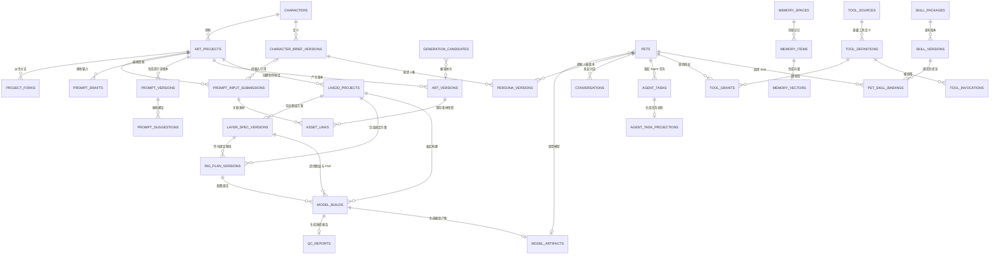
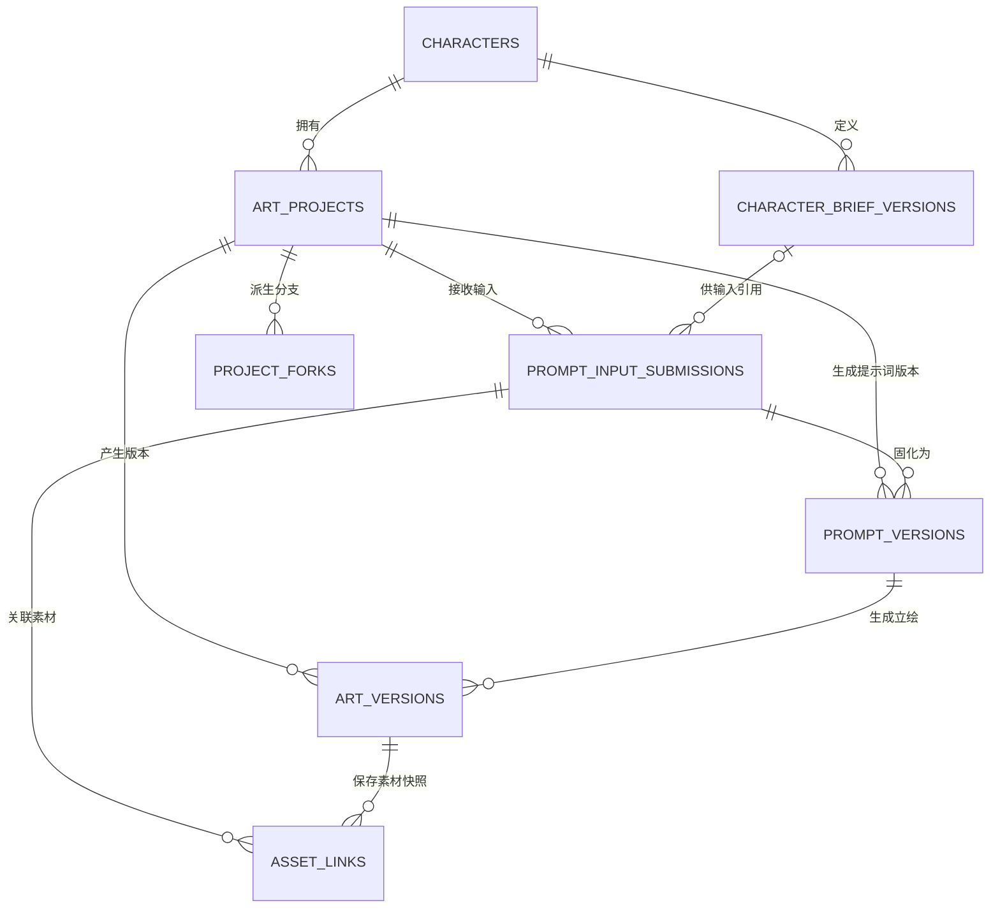
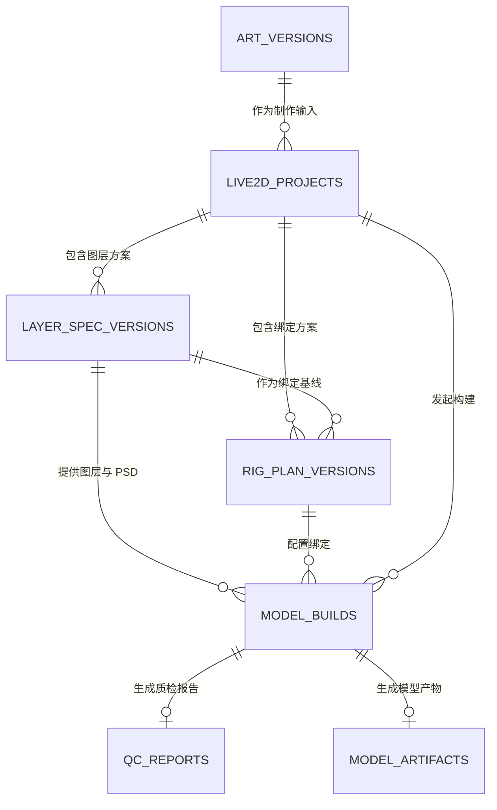
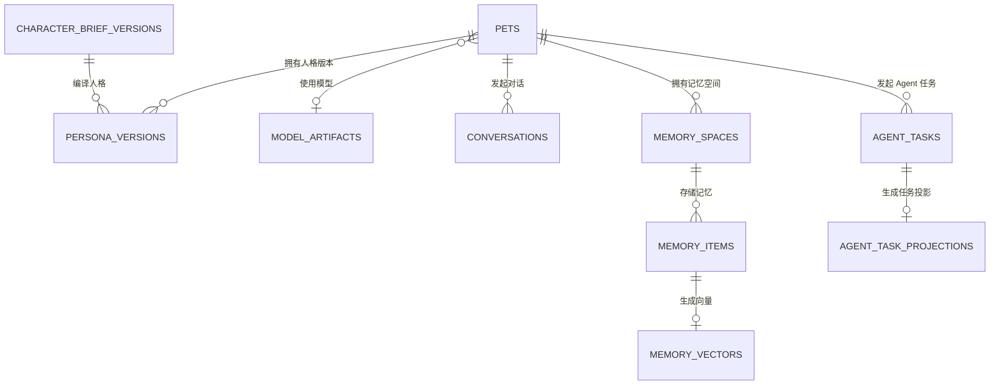
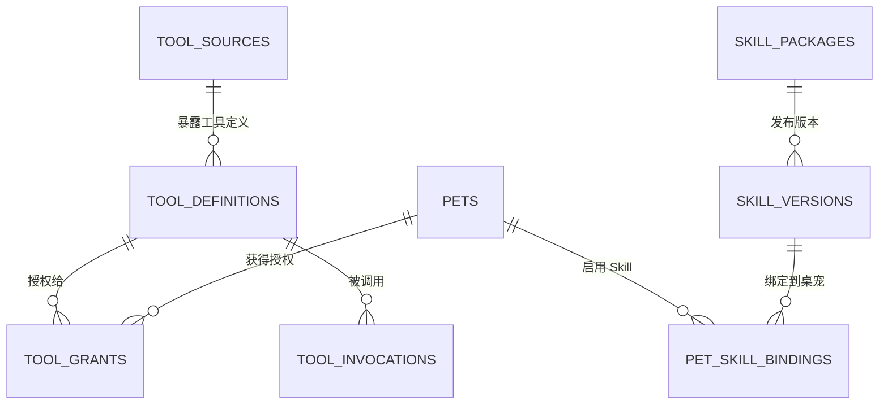

# agent2live 数据模型 v1

> 状态：单用户本地工作区基线  
> 日期：2026-11-12  
> 对应架构：[agent2live 技术方案 v1.4](./2026-11-06-idea-to-desktop-pet.md)  
> 阶段流程：[各阶段完整工作流](./2026-11-08-stage-workflows.md)

## 1. 建模约定

### 1.1 存储与类型

- 首版本地数据库使用 SQLite WAL；后续云端可迁移 PostgreSQL。
- ID 使用应用侧生成的 26 位 ULID，以 `TEXT` 保存。
- 数据库时间使用 Unix 毫秒 `INTEGER`；API 输出 RFC 3339 字符串。
- 布尔值使用 `INTEGER NOT NULL CHECK(value IN (0,1))`。
- 枚举值使用 `TEXT` + CHECK，或由同一张 lookup/state 表约束。
- JSON 使用 `TEXT` 保存，并在写入前通过同版本 Zod Schema 校验。
- Blob 不写入 SQLite；`assets.sha256` 指向内容寻址 Blob Store。
- 密钥不写入数据库，只保存 `secret_ref`。
- 可变业务实体带 `row_version INTEGER NOT NULL DEFAULT 1` 做乐观并发。
- 删除默认软删除：`deleted_at INTEGER NULL`；只有纯派生数据允许硬删除。

### 1.1.1 单用户与工作区边界

首版数据库代表一个本地单用户工作区：

- 不建立 `users`、`accounts`、`tenants`、`teams` 或 `memberships` 表。
- 领域表不增加 `user_id`、`tenant_id` 或账户所有权列；`created_by`/`updated_by` 也不作为首版权限字段。
- sidecar 的本地 bearer token 只保护本机 API，不是用户身份或数据库查询范围。
- 审计中的 `local-user` 是本地操作者标签，不是账号外键。
- 领域表内的 `owner_id` 指 PromptInput、ArtVersion 等业务实体 ID，绝不表示用户 ID。
- 同一工作区内的 `assets.sha256` 全局去重；Provider 配置、备份和记忆空间都是工作区级资源。
- 未来引入账号、多工作区、共享或同步时，必须进行显式 schema migration，不能靠当前占位字段猜测。

### 1.2 外键与生命周期

- 默认 `ON DELETE RESTRICT`，避免误级联删除创作历史。
- 纯组成数据可 `ON DELETE CASCADE`，例如 `memory_vectors → memory_items`。
- `project_forks` 不随父项目级联删除；父子关系保留 provenance。
- `art_versions`、`prompt_versions`、`layer_spec_versions`、`rig_plan_versions`、`model_builds`、`model_artifacts` 的内容都是不可变快照；`label/change_summary` 只作为可修订注记。
- Blob GC 根据 `assets`、`asset_links`、版本快照和模型 artifact 的总引用决定，不按单个项目目录删除。

### 1.3 通用审计字段

除纯关系表外，主要业务表包含：

| 字段          | 类型         | 说明                    |
| ------------- | ------------ | ----------------------- |
| `created_at`  | INTEGER      | 创建时间，毫秒时间戳    |
| `updated_at`  | INTEGER      | 最后修改时间            |
| `deleted_at`  | INTEGER NULL | 软删除时间              |
| `row_version` | INTEGER      | 乐观并发版本，从 1 开始 |

## 2. 实体关系

保留原全量 ER 总图用于查看全局关系，同时再按“角色创作、Live2D、桌宠、工具”提供四张可读性更高的细分图。总图与细分图并存；active 指针、审计字段和候选状态等细节放在对应表定义中。

### 2.1 总图



下面的细分图用于按领域阅读；总图继续作为完整关系索引。

### 2.2 角色、提示词与立绘



PromptDraft、GenerationCandidate、ProjectFork 状态和 active 指针仍由对应表管理，不在图中展开。

### 2.3 Live2D 与模型产物



LayerSpecVersion 固定 source/binding-ready PSD 与 compose report；RigPlanVersion 固定来源 LayerSpec 和 BindingReadyPsd；ModelBuild 固化完整输入并对 QC、ModelArtifact 负责。

### 2.4 桌宠、聊天与记忆



Direct 聊天正文、Forward 零写入和 Agent 摘要投影是三条独立数据边界，不能只根据图中的 PETS 关系推断它们共享存储。

### 2.5 工具与 Skills



审批、Schema hash、权限状态和调用审计分别由 Tool Grant、Tool Approval、Tool Invocation 与 audit 表记录。

## 3. 平台与配置

### 3.1 `schema_migrations`

| 字段         | 类型    | 必填 | 约束   | 说明          |
| ------------ | ------- | ---- | ------ | ------------- |
| `version`    | TEXT    | 是   | PK     | 迁移版本      |
| `checksum`   | TEXT    | 是   | UNIQUE | 迁移文件 hash |
| `applied_at` | INTEGER | 是   |        | 执行时间      |

### 3.2 `app_settings`

| 字段          | 类型    | 必填 | 约束 | 说明                               |
| ------------- | ------- | ---- | ---- | ---------------------------------- |
| `key`         | TEXT    | 是   | PK   | 设置键，如 `logging.retentionDays` |
| `value_json`  | TEXT    | 是   | JSON | 由 Schema 校验                     |
| `updated_at`  | INTEGER | 是   |      | 修改时间                           |
| `row_version` | INTEGER | 是   | ≥1   | 乐观锁                             |

### 3.3 `provider_connections`

| 字段                | 类型      | 必填 | 约束   | 说明                                |
| ------------------- | --------- | ---- | ------ | ----------------------------------- |
| `id`                | TEXT      | 是   | PK     | Provider connection ID              |
| `kind`              | TEXT      | 是   | enum   | `llm/image/embedding/forward/agent` |
| `label`             | TEXT      | 是   | 1..100 | 用户可读名称                        |
| `config_json`       | TEXT      | 是   | JSON   | baseURL、模型、能力、超时，不含密钥 |
| `secret_ref`        | TEXT NULL | 否   |        | OS keychain 引用                    |
| `capabilities_json` | TEXT      | 是   | JSON   | 多图、SSE、工具、embedding 维度等   |
| `enabled`           | INTEGER   | 是   | 0/1    | 是否启用                            |
| `created_at`        | INTEGER   | 是   |        |                                     |
| `updated_at`        | INTEGER   | 是   |        |                                     |
| `row_version`       | INTEGER   | 是   | ≥1     |                                     |

### 3.4 `provider_invocations`

只记录 provider 调用元数据，不保存 Prompt、消息或响应正文。

| 字段              | 类型         | 必填 | 约束                    | 说明                                               |
| ----------------- | ------------ | ---- | ----------------------- | -------------------------------------------------- |
| `id`              | TEXT         | 是   | PK                      | 调用 ID                                            |
| `connection_id`   | TEXT NULL    | 否   | FK provider_connections |                                                    |
| `purpose`         | TEXT         | 是   | enum                    | `prompt_reverse/image/memory/chat/agent/embedding` |
| `provider`        | TEXT         | 是   |                         | 厂商                                               |
| `model`           | TEXT         | 是   |                         | 模型                                               |
| `status`          | TEXT         | 是   | enum                    | `running/succeeded/failed/cancelled`               |
| `request_hash`    | TEXT         | 是   | 64 hex                  | 请求 canonical hash                                |
| `upstream_status` | INTEGER NULL | 否   |                         | 上游 HTTP 状态                                     |
| `latency_ms`      | INTEGER NULL | 否   | ≥0                      | 耗时                                               |
| `input_units`     | INTEGER NULL | 否   | ≥0                      | token/image 数等                                   |
| `output_units`    | INTEGER NULL | 否   | ≥0                      |                                                    |
| `cost_micros`     | INTEGER NULL | 否   | ≥0                      | 可计量费用                                         |
| `error_code`      | TEXT NULL    | 否   |                         | 错误注册表 code                                    |
| `trace_id`        | TEXT         | 是   |                         | 全链路关联                                         |
| `created_at`      | INTEGER      | 是   |                         |                                                    |

## 4. 角色、项目和 Fork

### 4.1 `characters`

| 字段                      | 类型         | 必填 | 约束                                 | 说明                               |
| ------------------------- | ------------ | ---- | ------------------------------------ | ---------------------------------- |
| `id`                      | TEXT         | 是   | PK                                   | Character ID                       |
| `title`                   | TEXT         | 是   | 1..100                               | 显示名称                           |
| `summary`                 | TEXT NULL    | 否   | ≤2000                                | 显示用角色简介，不替代完整角色设定 |
| `active_brief_version_id` | TEXT NULL    | 否   | FK character_brief_versions RESTRICT | 当前角色设定版本                   |
| `created_at`              | INTEGER      | 是   |                                      |                                    |
| `updated_at`              | INTEGER      | 是   |                                      |                                    |
| `deleted_at`              | INTEGER NULL | 否   |                                      | 软删除                             |
| `row_version`             | INTEGER      | 是   | ≥1                                   |                                    |

### 4.2 `character_brief_versions`

不可变的角色设定快照，用于记录外貌、性格、背景、世界观和说话方式。只有用户提供或确认后的设定才成为正式版本；仅由参考图推断的结果只能先作为草稿候选。

| 字段                | 类型      | 必填 | 约束                        | 说明                                 |
| ------------------- | --------- | ---- | --------------------------- | ------------------------------------ |
| `id`                | TEXT      | 是   | PK                          |                                      |
| `character_id`      | TEXT      | 是   | FK characters               | 所属角色                             |
| `parent_version_id` | TEXT NULL | 否   | FK character_brief_versions | 设定版本链                           |
| `content_json`      | TEXT      | 是   | JSON                        | `character-brief/1` 完整角色设定快照 |
| `source_kind`       | TEXT      | 是   | enum                        | `user/imported/derived_confirmed`    |
| `content_hash`      | TEXT      | 是   | 64 hex                      | 快照 hash                            |
| `created_at`        | INTEGER   | 是   |                             |                                      |

约束：

- 已创建版本不可修改；修正角色设定时创建新版本并事务更新 `characters.active_brief_version_id`。
- `derived_confirmed` 表示用户已确认从素材推断出的视觉设定；未确认候选不得写入该表。
- 只有参考图、没有角色设定时，`active_brief_version_id` 允许为空，初始化仍可继续。
- `characters.active_brief_version_id` 必须指向同一 Character 的设定版本。

#### `character-brief/1`

角色设定不能退化为外貌、性格、背景和说话方式四个字段。`content_json` 至少支持以下维度；数组字段允许为空，未知信息进入 `unknowns`，不能由模型自行补成事实。

| 维度                 | 主要字段                                                                 | 用途                                               |
| -------------------- | ------------------------------------------------------------------------ | -------------------------------------------------- |
| `identity`           | fullName、givenName、aliases、codeNames、age、gender、birthday、species  | 角色身份检索、提示词主体和跨版本一致性             |
| `social`             | occupations、titles、affiliations、storyRole                             | 服装、道具、职业姿态、叙事定位                     |
| `background`         | birthplace、family、upbringing、formativeEvents、traumas                 | 性格解释、关系与聊天人格                           |
| `appearance`         | body、face、hair、outfit、accessories、props、palette、defaultExpression | 立绘提示词、候选校验、图层与模型制作的主要视觉依据 |
| `personality`        | coreTraits、contradictions、values、bottomLines、motivations、fears      | 表情、姿势、动作、对话和剧情选择                   |
| `behavior`           | speech、mannerisms、bodyLanguage                                         | 语言风格、习惯动作、Live2D 动作和待机表现          |
| `abilities`          | name、description、combatStyle、conditions、limits                       | 能力设定、动作映射和提示词冲突检查                 |
| `relationships`      | target、relation、dynamic、conflict、history                             | 聊天人格、关系记忆和情境反应                       |
| `arc`                | initialState、goal、flaw、turningPoints、growth、endState                | 长期对话、角色成长和后续创作方向                   |
| `unknowns` / `notes` | 未确定维度、自由补充                                                     | 防止模型补造设定，同时保留无法结构化表达的细节     |

建议的 JSON 结构：

```json
{
  "schemaVersion": "character-brief/1",
  "identity": {
    "fullName": "",
    "givenName": "",
    "aliases": [],
    "codeNames": [],
    "age": "",
    "gender": "",
    "birthday": "",
    "species": ""
  },
  "social": {
    "occupations": [],
    "titles": [],
    "affiliations": [],
    "storyRole": ""
  },
  "background": {
    "birthplace": "",
    "family": "",
    "upbringing": "",
    "formativeEvents": [],
    "traumas": []
  },
  "appearance": {
    "body": {
      "height": "",
      "build": "",
      "silhouette": "",
      "proportions": "",
      "posture": "",
      "distinguishingMarks": []
    },
    "face": {
      "shape": "",
      "eyes": "",
      "eyebrows": "",
      "nose": "",
      "mouth": "",
      "skin": ""
    },
    "hair": {
      "style": "",
      "color": "",
      "length": "",
      "details": []
    },
    "outfit": {
      "default": "",
      "materials": [],
      "accessories": [],
      "props": []
    },
    "palette": {
      "primary": [],
      "secondary": [],
      "accent": []
    },
    "defaultExpression": ""
  },
  "personality": {
    "coreTraits": [],
    "contradictions": [],
    "values": [],
    "bottomLines": [],
    "motivations": [],
    "fears": []
  },
  "behavior": {
    "speech": {
      "tone": "",
      "register": "",
      "catchphrases": []
    },
    "mannerisms": [],
    "bodyLanguage": []
  },
  "abilities": [
    {
      "name": "",
      "description": "",
      "combatStyle": "",
      "conditions": "",
      "limits": ""
    }
  ],
  "relationships": [
    {
      "target": "",
      "relation": "",
      "dynamic": "",
      "conflict": "",
      "history": ""
    }
  ],
  "arc": {
    "initialState": "",
    "goal": "",
    "flaw": "",
    "turningPoints": [],
    "growth": "",
    "endState": ""
  },
  "unknowns": [],
  "notes": ""
}
```

不同能力只消费同一设定的投影：

- 立绘提示词直接消费 `identity` 的基础识别信息和完整 `appearance`，并可使用 `defaultExpression`、`bodyLanguage` 来设计表情与姿势。
- Prompt 管理可以把 `personality`、`motivations`、`relationships` 作为建议上下文，但必须转换成用户可审查的视觉要求，不能擅自补造未定义的外观事实。
- 聊天 `PersonaVersion` 主要消费 `background`、`personality`、`behavior.speech`、`relationships` 与 `arc`，不能直接把生图提示词当作人格设定。
- Live2D 动作和待机表现可消费 `bodyLanguage`、`mannerisms` 与能力信息。

### 4.3 `art_projects`

| 字段                       | 类型         | 必填 | 约束                        | 说明                   |
| -------------------------- | ------------ | ---- | --------------------------- | ---------------------- |
| `id`                       | TEXT         | 是   | PK                          | ArtProject ID          |
| `character_id`             | TEXT         | 是   | FK characters RESTRICT      | 所属角色               |
| `title`                    | TEXT         | 是   | 1..100                      | 项目名                 |
| `description`              | TEXT NULL    | 否   | ≤4000                       | 项目说明               |
| `stage`                    | TEXT         | 是   | enum                        | 派生阶段               |
| `active_version_id`        | TEXT NULL    | 否   | FK art_versions RESTRICT    | 当前 active ArtVersion |
| `active_prompt_version_id` | TEXT NULL    | 否   | FK prompt_versions RESTRICT | 当前提示词版本         |
| `created_at`               | INTEGER      | 是   |                             |                        |
| `updated_at`               | INTEGER      | 是   |                             |                        |
| `deleted_at`               | INTEGER NULL | 否   |                             |                        |
| `row_version`              | INTEGER      | 是   | ≥1                          |                        |

约束：

- `active_version_id` 必须属于当前 ArtProject。
- `active_prompt_version_id` 必须属于当前 ArtProject。
- 用事务同时更新 active 指针和审计事件。

### 4.4 `project_forks`

| 字段                | 类型         | 必填 | 约束                   | 说明                         |
| ------------------- | ------------ | ---- | ---------------------- | ---------------------------- |
| `id`                | TEXT         | 是   | PK                     | Fork relation ID             |
| `child_project_id`  | TEXT         | 是   | UNIQUE FK art_projects | 子项目                       |
| `parent_project_id` | TEXT         | 是   | FK art_projects        | 父项目                       |
| `root_project_id`   | TEXT         | 是   | FK art_projects        | 根项目，用于树查询           |
| `source_kind`       | TEXT         | 是   | enum                   | `prompt_version/art_version` |
| `source_version_id` | TEXT         | 是   |                        | 固定源版本 ID                |
| `source_hash`       | TEXT         | 是   | 64 hex                 | 固化源内容                   |
| `branch_label`      | TEXT         | 是   | 1..80                  | 分支名称                     |
| `status`            | TEXT         | 是   | enum                   | `active/detached`            |
| `created_at`        | INTEGER      | 是   |                        |                              |
| `detached_at`       | INTEGER NULL | 否   |                        |                              |

唯一索引：

```sql
CREATE UNIQUE INDEX ux_forks_child ON project_forks(child_project_id);
CREATE UNIQUE INDEX ux_forks_branch
  ON project_forks(parent_project_id, lower(branch_label))
  WHERE status = 'active';
```

业务约束：

- 父子项目必须同属一个 Character。
- `child_project_id != parent_project_id`。
- `root_project_id` 必须是父项目所在树的根。
- Fork 源必须已提交且 hash 未变。

## 5. 资产

### 5.1 `assets`

| 字段            | 类型         | 必填 | 约束          | 说明                     |
| --------------- | ------------ | ---- | ------------- | ------------------------ |
| `id`            | TEXT         | 是   | PK            | Asset ID                 |
| `sha256`        | TEXT         | 是   | UNIQUE 64 hex | 内容 hash                |
| `media_type`    | TEXT         | 是   |               | IANA MIME                |
| `byte_size`     | INTEGER      | 是   | ≥0            | 字节数                   |
| `storage_key`   | TEXT         | 是   | UNIQUE        | Blob 相对路径            |
| `width`         | INTEGER NULL | 否   | ≥0            | 图片/纹理                |
| `height`        | INTEGER NULL | 否   | ≥0            |                          |
| `metadata_json` | TEXT         | 是   | JSON          | 解码器输出，不含敏感数据 |
| `created_at`    | INTEGER      | 是   |               | 首次入库                 |

同一 `sha256` 只保存一条逻辑资产记录，用户原名保存在 `asset_provenance`。

### 5.2 `asset_provenance`

| 字段            | 类型      | 必填 | 约束      | 说明                                   |
| --------------- | --------- | ---- | --------- | -------------------------------------- |
| `id`            | TEXT      | 是   | PK        |                                        |
| `asset_id`      | TEXT      | 是   | FK assets |                                        |
| `source_kind`   | TEXT      | 是   | enum      | `upload/ai_generated/imported/derived` |
| `original_name` | TEXT NULL | 否   | ≤255      | 只用于显示，不参与路径                 |
| `source_ref`    | TEXT NULL | 否   |           | 来源 URL/模型/生成任务                 |
| `license`       | TEXT NULL | 否   | ≤500      | 用户声明的许可                         |
| `consent`       | TEXT NULL | 否   | ≤500      | 使用范围/授权备注                      |
| `model_ref`     | TEXT NULL | 否   |           | 生图/分层模型                          |
| `created_at`    | INTEGER   | 是   |           |                                        |

### 5.3 `asset_links`

| 字段         | 类型      | 必填 | 约束        | 说明                                                       |
| ------------ | --------- | ---- | ----------- | ---------------------------------------------------------- |
| `id`         | TEXT      | 是   | PK          |                                                            |
| `asset_id`   | TEXT      | 是   | FK assets   |                                                            |
| `owner_type` | TEXT      | 是   | enum        | `prompt_input/prompt_version/art_version/layer_spec/model` |
| `owner_id`   | TEXT      | 是   |             | 对应实体                                                   |
| `role`       | TEXT      | 是   | enum        | 素材用途                                                   |
| `note`       | TEXT NULL | 否   | ≤1000       | 单素材要求                                                 |
| `weight`     | REAL      | 是   | 0.1..2.0    | 参考权重                                                   |
| `sort_order` | INTEGER   | 是   | ≥0          | UI 排序                                                    |
| `is_primary` | INTEGER   | 是   | 0/1，默认 0 | ArtVersion 的主参考图                                      |
| `locked`     | INTEGER   | 是   | 0/1，默认 0 | 锁定素材的角色、备注和权重                                 |
| `created_at` | INTEGER   | 是   |             |                                                            |

素材角色：

```text
identity_reference, style_reference, outfit_reference, color_reference,
background_reference, pose_reference, sketch, texture, other
```

`owner_id` 是 `owner_type` 指向的领域实体 ID（例如 `art_version`），不是用户 ID。首版没有用户表，也不按本地操作系统用户拆分数据。

ArtVersion 的参考图使用 `asset_links` 保存，至少有一条，且同一 owner 恰有一条 `is_primary=1`。主图 `sort_order=0`，其余值从 1 开始连续且唯一。每个资产在同一 ArtVersion 中只能关联一次；`sort_order` 和 `is_primary` 都进入 ArtVersion 的 `content_hash`。用户增删、排序、修改 role/note/weight 或切换主图时，不能更新已提交 ArtVersion 的 links，而是复制当前状态并创建新的 ArtVersion 引用集快照。删除关联只减少引用计数，Blob 由延迟 GC 回收。

`PromptInputSubmission.materials[].partName` 是 `multipart/form-data` 中临时文件 part 的键，仅用于上传阶段把文件和 metadata 对应起来，不作为业务列持久化；提交完成后以 `asset_links.asset_id` 为准。素材的 `locked` 则必须写入 `asset_links.locked`，不能只存在于请求中。

## 6. 提示词与立绘

### 6.1 `prompt_input_submissions`

| 字段                         | 类型      | 必填 | 约束                        | 说明                           |
| ---------------------------- | --------- | ---- | --------------------------- | ------------------------------ |
| `id`                         | TEXT      | 是   | PK                          |                                |
| `art_project_id`             | TEXT      | 是   | FK art_projects             |                                |
| `draft_id`                   | TEXT      | 是   | FK prompt_drafts            | 本次应用的草稿                 |
| `revision`                   | INTEGER   | 是   | ≥1                          | Draft revision                 |
| `character_brief_version_id` | TEXT NULL | 否   | FK character_brief_versions | 初始化使用的角色设定快照       |
| `global_notes`               | TEXT NULL | 否   | ≤8000                       | 本次立绘创作要求，不是角色设定 |
| `requirements_json`          | TEXT      | 是   | JSON                        | must/prefer/avoid              |
| `created_at`                 | INTEGER   | 是   |                             |                                |
| `row_version`                | INTEGER   | 是   | ≥1                          |                                |

唯一约束：`UNIQUE(art_project_id, revision)`。

初始化约束：角色设定（请求中的 `characterBrief` 或已存在的 `character_brief_version_id`）与至少一张参考图必须存在一种。`global_notes` 与 `requirements_json` 是相互独立的选填补充信息，任意一项为空或两者同时为空都不影响创建 `PromptInputSubmission` 或 AI 反推任务；只有角色设定和参考图同时缺失时才拒绝初始化。

`character_brief_version_id` 如果存在，必须属于当前 ArtProject 的 Character。

创建 `PromptInputSubmission` 的请求可以直接携带 `characterBrief` 内容，也可以携带已有的 `characterBriefVersionId`。前者由 Application Service 先创建不可变的 `CharacterBriefVersion`，再让 submission 引用该版本；数据库不为两种写法保存两份设定正文。

### 6.2 `prompt_drafts`

| 字段                  | 类型      | 必填 | 约束                        | 说明                          |
| --------------------- | --------- | ---- | --------------------------- | ----------------------------- |
| `id`                  | TEXT      | 是   | PK                          | Draft ID                      |
| `art_project_id`      | TEXT      | 是   | FK art_projects             |                               |
| `revision`            | INTEGER   | 是   | ≥1                          | 单调递增                      |
| `status`              | TEXT      | 是   | enum                        | `active/committed/superseded` |
| `state_json`          | TEXT      | 是   | JSON                        | PromptSpec Draft              |
| `input_submission_id` | TEXT NULL | 否   | FK prompt_input_submissions | 当前素材/要求快照             |
| `created_at`          | INTEGER   | 是   |                             |                               |
| `updated_at`          | INTEGER   | 是   |                             |                               |
| `row_version`         | INTEGER   | 是   | ≥1                          |                               |

约束：每个 ArtProject 最多一个 `active` draft。

### 6.3 `prompt_versions`

| 字段                        | 类型      | 必填 | 约束                        | 说明                  |
| --------------------------- | --------- | ---- | --------------------------- | --------------------- |
| `id`                        | TEXT      | 是   | PK                          |                       |
| `art_project_id`            | TEXT      | 是   | FK art_projects             |                       |
| `parent_version_id`         | TEXT NULL | 否   | FK prompt_versions          | 项目内 DAG            |
| `parent_project_version_id` | TEXT NULL | 否   |                             | Fork 来源的跨项目版本 |
| `origin_version_id`         | TEXT NULL | 否   |                             | Fork 复制来源         |
| `input_submission_id`       | TEXT      | 是   | FK prompt_input_submissions | 固化素材与要求        |
| `content_json`              | TEXT      | 是   | JSON                        | `prompt-spec/2`       |
| `content_hash`              | TEXT      | 是   | 64 hex                      | canonical hash        |
| `created_at`                | INTEGER   | 是   |                             |                       |

### 6.4 `prompt_suggestions`

| 字段                     | 类型         | 必填 | 约束                    | 说明                               |
| ------------------------ | ------------ | ---- | ----------------------- | ---------------------------------- |
| `id`                     | TEXT         | 是   | PK                      |                                    |
| `base_version_id`        | TEXT         | 是   | FK prompt_versions      | 建议基线                           |
| `base_content_hash`      | TEXT         | 是   | 64 hex                  | 防止 stale                         |
| `operations_json`        | TEXT         | 是   | JSON                    | 结构化 patch                       |
| `intent`                 | TEXT         | 是   | ≤2000                   | 用户要求                           |
| `status`                 | TEXT         | 是   | enum                    | `proposed/accepted/rejected/stale` |
| `provider_invocation_id` | TEXT NULL    | 否   | FK provider_invocations |                                    |
| `created_at`             | INTEGER      | 是   |                         |                                    |
| `resolved_at`            | INTEGER NULL | 否   |                         |                                    |

### 6.5 `generation_jobs`

| 字段                     | 类型      | 必填 | 约束                    | 说明                                     |
| ------------------------ | --------- | ---- | ----------------------- | ---------------------------------------- |
| `id`                     | TEXT      | 是   | PK                      |                                          |
| `art_project_id`         | TEXT      | 是   | FK art_projects         |                                          |
| `prompt_version_id`      | TEXT      | 是   | FK prompt_versions      |                                          |
| `base_art_version_id`    | TEXT NULL | 否   | FK art_versions         | 固定本次使用的 active 版本及其参考图集合 |
| `provider_connection_id` | TEXT NULL | 否   | FK provider_connections |                                          |
| `request_json`           | TEXT      | 是   | JSON                    | 编译后请求，不含密钥                     |
| `request_hash`           | TEXT      | 是   | 64 hex                  |                                          |
| `job_id`                 | TEXT      | 是   | FK jobs                 | 通用任务                                 |
| `status`                 | TEXT      | 是   |                         | 来自 jobs                                |
| `created_at`             | INTEGER   | 是   |                         |                                          |

### 6.6 `generation_candidates`

| 字段                      | 类型      | 必填 | 约束               | 说明                              |
| ------------------------- | --------- | ---- | ------------------ | --------------------------------- |
| `id`                      | TEXT      | 是   | PK                 |                                   |
| `generation_job_id`       | TEXT      | 是   | FK generation_jobs |                                   |
| `asset_id`                | TEXT      | 是   | FK assets          | 候选图                            |
| `validation_json`         | TEXT      | 是   | JSON               | 构图/尺寸/安全检查                |
| `status`                  | TEXT      | 是   | enum               | `ready/accepted/rejected/expired` |
| `accepted_art_version_id` | TEXT NULL | 否   | FK art_versions    |                                   |
| `created_at`              | INTEGER   | 是   |                    |                                   |

### 6.7 `art_versions`

| 字段                    | 类型      | 必填 | 约束               | 说明                             |
| ----------------------- | --------- | ---- | ------------------ | -------------------------------- |
| `id`                    | TEXT      | 是   | PK                 |                                  |
| `art_project_id`        | TEXT      | 是   | FK art_projects    |                                  |
| `parent_version_id`     | TEXT NULL | 否   | FK art_versions    | 项目内 DAG                       |
| `origin_version_id`     | TEXT NULL | 否   |                    | Fork 复制来源                    |
| `prompt_version_id`     | TEXT      | 是   | FK prompt_versions | 生成时提示词                     |
| `source_json`           | TEXT      | 是   | JSON               | provider/model/candidateIds/seed |
| `validation_json`       | TEXT      | 是   | JSON               | 构图/alpha/hash                  |
| `canvas_transform_json` | TEXT      | 是   | JSON               | 后续模型画布映射                 |
| `content_hash`          | TEXT      | 是   | 64 hex             | 版本快照 hash                    |
| `created_at`            | INTEGER   | 是   |                    |                                  |

`art_versions` 主表不保存参考图列。版本的 1..N 个参考图及其顺序、角色、权重、备注、锁定和主图标记由对应 `asset_links(owner_type='art_version', owner_id=art_versions.id)` 组成，并全部纳入 `content_hash`。主参考图用于 Studio 主画布、平图自动分层和 Live2D 构建；其他参考图作为生成辅助条件。

`art_versions.canvas_transform_json` 保存该立绘版本的默认画布映射；实际模型构建必须在 `model_builds.canvas_transform_json` 再固化本次使用的值，二者相同时也要复制快照，避免后续默认映射变化影响历史构建。

## 7. Live2D 与绑定

### 7.1 `live2d_projects`

| 字段                           | 类型         | 必填 | 约束                            | 说明                   |
| ------------------------------ | ------------ | ---- | ------------------------------- | ---------------------- |
| `id`                           | TEXT         | 是   | PK                              |                        |
| `art_project_id`               | TEXT         | 是   | FK art_projects                 | 一个项目可有多次构建线 |
| `base_art_version_id`          | TEXT         | 是   | FK art_versions                 | 固定立绘版本           |
| `active_layer_spec_version_id` | TEXT NULL    | 否   | FK layer_spec_versions RESTRICT | 当前图层方案           |
| `active_rig_plan_version_id`   | TEXT NULL    | 否   | FK rig_plan_versions RESTRICT   | 当前绑定方案           |
| `stage`                        | TEXT         | 是   | enum                            | 6.1 状态机             |
| `created_at`                   | INTEGER      | 是   |                                 |                        |
| `updated_at`                   | INTEGER      | 是   |                                 |                        |
| `deleted_at`                   | INTEGER NULL | 否   |                                 |                        |
| `row_version`                  | INTEGER      | 是   | ≥1                              |                        |

### 7.2 `layer_spec_versions`

| 字段                         | 类型      | 必填 | 约束                   | 说明                                               |
| ---------------------------- | --------- | ---- | ---------------------- | -------------------------------------------------- |
| `id`                         | TEXT      | 是   | PK                     |                                                    |
| `live2d_project_id`          | TEXT      | 是   | FK live2d_projects     |                                                    |
| `parent_version_id`          | TEXT NULL | 否   | FK layer_spec_versions |                                                    |
| `source_art_version_id`      | TEXT      | 是   | FK art_versions        |                                                    |
| `label`                      | TEXT NULL | 否   | ≤100                   | 用户可读版本名，不进入 content hash                |
| `change_summary`             | TEXT NULL | 否   | ≤2000                  | 相对父版本的变更说明，不进入 content hash          |
| `source_kind`                | TEXT      | 是   | enum                   | `see_through/imported_psd/external_import/derived` |
| `source_psd_asset_id`        | TEXT NULL | 否   | FK assets              | 用户导入或外部来源的原始 PSD；自动分层时为空       |
| `binding_ready_psd_asset_id` | TEXT      | 是   | FK assets              | Binder 实际读取的规范化 PSD                        |
| `compose_report_asset_id`    | TEXT      | 是   | FK assets              | PSD 合成与不支持特性报告                           |
| `layers_json`                | TEXT      | 是   | JSON                   | 图层语义、bbox、来源、置信度                       |
| `decomposer_json`            | TEXT      | 是   | JSON                   | See-through 版本/权重/参数                         |
| `qc_json`                    | TEXT      | 是   | JSON                   | 合成误差、必需角色                                 |
| `content_hash`               | TEXT      | 是   | 64 hex                 |                                                    |
| `created_at`                 | INTEGER   | 是   |                        |                                                    |

### 7.3 `semantic_patch_candidates`

| 字段                             | 类型      | 必填 | 约束                   | 说明                                   |
| -------------------------------- | --------- | ---- | ---------------------- | -------------------------------------- |
| `id`                             | TEXT      | 是   | PK                     |                                        |
| `live2d_project_id`              | TEXT      | 是   | FK live2d_projects     |                                        |
| `layer_spec_version_id`          | TEXT      | 是   | FK layer_spec_versions |                                        |
| `role`                           | TEXT      | 是   | enum                   | `eyes_closed/mouth_open/svg_patch/...` |
| `asset_id`                       | TEXT      | 是   | FK assets              | 候选                                   |
| `provider`                       | TEXT      | 是   |                        |                                        |
| `confidence`                     | REAL NULL | 否   | 0..1                   |                                        |
| `validation_json`                | TEXT      | 是   | JSON                   | 对齐、尺寸、清洗                       |
| `status`                         | TEXT      | 是   | enum                   | `ready/accepted/rejected`              |
| `accepted_layer_spec_version_id` | TEXT NULL | 否   | FK layer_spec_versions | 采纳后生成的图层方案版本               |
| `created_at`                     | INTEGER   | 是   |                        |                                        |

### 7.4 `rig_plan_versions`

| 字段                           | 类型      | 必填 | 约束                   | 说明                                                        |
| ------------------------------ | --------- | ---- | ---------------------- | ----------------------------------------------------------- |
| `id`                           | TEXT      | 是   | PK                     |                                                             |
| `live2d_project_id`            | TEXT      | 是   | FK live2d_projects     |                                                             |
| `parent_version_id`            | TEXT NULL | 否   | FK rig_plan_versions   |                                                             |
| `label`                        | TEXT NULL | 否   | ≤100                   | 用户可读版本名，不进入 content hash                         |
| `change_summary`               | TEXT NULL | 否   | ≤2000                  | 相对父版本的变更说明，不进入 content hash                   |
| `source_layer_spec_version_id` | TEXT      | 是   | FK layer_spec_versions | 绑定所基于的图层方案                                        |
| `binding_ready_psd_asset_id`   | TEXT      | 是   | FK assets              | 必须等于来源 LayerSpecVersion 的 binding_ready_psd_asset_id |
| `plan_json`                    | TEXT      | 是   | JSON                   | 参数、deformer、mesh、physics                               |
| `binder_state_asset_id`        | TEXT NULL | 否   | FK assets              | PSD2Live 工程快照                                           |
| `base_state_hash`              | TEXT NULL | 否   | 64 hex                 | AI CAS 基线                                                 |
| `edit_log_json`                | TEXT      | 是   | JSON                   | 可重放编辑                                                  |
| `content_hash`                 | TEXT      | 是   | 64 hex                 |                                                             |
| `created_at`                   | INTEGER   | 是   |                        |                                                             |

### 7.5 `rig_copilot_sessions`

| 字段                | 类型      | 必填 | 约束               | 说明                            |
| ------------------- | --------- | ---- | ------------------ | ------------------------------- |
| `id`                | TEXT      | 是   | PK                 |                                 |
| `live2d_project_id` | TEXT      | 是   | FK live2d_projects |                                 |
| `model_build_id`    | TEXT NULL | 否   | FK model_builds    | 当前预览构建                    |
| `selection_json`    | TEXT      | 是   | JSON               | 选区、参数、动作                |
| `mode`              | TEXT      | 是   | enum               | `explain/co-drive/sandbox-auto` |
| `status`            | TEXT      | 是   | enum               | `active/closed`                 |
| `created_at`        | INTEGER   | 是   |                    |                                 |
| `updated_at`        | INTEGER   | 是   |                    |                                 |

### 7.6 `rig_copilot_messages`

| 字段           | 类型    | 必填 | 约束                            | 说明                  |
| -------------- | ------- | ---- | ------------------------------- | --------------------- |
| `id`           | TEXT    | 是   | PK                              |                       |
| `session_id`   | TEXT    | 是   | FK rig_copilot_sessions CASCADE |                       |
| `role`         | TEXT    | 是   | enum                            | `user/assistant/tool` |
| `content_json` | TEXT    | 是   | JSON                            | 消息与工具摘要        |
| `created_at`   | INTEGER | 是   |                                 |                       |

该表不参与 Pet Memory 检索。

### 7.7 `rig_edit_proposals`

| 字段                | 类型         | 必填 | 约束                    | 说明                                                         |
| ------------------- | ------------ | ---- | ----------------------- | ------------------------------------------------------------ |
| `id`                | TEXT         | 是   | PK                      |                                                              |
| `session_id`        | TEXT         | 是   | FK rig_copilot_sessions |                                                              |
| `base_state_hash`   | TEXT         | 是   | 64 hex                  | CAS 基线                                                     |
| `intent`            | TEXT         | 是   | ≤4000                   | 用户目标                                                     |
| `edits_json`        | TEXT         | 是   | JSON                    | ≤32 语义操作                                                 |
| `preview_json`      | TEXT         | 是   | JSON                    | 试运行摘要                                                   |
| `verification_json` | TEXT         | 是   | JSON                    | 探针/几何检查                                                |
| `status`            | TEXT         | 是   | enum                    | `draft/preview_ready/approved/applied/rejected/stale/failed` |
| `approval_id`       | TEXT NULL    | 否   |                         | UI proof                                                     |
| `created_at`        | INTEGER      | 是   |                         |                                                              |
| `applied_at`        | INTEGER NULL | 否   |                         |                                                              |

### 7.8 `rig_preview_renders`

| 字段              | 类型    | 必填 | 约束                  | 说明            |
| ----------------- | ------- | ---- | --------------------- | --------------- |
| `id`              | TEXT    | 是   | PK                    |                 |
| `proposal_id`     | TEXT    | 是   | FK rig_edit_proposals |                 |
| `probe_id`        | TEXT    | 是   |                       | 参数/动作采样点 |
| `parameters_json` | TEXT    | 是   | JSON                  |                 |
| `before_asset_id` | TEXT    | 是   | FK assets             |                 |
| `after_asset_id`  | TEXT    | 是   | FK assets             |                 |
| `metrics_json`    | TEXT    | 是   | JSON                  | 视觉差与诊断    |
| `created_at`      | INTEGER | 是   |                       |                 |

### 7.9 `model_builds`

| 字段                         | 类型         | 必填 | 约束                   | 说明                                                                   |
| ---------------------------- | ------------ | ---- | ---------------------- | ---------------------------------------------------------------------- |
| `id`                         | TEXT         | 是   | PK                     |                                                                        |
| `live2d_project_id`          | TEXT         | 是   | FK live2d_projects     |                                                                        |
| `art_version_id`             | TEXT         | 是   | FK art_versions        | 固定输入                                                               |
| `layer_spec_version_id`      | TEXT         | 是   | FK layer_spec_versions | 固定图层方案                                                           |
| `binding_ready_psd_asset_id` | TEXT         | 是   | FK assets              | 固定 Binder 实际读取的 PSD                                             |
| `rig_plan_version_id`        | TEXT         | 是   | FK rig_plan_versions   | 固定绑定                                                               |
| `label`                      | TEXT NULL    | 否   | ≤100                   | 用户可读构建名，不进入 content hash                                    |
| `change_summary`             | TEXT NULL    | 否   | ≤2000                  | 本次构建说明，不进入 content hash                                      |
| `canvas_transform_json`      | TEXT         | 是   | JSON                   | 本次构建固定使用的画布映射                                             |
| `target_cubism_version`      | TEXT         | 是   |                        | 目标 Cubism / moc3 版本                                                |
| `required_capabilities_json` | TEXT         | 是   | JSON                   | 本次构建要求产物具备的参数、动作和运行能力                             |
| `binder_connection_id`       | TEXT NULL    | 否   |                        | Binder ID                                                              |
| `binder_version`             | TEXT         | 是   |                        | 版本                                                                   |
| `status`                     | TEXT         | 是   | enum                   | `queued/running/qc_pending/qc_passed/qc_failed/failed/unknown_outcome` |
| `job_id`                     | TEXT         | 是   | FK jobs                |                                                                        |
| `work_asset_id`              | TEXT NULL    | 否   | FK assets              | 工程快照                                                               |
| `input_hash`                 | TEXT         | 是   | 64 hex                 | 构建请求、全部输入引用和配置的 canonical hash                          |
| `created_at`                 | INTEGER      | 是   |                        |                                                                        |
| `finished_at`                | INTEGER NULL | 否   |                        |                                                                        |

版本引用约束：

- `active_layer_spec_version_id`、`active_rig_plan_version_id` 及其版本链必须属于当前 Live2DProject。
- `active_rig_plan_version_id` 非空时，其 `source_layer_spec_version_id` 必须等于 `active_layer_spec_version_id`；切换 LayerSpec 后，不兼容的 RigPlan pointer 必须清空或在同一事务中替换。
- `rig_plan_versions.binding_ready_psd_asset_id` 必须等于 `source_layer_spec_version_id.binding_ready_psd_asset_id`。
- `model_builds.binding_ready_psd_asset_id` 必须同时等于 `layer_spec_version_id.binding_ready_psd_asset_id` 和 `rig_plan_version_id.binding_ready_psd_asset_id`。
- LayerSpecVersion、RigPlanVersion 和 ModelBuild 的 `label/change_summary` 是版本注记，可独立修订并写审计，不进入 LayerSpec/RigPlan 的 `content_hash` 或 ModelBuild 的 `input_hash`。
- LayerSpecVersion 的 `content_hash` 必须覆盖 layers、decomposer、QC、source/binding-ready PSD 和 compose report 引用；RigPlanVersion 的 `content_hash` 必须覆盖 plan、Binder state、edit log 及来源 LayerSpec/PSD；ModelBuild 的 `input_hash` 必须覆盖全部构建输入、required capabilities 和配置。

### 7.10 `qc_reports`

| 字段             | 类型    | 必填 | 约束            | 说明                  |
| ---------------- | ------- | ---- | --------------- | --------------------- |
| `id`             | TEXT    | 是   | PK              |                       |
| `model_build_id` | TEXT    | 是   | FK model_builds |                       |
| `passed`         | INTEGER | 是   | 0/1             | 是否阻塞通过          |
| `blockers_json`  | TEXT    | 是   | JSON            | `QC-B01..B08`         |
| `warnings_json`  | TEXT    | 是   | JSON            | `QC-W01..W06`         |
| `runtime_json`   | TEXT    | 是   | JSON            | Core/runtime/参数诊断 |
| `report_json`    | TEXT    | 是   | JSON            | 完整报告              |
| `created_at`     | INTEGER | 是   |                 |                       |

### 7.11 `model_artifacts`

| 字段                  | 类型         | 必填 | 约束                   | 说明                    |
| --------------------- | ------------ | ---- | ---------------------- | ----------------------- |
| `id`                  | TEXT         | 是   | PK                     |                         |
| `model_build_id`      | TEXT         | 是   | UNIQUE FK model_builds |                         |
| `entry`               | TEXT         | 是   |                        | `.model3.json` 相对路径 |
| `content_digest`      | TEXT         | 是   | 64 hex                 | 文件族整体 hash         |
| `manifest_asset_id`   | TEXT NULL    | 否   | FK assets              | 打包 manifest           |
| `moc_version`         | INTEGER      | 是   |                        | moc3 版本               |
| `cubism_core_version` | TEXT         | 是   |                        |                         |
| `runtime_version`     | TEXT         | 是   |                        |                         |
| `capabilities_json`   | TEXT         | 是   | JSON                   | 参数、动作、物理        |
| `qc_report_id`        | TEXT         | 是   | FK qc_reports          |                         |
| `published_at`        | INTEGER NULL | 否   |                        | 未被桌宠发布时为空      |

## 8. 桌宠、聊天和记忆

### 8.1 `pets`

| 字段                 | 类型         | 必填 | 约束               | 说明               |
| -------------------- | ------------ | ---- | ------------------ | ------------------ |
| `id`                 | TEXT         | 是   | PK                 |                    |
| `name`               | TEXT         | 是   | 1..100             |                    |
| `character_id`       | TEXT         | 是   | FK characters      |                    |
| `active_model_id`    | TEXT NULL    | 否   | FK model_artifacts | 唯一模型指针       |
| `window_config_json` | TEXT         | 是   | JSON               | 窗口位置/缩放/层级 |
| `created_at`         | INTEGER      | 是   |                    |                    |
| `updated_at`         | INTEGER      | 是   |                    |                    |
| `deleted_at`         | INTEGER NULL | 否   |                    |                    |
| `row_version`        | INTEGER      | 是   | ≥1                 |                    |

### 8.2 `persona_versions`

| 字段                         | 类型      | 必填 | 约束                        | 说明                                                |
| ---------------------------- | --------- | ---- | --------------------------- | --------------------------------------------------- |
| `id`                         | TEXT      | 是   | PK                          |                                                     |
| `pet_id`                     | TEXT      | 是   | FK pets                     |                                                     |
| `model_artifact_id`          | TEXT      | 是   | FK model_artifacts          | 每模型独立人格                                      |
| `character_brief_version_id` | TEXT      | 是   | FK character_brief_versions | 角色设定来源版本                                    |
| `overrides_json`             | TEXT NULL | 否   | JSON                        | 当前模型的人格覆盖项                                |
| `persona_json`               | TEXT      | 是   | JSON                        | 从 CharacterBriefVersion 与运行时覆盖编译的人格投影 |
| `prompt_hash`                | TEXT      | 是   | 64 hex                      | 缓存失效                                            |
| `created_at`                 | INTEGER   | 是   |                             |                                                     |

`persona_versions` 保存聊天运行时需要的投影，不是角色设定的第二个事实源。重新编译时必须固定输入的 `character_brief_version_id` 或 content hash；角色设定版本、运行时覆盖或编译规则变化时创建新的 PersonaVersion。

### 8.3 `runtime_bindings`

| 字段                     | 类型      | 必填 | 约束                    | 说明                   |
| ------------------------ | --------- | ---- | ----------------------- | ---------------------- |
| `id`                     | TEXT      | 是   | PK                      |                        |
| `pet_id`                 | TEXT      | 是   | FK pets                 |                        |
| `model_artifact_id`      | TEXT      | 是   | FK model_artifacts      |                        |
| `persona_version_id`     | TEXT      | 是   | FK persona_versions     |                        |
| `motion_map_json`        | TEXT      | 是   | JSON                    | intent → motion        |
| `provider_connection_id` | TEXT NULL | 否   | FK provider_connections |                        |
| `chat_mode`              | TEXT      | 是   | enum                    | `direct/forward/agent` |
| `updated_at`             | INTEGER   | 是   |                         |                        |
| `row_version`            | INTEGER   | 是   | ≥1                      |                        |

### 8.4 `conversations`

只用于 Direct 模式。

| 字段         | 类型      | 必填 | 约束           | 说明                      |
| ------------ | --------- | ---- | -------------- | ------------------------- |
| `id`         | TEXT      | 是   | PK             |                           |
| `pet_id`     | TEXT      | 是   | FK pets        |                           |
| `mode`       | TEXT      | 是   | CHECK = direct |                           |
| `status`     | TEXT      | 是   | enum           | `active/archived/deleted` |
| `summary`    | TEXT NULL | 否   | ≤4000          | 近期摘要                  |
| `created_at` | INTEGER   | 是   |                |                           |
| `updated_at` | INTEGER   | 是   |                |                           |

### 8.5 `messages`

| 字段                     | 类型         | 必填 | 约束                     | 说明                         |
| ------------------------ | ------------ | ---- | ------------------------ | ---------------------------- |
| `id`                     | TEXT         | 是   | PK                       |                              |
| `conversation_id`        | TEXT         | 是   | FK conversations CASCADE |                              |
| `role`                   | TEXT         | 是   | enum                     | `user/assistant/system/tool` |
| `content_json`           | TEXT         | 是   | JSON                     | 文本与 action intent         |
| `provider_invocation_id` | TEXT NULL    | 否   | FK provider_invocations  |                              |
| `created_at`             | INTEGER      | 是   |                          |                              |
| `deleted_at`             | INTEGER NULL | 否   |                          |                              |

### 8.6 `memory_spaces`

| 字段                | 类型    | 必填 | 约束               | 说明                           |
| ------------------- | ------- | ---- | ------------------ | ------------------------------ |
| `id`                | TEXT    | 是   | PK                 |                                |
| `pet_id`            | TEXT    | 是   | FK pets            |                                |
| `model_artifact_id` | TEXT    | 是   | FK model_artifacts | 模型隔离                       |
| `namespace`         | TEXT    | 是   |                    | `character/shared_preferences` |
| `created_at`        | INTEGER | 是   |                    |                                |

唯一：`UNIQUE(pet_id, model_artifact_id, namespace)`。

### 8.7 `memory_items`

| 字段            | 类型         | 必填 | 约束             | 说明                                                   |
| --------------- | ------------ | ---- | ---------------- | ------------------------------------------------------ |
| `id`            | TEXT         | 是   | PK               |                                                        |
| `space_id`      | TEXT         | 是   | FK memory_spaces |                                                        |
| `kind`          | TEXT         | 是   | enum             | `profile/preference/relationship/episode/task_summary` |
| `content`       | TEXT         | 是   | ≤8000            | 记忆正文                                               |
| `importance`    | INTEGER      | 是   | 1..10            |                                                        |
| `confidence`    | REAL         | 是   | 0..1             |                                                        |
| `source_json`   | TEXT         | 是   | JSON             | Direct message IDs 或 AgentTask                        |
| `supersedes_id` | TEXT NULL    | 否   | FK memory_items  | 冲突链                                                 |
| `status`        | TEXT         | 是   | enum             | `active/pending/superseded/deleted`                    |
| `created_at`    | INTEGER      | 是   |                  |                                                        |
| `expires_at`    | INTEGER NULL | 否   |                  |                                                        |

### 8.8 `memory_vectors`

| 字段                 | 类型    | 必填 | 约束                        | 说明         |
| -------------------- | ------- | ---- | --------------------------- | ------------ |
| `memory_id`          | TEXT    | 是   | PK, FK memory_items CASCADE |              |
| `embedding_model`    | TEXT    | 是   |                             |              |
| `embedding_revision` | TEXT    | 是   |                             |              |
| `dimensions`         | INTEGER | 是   | >0                          |              |
| `embedding`          | BLOB    | 是   |                             | float32 数组 |
| `created_at`         | INTEGER | 是   |                             |              |

## 9. Agent

### 9.1 `agent_tasks`

| 字段                  | 类型      | 必填 | 约束    | 说明                         |
| --------------------- | --------- | ---- | ------- | ---------------------------- |
| `id`                  | TEXT      | 是   | PK      |                              |
| `pet_id`              | TEXT      | 是   | FK pets |                              |
| `provider`            | TEXT      | 是   | enum    | `codex/claude`               |
| `source`              | TEXT      | 是   | enum    | `owned/hook`                 |
| `native_session_ref`  | TEXT NULL | 否   |         | 外部 thread/session          |
| `objective`           | TEXT      | 是   | ≤2000   | 用户目标                     |
| `normalized_cwd_hash` | TEXT NULL | 否   | 64 hex  | 默认不存原路径               |
| `permission_mode`     | TEXT      | 是   | enum    | `read-only/ask/accept-edits` |
| `status`              | TEXT      | 是   | enum    | session 状态                 |
| `created_at`          | INTEGER   | 是   |         |                              |
| `updated_at`          | INTEGER   | 是   |         |                              |
| `last_error_code`     | TEXT NULL | 否   |         |                              |

### 9.2 `agent_task_projections`

| 字段            | 类型      | 必填 | 约束               | 说明                    |
| --------------- | --------- | ---- | ------------------ | ----------------------- |
| `agent_task_id` | TEXT      | 是   | PK, FK agent_tasks |                         |
| `completion`    | REAL NULL | 否   | 0..1               | 无法可靠计算时必须 NULL |
| `summary`       | TEXT      | 是   | ≤2000              | 当前任务总结            |
| `blockers_json` | TEXT      | 是   | JSON               | 阻塞项                  |
| `evidence_json` | TEXT      | 是   | JSON               | 完成信号摘要            |
| `revision`      | INTEGER   | 是   | ≥1                 |                         |
| `updated_at`    | INTEGER   | 是   |                    |                         |

### 9.3 `agent_approvals`

| 字段                      | 类型         | 必填 | 约束           | 说明                                          |
| ------------------------- | ------------ | ---- | -------------- | --------------------------------------------- |
| `id`                      | TEXT         | 是   | PK             |                                               |
| `agent_task_id`           | TEXT         | 是   | FK agent_tasks |                                               |
| `native_turn_ref`         | TEXT         | 是   |                |                                               |
| `native_tool_request_ref` | TEXT         | 是   |                |                                               |
| `payload_hash`            | TEXT         | 是   | 64 hex         | 原始请求                                      |
| `permission_mode`         | TEXT         | 是   |                |                                               |
| `normalized_cwd_hash`     | TEXT         | 是   | 64 hex         |                                               |
| `scope_hash`              | TEXT         | 是   | 64 hex, UNIQUE | 组合摘要                                      |
| `kind`                    | TEXT         | 是   | enum           | `command/file-change/network/permission`      |
| `status`                  | TEXT         | 是   | enum           | `pending/accepted/declined/expired/cancelled` |
| `created_at`              | INTEGER      | 是   |                |                                               |
| `expires_at`              | INTEGER      | 是   |                |                                               |
| `resolved_at`             | INTEGER NULL | 否   |                |                                               |

### 9.4 `agent_event_receipts`

只保存去重元数据，不保存 transcript：

| 字段              | 类型      | 必填 | 约束           | 说明                |
| ----------------- | --------- | ---- | -------------- | ------------------- |
| `id`              | TEXT      | 是   | PK             |                     |
| `provider`        | TEXT      | 是   |                |                     |
| `source`          | TEXT      | 是   |                |                     |
| `stable_event_id` | TEXT      | 是   | UNIQUE         | provider 事件幂等键 |
| `agent_task_id`   | TEXT NULL | 否   | FK agent_tasks |                     |
| `event_type`      | TEXT      | 是   |                |                     |
| `payload_hash`    | TEXT      | 是   | 64 hex         | 检测内容变化        |
| `received_at`     | INTEGER   | 是   |                |                     |

### 9.5 `tool_sources`

| 字段            | 类型         | 必填 | 约束   | 说明                                           |
| --------------- | ------------ | ---- | ------ | ---------------------------------------------- |
| `id`            | TEXT         | 是   | PK     | 工具源 ID                                      |
| `kind`          | TEXT         | 是   | enum   | `builtin/mcp`                                  |
| `name`          | TEXT         | 是   | 1..100 | 显示名                                         |
| `transport`     | TEXT NULL    | 否   | enum   | `stdio/streamable-http/null`                   |
| `config_json`   | TEXT         | 是   | JSON   | command/args/cwd/url/headers 引用              |
| `secret_ref`    | TEXT NULL    | 否   |        | OAuth/token 引用                               |
| `trust_level`   | TEXT         | 是   | enum   | `builtin/user/community/unknown`               |
| `enabled`       | INTEGER      | 是   | 0/1    | 总开关                                         |
| `health_status` | TEXT         | 是   | enum   | `unknown/ready/degraded/offline/auth_required` |
| `last_sync_at`  | INTEGER NULL | 否   |        | 最近工具发现                                   |
| `created_at`    | INTEGER      | 是   |        |                                                |
| `updated_at`    | INTEGER      | 是   |        |                                                |
| `row_version`   | INTEGER      | 是   | ≥1     |                                                |

### 9.6 `tool_definitions`

| 字段                 | 类型    | 必填 | 约束            | 说明                                  |
| -------------------- | ------- | ---- | --------------- | ------------------------------------- |
| `id`                 | TEXT    | 是   | PK              | 工具定义 ID                           |
| `source_id`          | TEXT    | 是   | FK tool_sources |                                       |
| `external_name`      | TEXT    | 是   |                 | MCP 原始工具名                        |
| `namespaced_name`    | TEXT    | 是   | UNIQUE          | `mcp.source.tool`                     |
| `description`        | TEXT    | 是   | ≤8000           | 面向模型的说明                        |
| `input_schema_json`  | TEXT    | 是   | JSON Schema     |                                       |
| `output_schema_json` | TEXT    | 是   | JSON Schema     |                                       |
| `schema_hash`        | TEXT    | 是   | 64 hex          | 变化后重新审批                        |
| `risk_class`         | TEXT    | 是   | enum            | `read/network/local_write/high_risk`  |
| `side_effect`        | TEXT    | 是   | enum            | `none/read/external/write`            |
| `enabled`            | INTEGER | 是   | 0/1             |                                       |
| `review_status`      | TEXT    | 是   | enum            | `approved/pending_reapproval/blocked` |
| `discovered_at`      | INTEGER | 是   |                 |                                       |

### 9.7 `tool_grants`

| 字段                   | 类型         | 必填 | 约束                | 说明                                                |
| ---------------------- | ------------ | ---- | ------------------- | --------------------------------------------------- |
| `id`                   | TEXT         | 是   | PK                  |                                                     |
| `pet_id`               | TEXT         | 是   | FK pets             |                                                     |
| `tool_definition_id`   | TEXT         | 是   | FK tool_definitions |                                                     |
| `policy`               | TEXT         | 是   | enum                | `deny/ask_each_time/allow_for_session/allow_always` |
| `constraints_json`     | TEXT         | 是   | JSON                | 域名、目录、最大结果、参数限制                      |
| `approved_schema_hash` | TEXT         | 是   | 64 hex              | 与当前 schema 不符即失效                            |
| `granted_at`           | INTEGER      | 是   |                     |                                                     |
| `revoked_at`           | INTEGER NULL | 否   |                     |                                                     |
| `expires_at`           | INTEGER NULL | 否   |                     |                                                     |

唯一约束：每个 Pet 和 Tool 只保留一条有效授权。

### 9.8 `tool_invocations`

| 字段                 | 类型         | 必填 | 约束                | 说明                                                            |
| -------------------- | ------------ | ---- | ------------------- | --------------------------------------------------------------- |
| `id`                 | TEXT         | 是   | PK                  |                                                                 |
| `trace_id`           | TEXT         | 是   |                     |                                                                 |
| `pet_id`             | TEXT         | 是   | FK pets             |                                                                 |
| `tool_definition_id` | TEXT         | 是   | FK tool_definitions |                                                                 |
| `conversation_id`    | TEXT NULL    | 否   | FK conversations    | Direct 模式                                                     |
| `agent_task_id`      | TEXT NULL    | 否   | FK agent_tasks      | 可选关联                                                        |
| `status`             | TEXT         | 是   | enum                | `requested/waiting_approval/running/succeeded/failed/cancelled` |
| `input_hash`         | TEXT         | 是   | 64 hex              | 不保存参数正文                                                  |
| `output_hash`        | TEXT NULL    | 否   | 64 hex              |                                                                 |
| `latency_ms`         | INTEGER NULL | 否   | ≥0                  |                                                                 |
| `error_code`         | TEXT NULL    | 否   |                     |                                                                 |
| `started_at`         | INTEGER      | 是   |                     |                                                                 |
| `finished_at`        | INTEGER NULL | 否   |                     |                                                                 |

### 9.9 `tool_approvals`

| 字段                 | 类型         | 必填 | 约束                       | 说明                                                  |
| -------------------- | ------------ | ---- | -------------------------- | ----------------------------------------------------- |
| `id`                 | TEXT         | 是   | PK                         |                                                       |
| `pet_id`             | TEXT         | 是   | FK pets                    |                                                       |
| `tool_invocation_id` | TEXT         | 是   | UNIQUE FK tool_invocations | 一次调用一次确认集                                    |
| `request_hash`       | TEXT         | 是   | 64 hex                     | 参数与 Schema 摘要                                    |
| `status`             | TEXT         | 是   | enum                       | `pending/allowed_once/allowed_session/denied/expired` |
| `created_at`         | INTEGER      | 是   |                            |                                                       |
| `resolved_at`        | INTEGER NULL | 否   |                            |                                                       |
| `expires_at`         | INTEGER      | 是   |                            |                                                       |

### 9.10 `skill_packages`

| 字段                 | 类型      | 必填 | 约束              | 说明            |
| -------------------- | --------- | ---- | ----------------- | --------------- |
| `id`                 | TEXT      | 是   | PK                |                 |
| `slug`               | TEXT      | 是   | UNIQUE            | 稳定标识        |
| `name`               | TEXT      | 是   | 1..100            | 显示名          |
| `source_kind`        | TEXT      | 是   | enum              | `local/zip/git` |
| `source_ref`         | TEXT NULL | 否   |                   | 来源说明        |
| `current_version_id` | TEXT NULL | 否   | FK skill_versions | 当前启用版本    |
| `created_at`         | INTEGER   | 是   |                   |                 |
| `updated_at`         | INTEGER   | 是   |                   |                 |

### 9.11 `skill_versions`

| 字段                 | 类型    | 必填 | 约束              | 说明                 |
| -------------------- | ------- | ---- | ----------------- | -------------------- |
| `id`                 | TEXT    | 是   | PK                |                      |
| `package_id`         | TEXT    | 是   | FK skill_packages |                      |
| `version`            | TEXT    | 是   |                   | SemVer               |
| `manifest_json`      | TEXT    | 是   | JSON              | `skill-manifest/1`   |
| `file_manifest_json` | TEXT    | 是   | JSON              | 相对路径、大小、hash |
| `content_hash`       | TEXT    | 是   | 64 hex            | 整包 hash            |
| `installed_at`       | INTEGER | 是   |                   |                      |

### 9.12 `pet_skill_bindings`

| 字段                     | 类型    | 必填 | 约束              | 说明             |
| ------------------------ | ------- | ---- | ----------------- | ---------------- |
| `id`                     | TEXT    | 是   | PK                |                  |
| `pet_id`                 | TEXT    | 是   | FK pets           |                  |
| `skill_version_id`       | TEXT    | 是   | FK skill_versions |                  |
| `enabled`                | INTEGER | 是   | 0/1               |                  |
| `approved_manifest_hash` | TEXT    | 是   | 64 hex            | 变化后需重新确认 |
| `granted_scopes_json`    | TEXT    | 是   | JSON              | 包含 tool scopes |
| `created_at`             | INTEGER | 是   |                   |                  |
| `updated_at`             | INTEGER | 是   |                   |                  |

## 10. 任务、事件和审计

### 10.1 `jobs`

| 字段              | 类型         | 必填 | 约束   | 说明          |
| ----------------- | ------------ | ---- | ------ | ------------- |
| `id`              | TEXT         | 是   | PK     |               |
| `type`            | TEXT         | 是   |        | Job 类型      |
| `status`          | TEXT         | 是   | enum   | 完整 Job 状态 |
| `payload_json`    | TEXT         | 是   | JSON   | 输入          |
| `payload_hash`    | TEXT         | 是   | 64 hex |               |
| `idempotency_key` | TEXT NULL    | 否   | UNIQUE |               |
| `attempts`        | INTEGER      | 是   | ≥0     |               |
| `max_attempts`    | INTEGER      | 是   | ≥1     |               |
| `lease_owner`     | TEXT NULL    | 否   |        |               |
| `lease_until`     | INTEGER NULL | 否   |        |               |
| `checkpoint_json` | TEXT NULL    | 否   | JSON   | 恢复点        |
| `error_json`      | TEXT NULL    | 否   | JSON   | 归一化错误    |
| `created_at`      | INTEGER      | 是   |        |               |
| `updated_at`      | INTEGER      | 是   |        |               |

### 10.2 `job_events`

| 字段           | 类型    | 必填 | 约束            | 说明                      |
| -------------- | ------- | ---- | --------------- | ------------------------- |
| `id`           | TEXT    | 是   | PK              |                           |
| `job_id`       | TEXT    | 是   | FK jobs CASCADE |                           |
| `seq`          | INTEGER | 是   |                 | 每个 Job 内单调           |
| `type`         | TEXT    | 是   |                 | `log/progress/done/error` |
| `payload_json` | TEXT    | 是   | JSON            | 脱敏事件                  |
| `created_at`   | INTEGER | 是   |                 |                           |

唯一：`UNIQUE(job_id, seq)`。

### 10.3 `outbox`

| 字段             | 类型         | 必填 | 约束 | 说明 |
| ---------------- | ------------ | ---- | ---- | ---- |
| `id`             | TEXT         | 是   | PK   |      |
| `topic`          | TEXT         | 是   |      |      |
| `aggregate_type` | TEXT         | 是   |      |      |
| `aggregate_id`   | TEXT         | 是   |      |      |
| `payload_json`   | TEXT         | 是   | JSON |      |
| `created_at`     | INTEGER      | 是   |      |      |
| `published_at`   | INTEGER NULL | 否   |      |      |

### 10.4 `audit_events`

| 字段            | 类型      | 必填 | 约束             | 说明                    |
| --------------- | --------- | ---- | ---------------- | ----------------------- |
| `seq`           | INTEGER   | 是   | PK AUTOINCREMENT | 单调顺序                |
| `at`            | INTEGER   | 是   |                  |                         |
| `actor_json`    | TEXT      | 是   | JSON             | 本地用户/系统/Agent     |
| `action`        | TEXT      | 是   |                  | `rig.proposal.apply` 等 |
| `target_type`   | TEXT      | 是   |                  |                         |
| `target_id`     | TEXT      | 是   |                  |                         |
| `outcome`       | TEXT      | 是   | enum             | `success/denied/failed` |
| `request_id`    | TEXT      | 是   |                  |                         |
| `trace_id`      | TEXT      | 是   |                  |                         |
| `before_hash`   | TEXT NULL | 否   | 64 hex           |                         |
| `after_hash`    | TEXT NULL | 否   | 64 hex           |                         |
| `metadata_json` | TEXT      | 是   | JSON             | 不含正文与密钥          |

## 11. 索引

```sql
CREATE INDEX ix_art_projects_character
  ON art_projects(character_id, updated_at DESC);
CREATE INDEX ix_forks_root
  ON project_forks(root_project_id, created_at);
CREATE INDEX ix_character_brief_versions_character
  ON character_brief_versions(character_id, created_at DESC);
CREATE INDEX ix_prompt_inputs_project
  ON prompt_input_submissions(art_project_id, created_at DESC);
CREATE INDEX ix_asset_links_owner
  ON asset_links(owner_type, owner_id, sort_order);
CREATE UNIQUE INDEX ux_asset_links_art_version_primary
  ON asset_links(owner_type, owner_id)
  WHERE owner_type = 'art_version' AND is_primary = 1;
CREATE UNIQUE INDEX ux_asset_links_art_version_asset
  ON asset_links(owner_type, owner_id, asset_id)
  WHERE owner_type = 'art_version';
CREATE UNIQUE INDEX ux_asset_links_art_version_order
  ON asset_links(owner_type, owner_id, sort_order)
  WHERE owner_type = 'art_version';
CREATE INDEX ix_art_versions_project
  ON art_versions(art_project_id, created_at DESC);
CREATE INDEX ix_prompt_versions_project
  ON prompt_versions(art_project_id, created_at DESC);
CREATE INDEX ix_live2d_project
  ON live2d_projects(art_project_id, updated_at DESC);
CREATE INDEX ix_layer_specs_project
  ON layer_spec_versions(live2d_project_id, created_at DESC);
CREATE INDEX ix_rig_plans_project
  ON rig_plan_versions(live2d_project_id, created_at DESC);
CREATE INDEX ix_model_builds_project
  ON model_builds(live2d_project_id, status);
CREATE INDEX ix_jobs_claim
  ON jobs(status, lease_until, created_at);
CREATE INDEX ix_job_events_cursor
  ON job_events(job_id, seq);
CREATE INDEX ix_memory_scope
  ON memory_items(space_id, status, expires_at);
CREATE INDEX ix_agent_approval_pending
  ON agent_approvals(agent_task_id, status, expires_at);
CREATE INDEX ix_tool_definitions_source
  ON tool_definitions(source_id, enabled, namespaced_name);
CREATE INDEX ix_tool_grants_pet
  ON tool_grants(pet_id, revoked_at, tool_definition_id);
CREATE INDEX ix_tool_invocations_trace
  ON tool_invocations(trace_id, started_at);
CREATE UNIQUE INDEX ux_active_tool_grant
  ON tool_grants(pet_id, tool_definition_id)
  WHERE revoked_at IS NULL;
CREATE UNIQUE INDEX ux_pet_skill_binding
  ON pet_skill_bindings(pet_id, skill_version_id);
CREATE INDEX ix_audit_target
  ON audit_events(target_type, target_id, seq DESC);

CREATE VIRTUAL TABLE messages_fts USING fts5(
  content,
  content='messages',
  content_rowid='rowid'
);
CREATE VIRTUAL TABLE memory_fts USING fts5(
  content,
  content='memory_items',
  content_rowid='rowid'
);
```

向量索引由 `sqlite-vec` 虚拟表实现，查询必须同时按 `space_id`、`embedding_model`、`embedding_revision` 和 `dimensions` 过滤。

## 12. 状态枚举

| 域                  | 枚举                                                                                                                                                               |
| ------------------- | ------------------------------------------------------------------------------------------------------------------------------------------------------------------ |
| PromptDraft         | `active, committed, superseded`                                                                                                                                    |
| PromptSuggestion    | `proposed, accepted, rejected, stale`                                                                                                                              |
| GenerationCandidate | `ready, accepted, rejected, expired`                                                                                                                               |
| Live2DProject       | `created, image_ready, decomposing, layer_review, psd_composed, rig_planning, rigging, rig_review, motion_review, qc, published, externally_edited, failed, stale` |
| RigProposal         | `draft, preview_ready, approved, applied, rejected, stale, failed`                                                                                                 |
| ModelBuild          | `queued, running, qc_pending, qc_passed, qc_failed, failed, unknown_outcome`                                                                                       |
| Job                 | `queued, leased, running, waiting_user, succeeded, failed, retrying, cancelled, unknown_outcome`                                                                   |
| AgentApproval       | `pending, accepted, declined, expired, cancelled`                                                                                                                  |
| ToolSource          | `unknown, ready, degraded, offline, auth_required`                                                                                                                 |
| ToolReview          | `approved, pending_reapproval, blocked`                                                                                                                            |
| ToolInvocation      | `requested, waiting_approval, running, succeeded, failed, cancelled`                                                                                               |
| ToolApproval        | `pending, allowed_once, allowed_session, denied, expired`                                                                                                          |
| Fork                | `active, detached`                                                                                                                                                 |

## 13. 事务边界

| 操作                          | 必须同事务写入                                                                                  |
| ----------------------------- | ----------------------------------------------------------------------------------------------- |
| 修改角色设定                  | 新 CharacterBriefVersion + characters.active_brief_version_id + audit                           |
| 保存 PromptInput              | Submission + asset_links + draft revision                                                       |
| 提交 PromptVersion            | Version + input snapshot 引用 + audit                                                           |
| 采纳候选                      | Candidate status + ArtVersion + 主参考图 asset_links + active pointer + audit                   |
| 修改 ArtVersion 参考图        | 新 ArtVersion + 完整 asset_links 快照 + 必要时 active pointer + audit                           |
| Fork                          | Child project + seed versions + fork relation + audit                                           |
| 采纳 SemanticPatch            | Candidate status + BindingReadyPsd + compose report + LayerSpecVersion + active pointer + audit |
| 重建 PSD                      | BindingReadyPsd + compose report + LayerSpecVersion + active pointer + audit                    |
| 保存 RigPlanVersion           | RigPlanVersion + 固定 source LayerSpec/PSD 引用 + audit                                         |
| 切换 active LayerSpec/RigPlan | 两个 active pointer + 兼容性校验 + audit                                                        |
| 创建 ModelBuild               | 固定 ArtVersion/LayerSpec/PSD/RigPlan/CanvasTransform 引用 + Job + audit                        |
| 应用 RigProposal              | Proposal status + RigPlanVersion + audit                                                        |
| 发布 ModelArtifact            | Artifact + Pet active_model_id + runtime binding + audit                                        |
| 安装 MCP 工具源               | Source + discovered tool definitions + schema hashes + audit                                    |
| 修改 Tools/Skills 权限        | Grant/binding + approved schema/manifest hash + audit                                           |
| 删除角色/项目                 | 软删除 + audit；不做级联物理删除                                                                |

## 14. 保留与删除

| 数据                        | 默认策略                                  |
| --------------------------- | ----------------------------------------- |
| 版本、模型、Fork provenance | 随项目保留，用户明确删除后才进入可回收区  |
| Direct messages             | 默认 90 天可配置；长期记忆独立            |
| Forward 内容                | 不落库                                    |
| Agent transcript            | 不存在本地表；归 Codex/Claude             |
| Agent task projection       | 随任务或用户显式清理                      |
| Rig Copilot 会话            | 默认保留到 Live2DProject 删除，可单独清理 |
| Job events                  | 最近 7 天或项目删除                       |
| Audit                       | 180 天或随项目导出；安全 tombstone 保留   |
| Provider invocation         | 90 天，只保留元数据                       |
| Tool invocation             | 90 天；只保存 hash、状态、耗时和错误码    |
| Tool/Skill 安装内容         | 用户卸载前保留；升级保留旧版本 hash       |

删除 Blob 前必须重新计算所有引用。任何仍被父版本、Fork seed、模型或导出快照引用的内容不能物理删除。
