# agent2live 各阶段完整工作流

> 日期：2026-11-12  
> 对应架构：[agent2live 技术方案 v1.4](./2026-11-06-idea-to-desktop-pet.md)  
> 约定：实线是正常流程，虚线是失败、回退或旁路；黄色节点表示人工确认或人工兜底。

首版流程运行在一个本地单用户工作区内。流程中的“用户”指当前 OS 用户/本地操作者，不是账号、组织成员或 RBAC 角色；不存在登录、切换用户、共享或跨设备同步步骤。未来新增账号系统时，应在其外层增加工作区/账号适配，不改变本文的版本链和人工门禁。

## 0. 全链路总览

```mermaid
flowchart LR
  Idea["想法 / 设定 / 素材"] --> Character["角色与 ArtProject"]
  Character --> Intake["角色设定或素材<br/>+ 可选创作要求<br/>PromptInputSubmission"]
  Intake --> Prompt["颗粒化提示词<br/>Prompt Draft / Version"]
  Prompt --> Generate["生图任务与候选"]
  Generate --> Art["ArtVersion<br/>最终立绘 + 生成来源"]
  Prompt --> Fork["从不可变版本 Fork"]
  Art --> Fork
  Fork --> Child["子 ArtProject<br/>谱系树分组"]
  Child --> Prompt
  Art --> Decompose["平图 → 分层 PSD"]
  Decompose --> Compose["语义补层与 PSD 合成"]
  Compose --> Rig["绑定计划与 Binder"]
  Rig --> Copilot["AI 协作修绑"]
  Copilot --> Build["ModelBuild"]
  Build --> QC["出厂 QC"]
  QC --> Publish["ModelArtifact<br/>发布"]
  Publish --> Pet["桌宠形象"]
  Pet --> Direct["Direct LLM"]
  Direct --> Tools["MCP / Skills /<br/>时间与搜索工具"]
  Pet --> Forward["Forward App"]
  Pet --> Agent["Codex / Claude"]

  classDef gate fill:#8d6a36,color:#fff,stroke:#6d4f24;
  classDef artifact fill:#286a63,color:#fff,stroke:#1d514b;
  classDef external fill:#5d6268,color:#fff,stroke:#42474c;
  class Prompt,Generate,Rig,Copilot gate;
  class Art,Build,QC,Publish artifact;
  class Decompose,Direct,Forward,Agent external;
```

所有阶段共享三条横切规则：

1. 写操作必须绑定明确的输入版本，并使用 `If-Match`、CAS 或 `Idempotency-Key`。
2. 长任务先创建持久 Job，立即返回 `202 + jobId`，通过 SSE 推送进度。
3. 失败统一进入 Problem Details / Job Error，保留 `requestId`、`traceId` 和 checkpoint。

## 1. 角色、想法和 ArtProject

| 项目     | 定义                                                                                                                 |
| -------- | -------------------------------------------------------------------------------------------------------------------- |
| 输入     | 角色名；角色设定与参考图至少提供一种；创作要求选填；每个素材的用途/备注/权重                                         |
| 持久输出 | `Character`、`ArtProject`、`PromptInputSubmission`、初始 `PromptDraft`；用户提供或确认时生成 `CharacterBriefVersion` |
| 人工门禁 | 校验角色设定或参考图至少存在一种；用户确认已填写的 must / prefer / avoid 和素材角色                                  |
| 失败出口 | 文件失败不丢文字；要求未覆盖时阻止静默提交 PromptVersion                                                             |

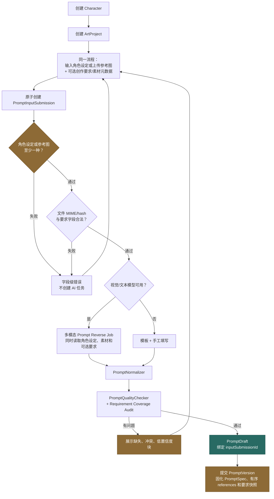

## 2. 提示词编辑、锁定与 AI 建议

| 项目     | 定义                                                     |
| -------- | -------------------------------------------------------- |
| 输入     | 当前 `PromptDraft`、用户修改、自然语言修改要求           |
| 持久输出 | 新 draft revision；用户采纳后可提交新 `PromptVersion`    |
| 人工门禁 | AI 建议必须由用户采纳，锁定块不可修改                    |
| 关键校验 | `baseContentHash`、目标 block 存在、lockAll/block.locked |

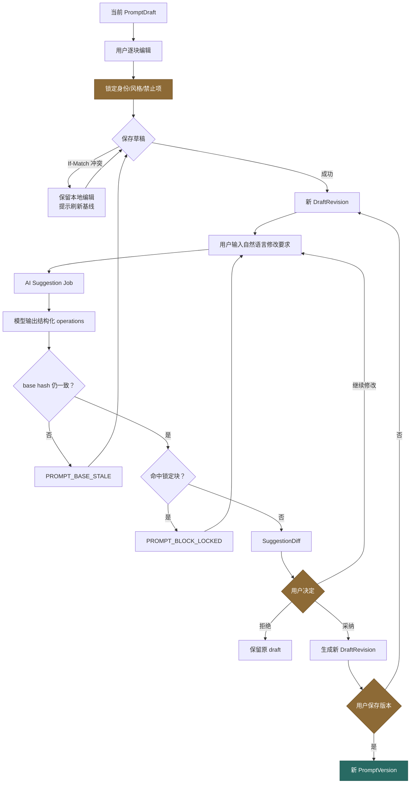

## 3. 生图、候选采纳、回退

| 项目       | 定义                                                                           |
| ---------- | ------------------------------------------------------------------------------ |
| 输入       | `PromptVersion`、可选 base ArtVersion；PromptVersion 内含有序 references       |
| 持久输出   | `GenerationCandidate`；采纳后生成只含最终图片的不可变 `ArtVersion`             |
| 人工门禁   | 用户必须采纳候选，AI 不自动成为当前版本                                        |
| 核心不变量 | PromptVersion 保存完整 PromptSpec 与 references；ArtVersion 只保存最终 artwork |

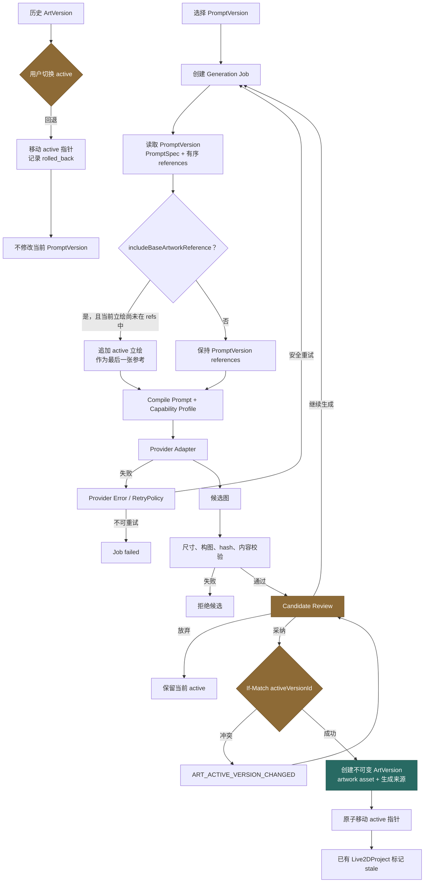

### 3.1 PromptVersion 参考图管理

| 项目          | 定义                                                                                 |
| ------------- | ------------------------------------------------------------------------------------ |
| 集合结构      | 0..14 个参考图；API 每项含 assetId、role、note、weight、locked，数组顺序即优先级     |
| 主图          | 不定义业务主图；Provider 只支持单图时发送数组第一张并记录能力降级                    |
| 用户操作      | 增加、移除、排序、修改角色/备注/权重和锁定                                           |
| 版本约束      | PromptVersion 不可变；提示词或 references 任一变化都会创建新 PromptVersion           |
| ArtVersion    | 只保存 `artworkAssetId`，不复制或持有参考图                                          |
| Provider 规则 | 多图能力足够时发送全集；数量不足时发送数组前缀，其余记录 `reference_budget_exceeded` |

参考图关联同时进入引用计数。移除某个 PromptVersion 中的参考图不立即删除 Blob；其他版本、候选或分层记录仍可能引用同一个内容 hash。

### 3.2 从版本 Fork 子项目

| 项目     | 定义                                                       |
| -------- | ---------------------------------------------------------- |
| 输入     | 已提交 `PromptVersion` 或 `ArtVersion`、分支名、分支标签   |
| 持久输出 | 子 ArtProject、本地 seed versions、`ProjectFork`、审计事件 |
| 人工门禁 | 用户从版本节点主动 Fork；未保存草稿必须先提交              |
| 关系规则 | 同一 Character、固定源版本、可多 Fork、无自动 merge-back   |

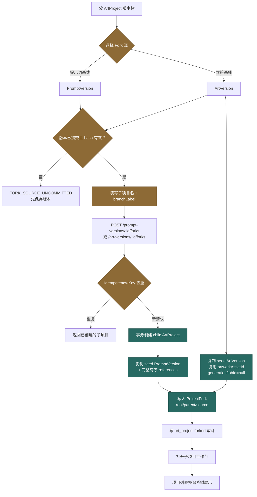

项目列表不把每个 Fork 当成独立根项目：

```text
银发少女
├─ 主项目 · active art v5
│  ├─ 蓝发冬季服 · from art v3
│  │  └─ 短发实验 · from art v4
│  ├─ 夏日礼服 · from art v3
│  └─ 配色实验 · from prompt v6
└─ 黑发实验线 · from art v2
```

根项目卡片显示分支数；子项目卡显示来源版本、分支标签、当前 active 和模型状态。搜索命中子项目时自动展开其祖先；父项目删除后子项目保留，并显示来源已删除。

## 4. 平图到分层 PSD

| 项目     | 定义                                                                                       |
| -------- | ------------------------------------------------------------------------------------------ |
| 输入     | 当前 ArtVersion 的 `artworkAssetId`，或用户直接提供分层 PSD                                |
| 持久输出 | `LayerSpecCandidate`；采纳后原子形成 `LayerSpecVersion`、BindingReadyPsd 和 compose report |
| 默认实现 | See-through 本地 worker                                                                    |
| 质量门   | 合成 alpha IoU ≥ 0.995；必需语义层存在；坐标与透明度合法                                   |

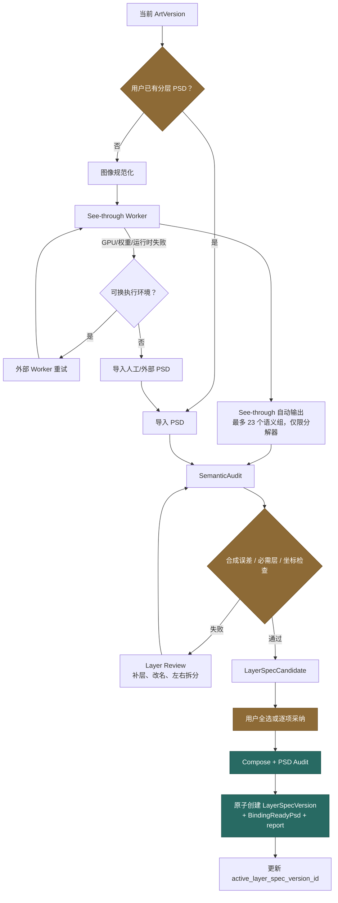

`23` 是 See-through 默认分解器预定义输出组的数量限制，只约束自动分层结果，不约束后续 PSD、用户补层、差分层或绑定流程。用户导入 PSD 或在候选上继续增加图层时，系统按实际图层进入审计和绑定，不执行 23 层截断或合并。具体资源上限应由文件大小、像素总量、内存和 Binder 能力单独决定。

## 5. 语义补层、差分与 PSD 合成

| 项目     | 定义                                                                         |
| -------- | ---------------------------------------------------------------------------- |
| 输入     | `LayerSpecVersion`、ArtVersion、闭眼/张嘴素材                                |
| 可选 AI  | 闭眼/张嘴 PNG、SVG 重绘、局部补层                                            |
| 持久输出 | `LayerSpecVersion`、`compose-report.json`、`layer-map.json`、BindingReadyPsd |
| 人工门禁 | AI 补层只进入候选，不直接覆盖正式 PSD                                        |

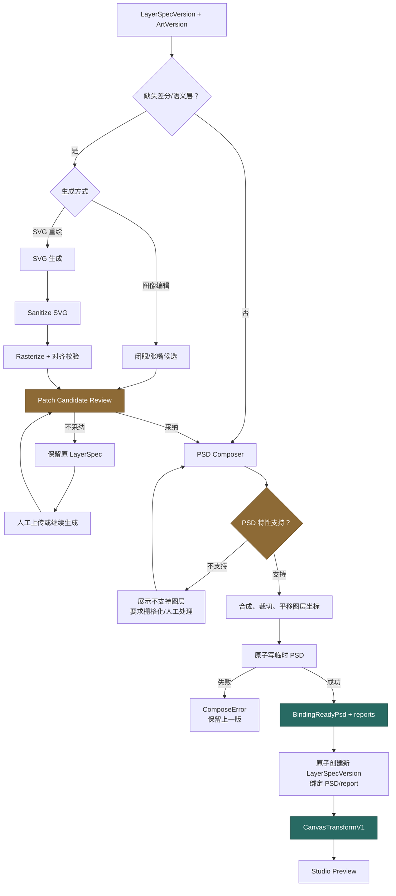

## 6. 自动绑定

| 项目        | 定义                                                         |
| ----------- | ------------------------------------------------------------ |
| 输入        | BindingReadyPsd、`RigPlanVersion`、目标 Cubism 版本          |
| 默认 Binder | PSD2Live，独立进程/MCP                                       |
| 持久输出    | Binder 工程快照、模型文件族、固定全部输入引用的 `ModelBuild` |
| 失败恢复    | 新临时目录重试；有副作用失联则 `unknown_outcome`             |

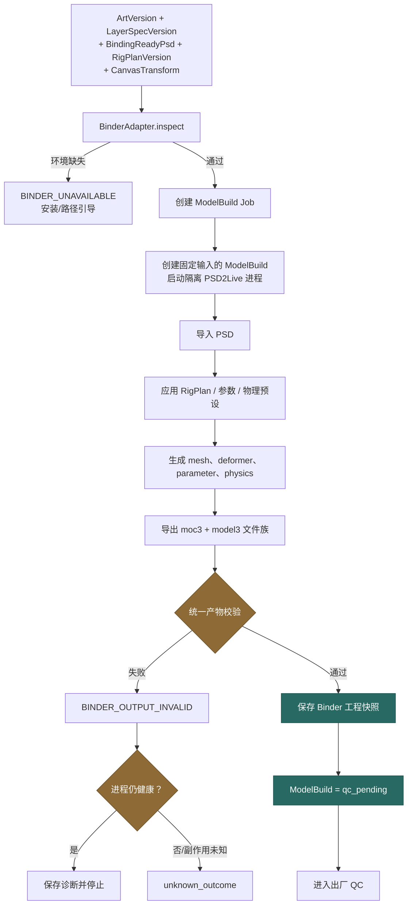

## 7. AI 协作修绑

| 项目     | 定义                                                     |
| -------- | -------------------------------------------------------- |
| 输入     | 当前 Binder state、Canvas 选区、参数/动作、用户自然语言  |
| 持久输出 | `RigEditProposal`、预览图、申请版本、新 `RigPlanVersion` |
| 默认模式 | `co-drive`：AI 先做可见效果预览，用户采用后才提交        |
| 安全边界 | 受控 `rig.*` 工具、32 个语义操作、approval proof、CAS    |

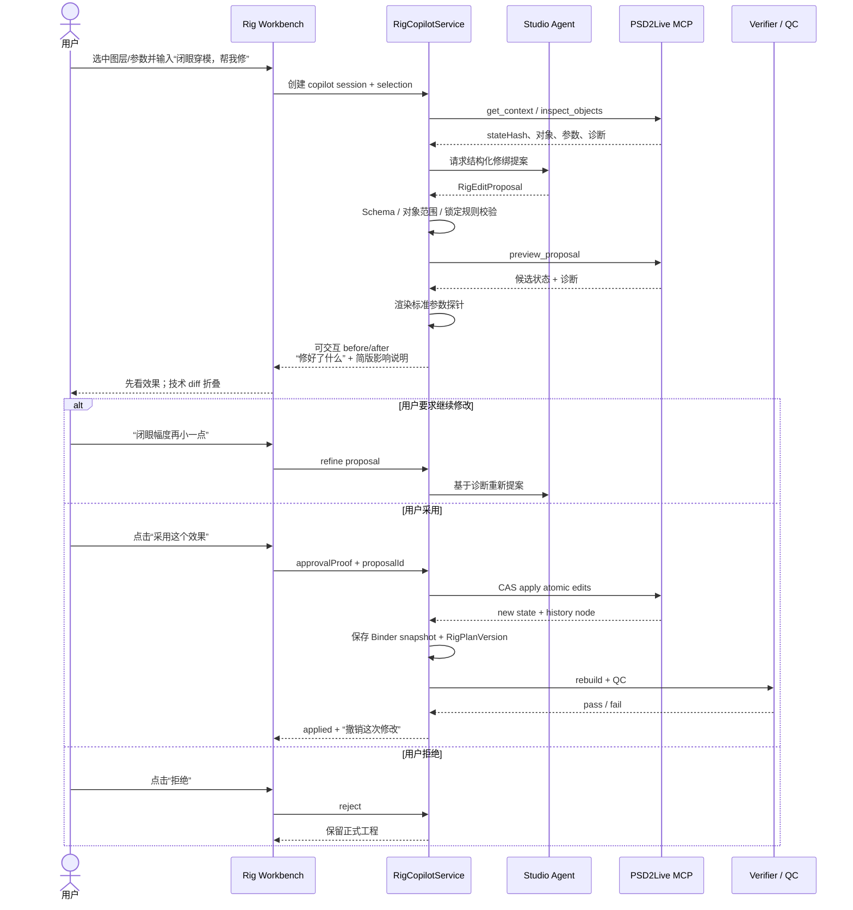

AI 预览失败最多自动修正 3 次；应用阶段不允许模型自行追加新操作。

采用后的回退：

```text
新 RigPlanVersion
  → 重建 ModelBuild
  → QC
  → 用户点击“撤销这次 AI 修改”
  → active RigPlan/ModelArtifact 指回上一个版本
  → 旧版本仍可查看和再次采用
```

## 8. 出厂 QC 与模型发布

| 项目     | 定义                                  |
| -------- | ------------------------------------- |
| 输入     | `ModelBuild`、模型文件族、Binder 版本 |
| 持久输出 | `QcReport`、可发布 `ModelArtifact`    |
| 阻塞规则 | `QC-B01` 至 `QC-B08` 全部通过         |
| 发布规则 | 只有 `qc_passed` 的产物可以绑定 Pet   |

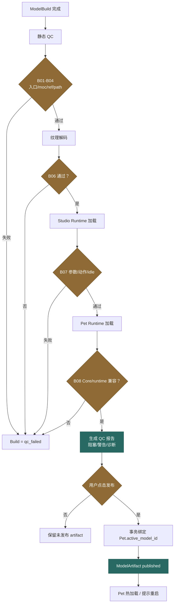

## 9. 外部模型导入与桌宠启动

| 项目     | 定义                                                   |
| -------- | ------------------------------------------------------ |
| 输入     | 标准 Live2D 目录或 zip                                 |
| 持久输出 | `ModelArtifact`、来源与许可元数据、Pet runtime binding |
| 安全门   | zip-slip、解压炸弹、MIME、引用逃逸、sandbox 加载       |

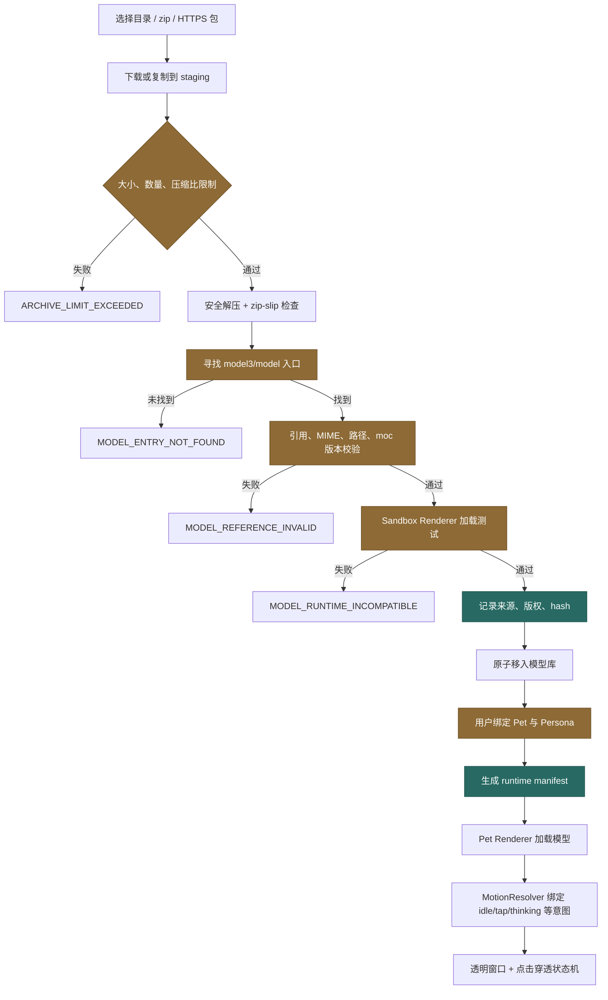

## 10. Direct LLM 聊天与全量记忆

| 项目     | 定义                                       |
| -------- | ------------------------------------------ |
| 输入     | 用户消息、PersonaVersion、当前模型记忆空间 |
| 持久输出 | Messages、会话摘要、MemoryItem             |
| 记忆规则 | 对话与长期记忆均由桌宠管理                 |
| 失败降级 | 流中断保留已收文本；记忆任务失败不回滚聊天 |

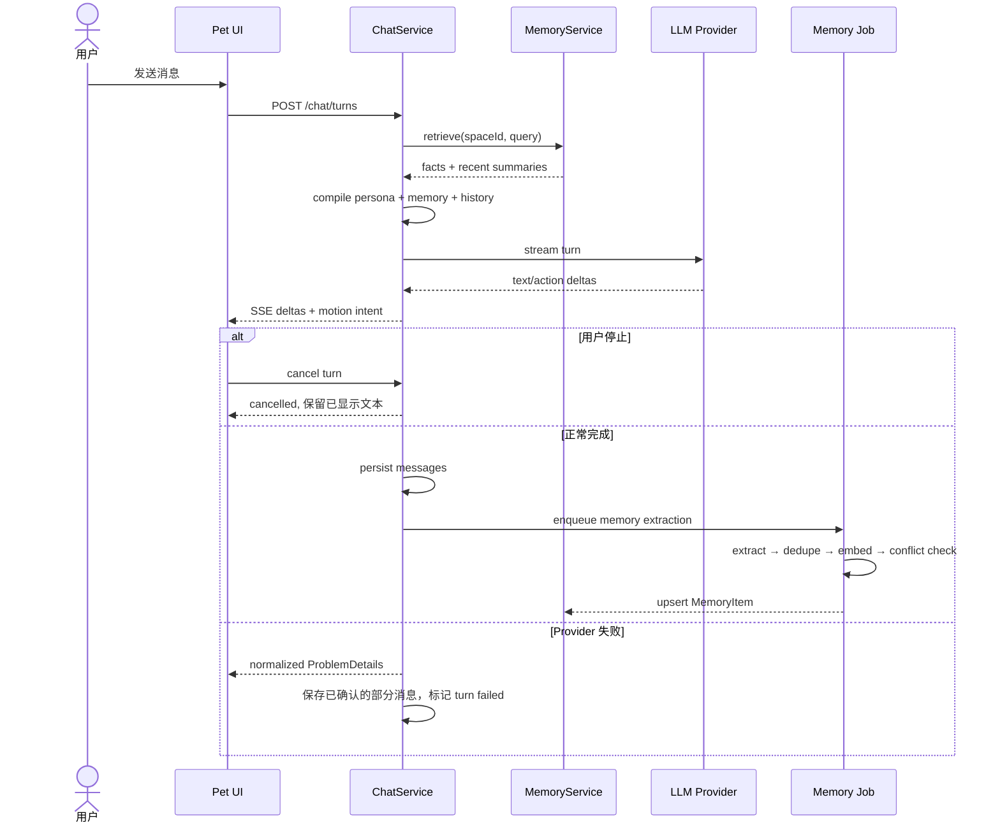

## 11. Forward 聊天与零持久记忆

| 项目     | 定义                                                     |
| -------- | -------------------------------------------------------- |
| 输入     | 用户消息、`external_only` Forward 配置、opaque sessionId |
| 持久输出 | 仅 transport metrics；不写 Conversation、Message、Memory |
| 显示状态 | 当前 turn 只在 renderer 临时状态或 sidecar ring buffer   |
| 失败规则 | 不自动重发有副作用的请求                                 |

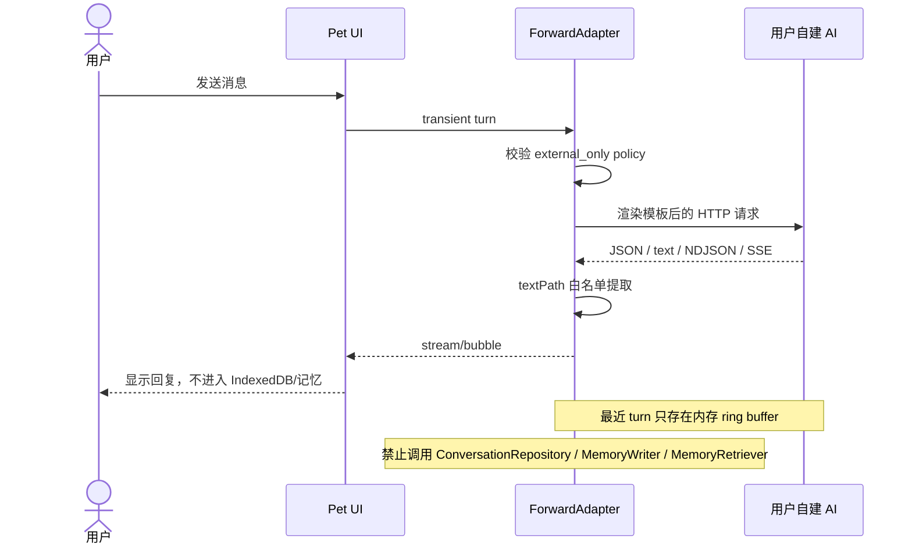

Forward 的异常：

- `FORWARD_TEMPLATE_INVALID`：设置页修正。
- `FORWARD_RESPONSE_PATH_MISSING`：设置页修正。
- `PROVIDER_TIMEOUT`：显示失败，不自动重试有副作用的 POST。
- `SEC_SSRF_BLOCKED`：不发起请求，记录安全审计。

## 12. Codex / Claude Agent

### 12.1 代班执行

| 项目     | 定义                                               |
| -------- | -------------------------------------------------- |
| 输入     | Agent provider、cwd、任务、权限模式                |
| 持久输出 | `agent_task` 元数据 + `agent_task_projection` 摘要 |
| 工作记忆 | Codex/Claude 原生 thread/session 管理              |
| 桌宠记忆 | 只保存目标、完成度、当前摘要、阻塞项               |

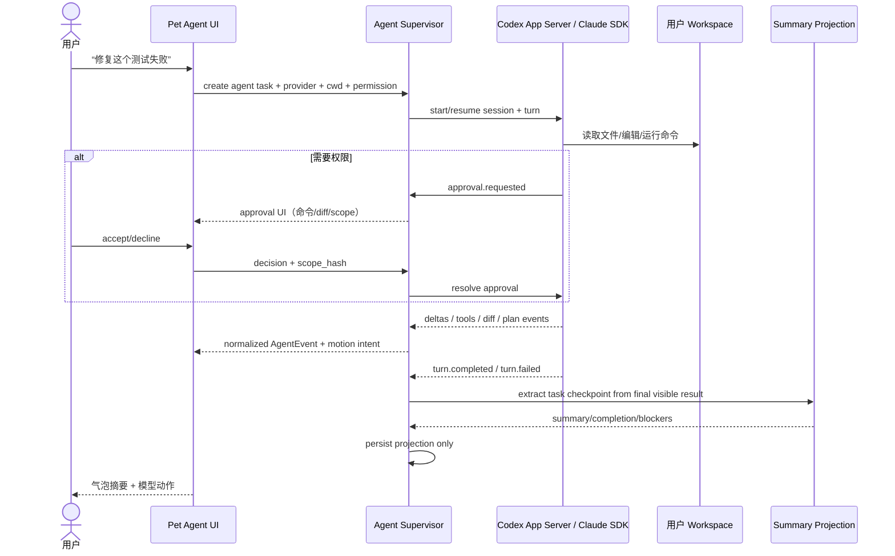

### 12.2 跟随外部会话

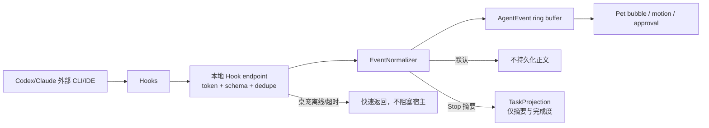

Agent 原始事件不写入桌宠记忆。完整 thread、工具轨迹和 diff 由 Codex/Claude 自身保存；桌宠通过 native session ref 恢复或重新打开。

## 13. 桌宠 AI 工具、MCP 与 Skills

| 项目     | 定义                                                          |
| -------- | ------------------------------------------------------------- |
| 输入     | 用户问题、当前时间/时区、Pet/Model 工具授权、MCP 工具、Skills |
| 持久输出 | ToolInvocation 元数据、来源引用、Tool/Skill 授权              |
| 默认工具 | `clock.now`、`calc.eval`、`system.get_context`                |
| 联网工具 | `web.search`、`web.fetch`，默认关闭                           |
| 扩展入口 | 本地/远程 MCP、Skill 目录或 zip                               |

### 13.1 Direct AI 工具循环

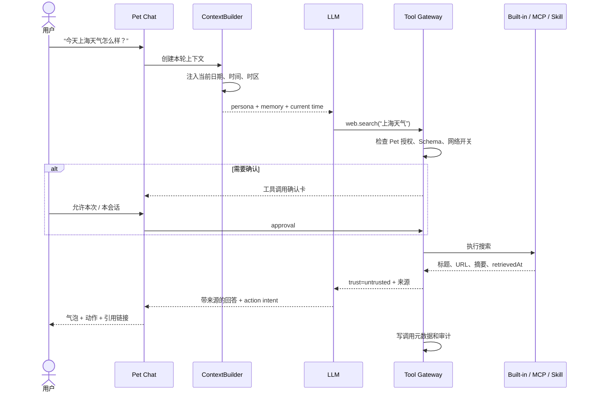

没有搜索工具时，模型仍能正确知道当前日期，因为每轮上下文都会注入系统时间；需要精确时间时调用 `clock.now`。

### 13.2 MCP 添加与授权

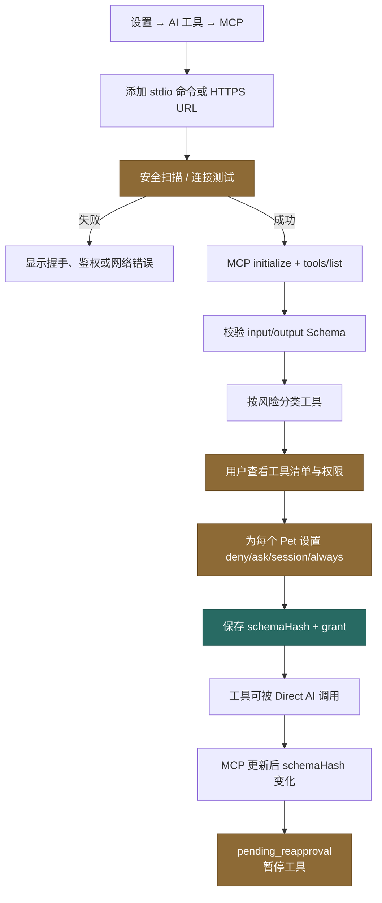

### 13.3 Skill 安装与启用

```mermaid
flowchart TD
  A["选择 Skill 目录 / zip"] --> B["解析 SKILL.md + manifest.json"]
  B --> C{"格式、文件清单、hash 校验"}
  C -->|失败| C1["SKILL_INVALID"]
  C -->|通过| D["预览说明、作者、版本、依赖工具"]
  D --> E{"用户确认安装？"}
  E -->|否| F["不写入"]
  E -->|是| G["安装 SkillVersion"]
  G --> H["为 Pet 启用并授予 scopes"]
  H --> I["按需加载 instructions/references"]
  I --> J{"需要脚本？"}
  J -->|否| K["进入模型上下文"]
  J -->|是| L["要求用户授权 Sandbox Runner"]
  L -->|拒绝| M["Skill 仍可作为纯文本指导"]
  L -->|允许| N["受控执行脚本工具"]

  classDef gate fill:#8d6a36,color:#fff,stroke:#6d4f24;
  classDef artifact fill:#286a63,color:#fff,stroke:#1d514b;
  C,E,H,J,L gate;
  class G artifact;
```

### 13.4 工具调用与记忆边界

| 情况              | 行为                                                 |
| ----------------- | ---------------------------------------------------- |
| Direct + 工具结果 | 可以形成消息上下文；长期事实需经过记忆提取与来源标注 |
| Forward           | 不调用桌宠工具，外部 AI 自行管理工具和记忆           |
| Agent             | 编码工具归 Codex/Claude；桌宠只保存任务投影          |
| 搜索/网页正文     | 标记为不可信外部内容，不自动写入长期记忆             |
| Skill 指令        | 只影响当前启用 Pet/Model，不覆盖安全策略             |
| MCP/Skill 升级    | Schema 或 manifest hash 变化后暂停，重新授权         |

## 14. 横切错误、取消与恢复

| 项目     | 定义                                                    |
| -------- | ------------------------------------------------------- |
| 输入     | 任意 HTTP、Job、Provider、Agent 或 Binder 异常          |
| 持久输出 | ProblemDetails、JobError、日志、审计、checkpoint        |
| 用户出口 | 修正输入、刷新、重试、切换 Provider、重新审批或联系支持 |
| 核心规则 | 有副作用或结果未知时禁止自动重放                        |

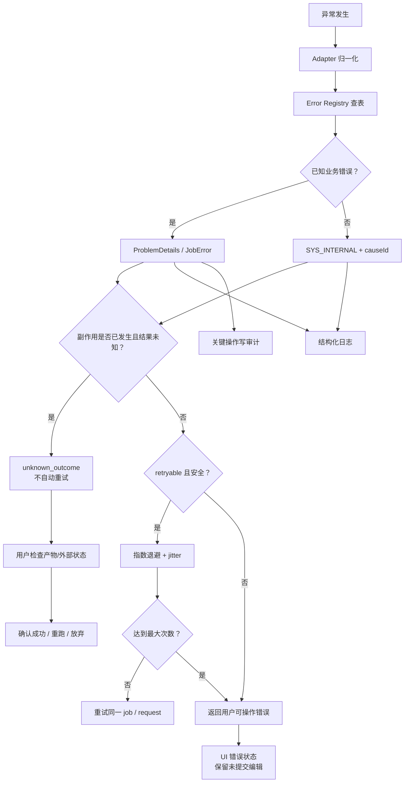

### 任务恢复

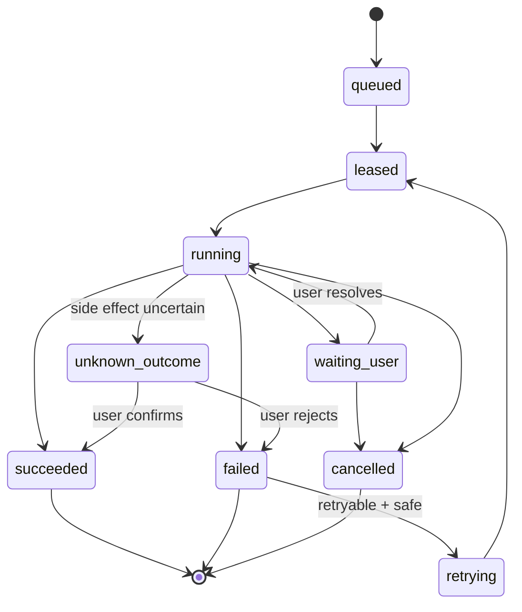

## 15. 一次完整成功链路

```mermaid
flowchart TD
  A["想法/设定"] --> B["PromptVersion"]
  B --> C["生成候选"]
  C --> D["用户采纳 ArtVersion v1"]
  D --> E["平图分层"]
  E --> F["语义补层"]
  F --> G["BindingReadyPsd"]
  G --> H["PSD2Live 自动绑定"]
  H --> I["AI 对话修绑"]
  I --> J["用户预览并应用"]
  J --> K["重建 ModelBuild"]
  K --> L["QC-B01…B08"]
  L --> M["发布 ModelArtifact"]
  M --> N["Pet 绑定 Persona"]
  N --> O["Direct / Forward / Agent"]
  O --> P["任务摘要 / 记忆按模式处理"]
  P --> Q["桌宠气泡 + 动作反馈"]

  classDef gate fill:#8d6a36,color:#fff,stroke:#6d4f24;
  classDef artifact fill:#286a63,color:#fff,stroke:#1d514b;
  class D,I,J,L,M,Q gate;
  class B,G,K,N artifact;
```

## 16. 各阶段必须留下的可审计产物

| 阶段             | 必须持久化                                                                                                        |
| ---------------- | ----------------------------------------------------------------------------------------------------------------- |
| 想法与提示词     | PromptInputSubmission、PromptSpec、PromptVersion references、锁定状态、CharacterBriefVersion（如有）、AI 建议     |
| Fork             | child/parent/root project、source version + hash、branchLabel、seed Prompt/ArtVersion、审计事件                   |
| 生图             | PromptVersion、可选 base ArtVersion、编译 Prompt、references hash、Provider 请求摘要、候选、active 指针           |
| 分层             | 输入 ArtVersion、See-through 版本/权重、quality report、LayerSpecVersion、source/binding-ready PSD 引用           |
| PSD              | 输入图层、补丁来源、compose-report、BindingReadyPsd assetId/hash                                                  |
| 自动绑定         | ArtVersion、LayerSpecVersion、BindingReadyPsd、RigPlanVersion、CanvasTransform、Binder 版本、工程快照、ModelBuild |
| AI 修绑          | 选区、proposal、baseStateHash、preview、approval proof、apply 结果                                                |
| QC/发布          | QC report、Core/runtime 版本、ModelArtifact、发布审计                                                             |
| Direct           | Messages、记忆抽取状态、MemoryItem                                                                                |
| Forward          | 仅 transport metrics 和错误码；不保存正文                                                                         |
| Agent            | native session ref、状态、任务投影摘要、审批审计                                                                  |
| Tools/MCP/Skills | source、tool schema hash、grant、invocation hash、来源与检索时间                                                  |
| 错误与恢复       | requestId/traceId、错误码、attempt、checkpoint、unknown_outcome 结论                                              |
