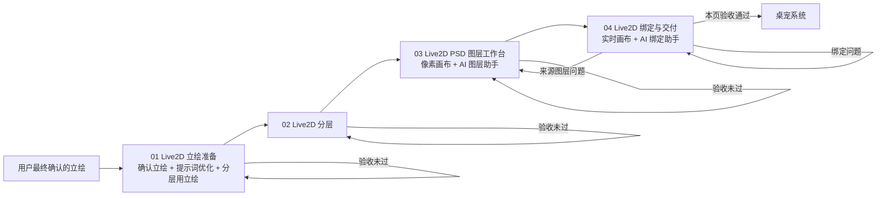
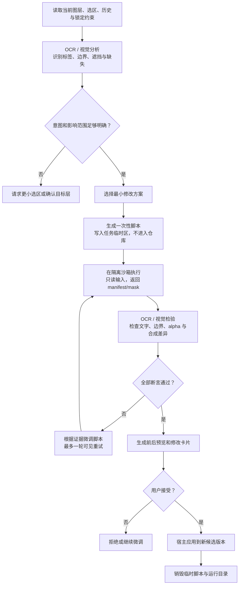

# Live2D 四段工作台架构

> 状态：待评审。产品方向已确认为四页工作流，各阶段自带验收，最终交付给桌宠系统。
> 日期：2026-11-26
> 取代：`docs/architecture/2026-11-26-psd-layer-workbench.md` 与
> `docs/architecture/2026-11-08-stage-workflows.md` 中旧的“语义补层、差分与 PSD 合成”阶段定义。
> 参考实现：`../live2d-keysheet-demo` 的真实立绘准备、PSD、PSD2Live、Cubism 运行证据。

## 1. 要解决的问题

原有产线是：

```text
分层 -> 语义差分补齐 -> PSD 合成 -> Live2D 绑定 -> QC -> 发布
```

这套划分把手段当成了工序；同时又把“普通立绘”直接当成 See-through 的合格输入。用户并不
关心“补层”和“合成”是两个步骤，只关心当前 PSD 图层能不能直接改好；用户也不应该看到
PSD2Live 的工具模式、MCP 会话和服务启停。

真实 demo 暴露了四件事：

1. 用户确认的普通立绘可能带背景、侧身、遮挡、相近色或缺少完整手脚，不适合直接分层。
2. 立绘准备、PSD、PSD2Live 和 Cubism 的真实链路可以贯通，但自动分解只能可靠处理当前可见
   像素，被遮挡的完整后层仍然需要人工或 AI 辅助补齐。
3. 图层问题的困难主要不是“生成一张漂亮图”，而是确定哪些像素属于哪一层。手指接触、
   衣服遮挡手臂、局部暗带和选区边界，都更适合在 PSD 像素画布里直接指认。
4. 绑定问题的困难是“动起来是否还成立”。用户在绑定阶段需要实时看眨眼、口型、表情与动作，
   不需要理解 PSD2Live 的网格、变形器和 MCP 调用细节。

因此产品改为四个用户可理解的工作台：

```text
立绘准备 -> 分层 -> PSD 图层工作台 -> Live2D 绑定与交付
```

第一段负责把“用户最终确认的角色立绘”改造成适合分层的主立绘，以及可选的设定参考；第二、三段
负责把分层用立绘变成正确、可绑定、可维护的 PSD；第四段负责把 PSD 变成可体验的模型，并在
本阶段验收通过后交给桌宠系统。所有 AI 修改都是候选版本，用户接受后才进入正式版本链。

## 2. 目标、非目标与反目标

### 2.1 目标

- 用户始终只看到四个制作工作台，不被提示词转换器、分解器、补层器、合成器、MCP 服务等内部
  组件打断。
- 在进入分层前检查原立绘是否适合制作，并把原始立绘提示词转换为结构化的“分层用立绘”提示词。
- 立绘准备阶段同时处理背景干扰、相近色、侧身、极端遮挡、手脚缺失和画布安全区问题。
- 立绘准备阶段输出一张可直接交给 See-through 的“分层用立绘”；表情、局部和遮挡说明放在
  单独的“角色设定板”，不用拼版图直接污染自动分层输入。
- PSD 工作台支持接近 Photoshop 的图层组织与像素选区，至少覆盖魔棒、自由套索、多边形套索、
  选区布尔运算、扩边/收边、图层导入、替换、重命名、排序和显隐。
- 绑定工作台提供真实 Live2D 实时渲染，以及眨眼、说话、表情、动作和参数组合的预体验。
- 立绘准备、PSD 图层和绑定三个工作台都有 AI 助手，但职责不同：立绘准备 AI 优化提示词并
  生成分层用立绘，图层 AI 修改像素，绑定 AI 修改绑定；后两者使用不同的工具边界。
- PSD 图层和绑定的 AI 修改必须经过“分析 -> 一次性脚本或受控工具 -> 隔离运行 -> 校验 ->
  候选预览 -> 用户接受”。
- 一次性脚本和中间运行文件不进入代码仓库、LayerSpecVersion、RigPlanVersion 或桌宠交付包。
- 修改失败不污染当前工程；用户可以从任意候选版本继续或回退。
- 第 4 页隐藏 PSD2Live 的运行细节，用户只看到更新进度、实时效果和可撤销结果。
- 每页都有本阶段的验收结果和放行条件；不设置独立的全局 QC 页面，也不把正常阶段检查表现成
  “全部做完后的返工”。
- 最终动作是“交给桌宠系统”，不引入发布、上架或成品公示语义。

### 2.2 非目标

- 不在首版重写 Photoshop 或 PSD2Live。PSD 编辑复用工作台自己的画布与 PSD 读写库，绑定复用
  PSD2Live 的网格、变形器和 MCP 能力。
- 不把 PSD 工作台做成完整绘画软件。首版重点是图层归属、局部修复和结构检查，不承诺完整笔刷、
  压感、滤镜体系和专业绘画工具。
- 不把绑定工作台做成 PSD2Live 的缩小版微操界面。网格点、父子关系和权重细节不作为默认 UI。
- 不复刻 Updream 的具体界面或提示词。只采用“把用户创作要求转换为专业角色设定板规格”的产品
  思路。
- 不把立绘准备强制定义为完整全身多视图拼版。对角色的身体范围允许按设定选择全身、半身或特定
  造型，但必须与用户的 Live2D 目标一致。
- 不承诺仅靠提示词解决背景分离。提示词只能降低风险，最终仍需前景抠图、alpha 检查和立绘准备
  质量门。
- 不把 OCR 当作美术语义的唯一来源。纯立绘没有稳定文字时，OCR 只能辅助读取标签、局部说明和
  前后状态一致性，不能替代像素、轮廓和视觉对齐检查。
- 不允许 AI 绕过版本、审批或锁定层直接覆盖当前模型。

### 2.3 反目标

- 页面里重新出现“差分补齐”和“PSD 合成”两个独立步骤。
- 把未经检查的普通立绘直接送进 See-through，等分层失败后再靠修层猜测根因。
- 把多宫格设定板直接裁成一张输入图送给分层器，导致表情格、局部图和主角色被识别成多个主体。
- 改写用户的原始 ArtPromptVersion。立绘准备提示词必须是一个可追溯的新版本。
- 在绑定画布上做像素级套索，或把 PSD2Live 的对象套索误当成像素选区。
- 每个案例提交一份定制 `.ts` / `.py` 脚本，最终把仓库变成临时脚本垃圾场。
- AI 每轮重写脚本时丢失用户上一轮已经确认的边界。
- 用户每次微调都要重导 PSD、重启 PSD2Live 或等待完整模型构建。
- 用“脚本跑成功了”代替“画面和绑定真的正确”。

## 3. 产品信息架构

四个页面共用一个 Live2D 项目路由：

```text
/characters/:characterId/live2d
  ?project=<artProjectId>
  &stage=prepare | layers | psd | rig
```

使用 `stage` 查询参数而不是四套互不相连的路由，原因是它们共享同一个 Live2DProject、当前活动
版本、后台任务和 AI 会话。每个 stage 都可深链、刷新恢复和从角色驾驶舱直接打开。

顶部只保留四项进度：

| 页面                  | 用户问题                               | 本页验收与出口                                     |
| --------------------- | -------------------------------------- | -------------------------------------------------- |
| Live2D 立绘准备       | 最终立绘能否稳定地变成可分层输入？     | 身份、背景和主体完整，生成 `Live2DReadyArtVersion` |
| Live2D 分层           | 分层用立绘是否已经变成合格的初始图层？ | 图层完整、合成通过，生成 `LayerSpecVersion`        |
| Live2D PSD 图层工作台 | 图层归属和局部画面是否正确？           | PSD 与局部修改验收通过，进入绑定                   |
| Live2D 绑定与交付     | 它动起来是否成立、是否像这个角色？     | 体验和运行时验收通过，交给桌宠系统                 |

页面之间的导航不应自动替用户提交版本。离开脏编辑时保存草稿并提示“有未提交修改”，但不能
把 AI 候选或未接受的选区状态写成正式版本。

## 4. 四段流程



### 4.1 状态机映射

不要求首版立即删除数据库旧状态。UI 将内部状态映射到四段，新增状态只补必要部分：

| 内部状态                                                           | 用户页面              | 说明                                |
| ------------------------------------------------------------------ | --------------------- | ----------------------------------- |
| `created`, `image_ready`                                           | Live2D 立绘准备       | 已有最终 ArtVersion，等待适用性检查 |
| 新增 `live2d_preparation_prompting`, `live2d_ready_art_generating` | Live2D 立绘准备       | 提示词优化或分层用立绘生成中        |
| 新增 `live2d_preparation_review`, `live2d_ready_art_ready`         | Live2D 立绘准备       | 候选审查或已接受分层用立绘          |
| `decomposing`                                                      | Live2D 分层           | 自动分解/候选生成中                 |
| `layer_review`                                                     | Live2D 分层           | 用户选择初始图层候选                |
| `psd_composed`                                                     | Live2D PSD 图层工作台 | 已有可编辑 PSD，进入正式修层        |
| 新增 `psd_editing`                                                 | Live2D PSD 图层工作台 | 有未提交的图层编辑或 AI 候选        |
| `rig_planning`, `rigging`                                          | Live2D 绑定与交付     | 绑定点检、构建和后台更新            |
| `rig_review`, `motion_review`                                      | Live2D 绑定与交付     | 实时预体验与 AI 修绑                |
| 新增 `handoff_ready`                                               | Live2D 绑定与交付     | 本页验收通过，可交给桌宠系统        |
| 新增 `handed_off`                                                  | Live2D 绑定与交付     | 桌宠已接手当前模型                  |

若数据库迁移成本需要更小，可暂时由已有状态推导 `psd_editing`、`handoff_ready` 和
`handed_off`；旧 `qc` / `published` 只能作为迁移别名，不能出现在界面、文案或新 API 契约里。

## 5. 页面一：Live2D 立绘准备

这一页承接普通立绘工作台，不是大型编辑画布。它负责把“可以看的角色图”转换为“适合
Live2D 分层的立绘输入”。该阶段解决的是输入质量，不解决具体 PSD 图层归属。

### 5.1 输入与输出

输入：

- **用户在立绘工作台最终确认的 ArtVersion。** 必须是已经采纳、形成不可变记录并成为当前确认
  版本的立绘；未采纳候选、最近生成图或编辑器草稿不能作为输入。
- 该 ArtVersion 绑定的原始 PromptVersion、确认时间和内容 hash。
- 角色设定版本、现有参考图和用户额外要求。
- Live2D 目标：全身/半身、需要哪些表情和口型、是否必须有手脚、预计动作幅度。
- 原图适用性检查报告。

页面顶部固定展示“来源立绘”卡片：缩略图、版本号、确认时间、来源 PromptVersion 和画布尺寸。
若用户尚未在立绘工作台确认任何 ArtVersion，本页显示“先回立绘工作台确认立绘”，不提供生成。
进入立绘准备后再切换当前立绘，已有的准备候选和验收结果标记 stale。

输出：

- `layerReadyArt` 分层用立绘：一张正面中性、主体完整、背景可清除的单角色图，直接作为
  See-through 的分层输入。
- `characterReferenceBoard` 角色设定板：可选的多视图、表情、局部细节和遮挡说明，用于指导修层
  与绑定，不进入 See-through。
- `live2d-ready-art.json`：画布、身体范围、关键部位、表情需求、背景策略、身份锚点和制作约束。
- `Live2DReadyArtVersion`：用户接受的不可变设计版本，绑定来源 ArtVersion 和
  `Live2DPreparationPromptVersion`。

### 5.2 原图适用性检查

生成分层用立绘前，先检查最终确认的 ArtVersion 是否适合直接制作。检查结果分为
`pass / warning / blocker`：

| 检查项     | 要回答的问题                             | 典型问题                             |
| ---------- | ---------------------------------------- | ------------------------------------ |
| 主体与画布 | 角色是否完整、边缘是否留足活动空间？     | 手脚被裁切、贴边、分辨率不足         |
| 背景可分离 | 前景和背景能否稳定产生 alpha？           | 白发白裙配白背景、复杂场景、阴影粘连 |
| 颜色分离   | 相邻部件是否能用颜色/轮廓区分？          | 白衣贴皮肤、黑发黑衣、透明衣物       |
| 体态与遮挡 | 部件是否伸直、可分离、少交叉？           | 侧身、抱臂、双手贴合、前后发完全重合 |
| 身体范围   | 用户要求的手脚是否真实存在？             | 只有半身却要求全身绑定               |
| 表情与口型 | 是否有闭眼、张嘴等制作信息？             | 表情差异只能靠猜测                   |
| 物件与特效 | 是否有会破坏绑定的复杂道具或场景？       | 手持大型物体、飘带与身体粘连         |
| 身份信息   | 服装、配色、发饰和角色特征是否足够清晰？ | 关键锚点被遮挡或分辨率不足           |

`blocker` 阻止直接分层，但允许用户选择“生成新的分层用立绘”或“明确接受风险后继续”。

### 5.3 立绘准备提示词优化

立绘准备提示词不是普通“画得更精细”提示词，而是一份专业角色设定板生成规格。它从已确认
ArtVersion 绑定的原始提示词、角色设定、参考图分析和 Live2D 制作目标生成新版本，不覆盖原
ArtPromptVersion。

优化器必须固定以下信息：

- 身份锁：脸型、五官、发型、发色、服装、配饰、配色和标志性特征。
- 制作姿态：正面中性站姿或约定的身体范围；手臂与躯干留出分离空间。
- 身体完整度：需要手/脚时明确双手和双脚完整，不需要时写入明确的身体范围。
- 背景策略：无场景、无地面阴影、无文字装饰；背景色与角色主色分离，并标记不确定性。
- 肢体分离：避免交叉手臂、双手相贴、手臂压胸、极端透视和侧身。
- 图层线索：前后发、左右眉眼、上下衣、前后裙、开衩内片等必要结构。
- 表情需求：闭眼、张嘴、微笑等作为角色设定板差分，不混入分层用立绘的多个角色画面。
- 禁止项：拼版主体、裁切手脚、遮挡关键部件、相近色粘连、复杂道具、背景元素。

提示词优化结果使用结构化 PromptSpec，而不是只有一段自由文本：

| 类别   | 示例                                                     |
| ------ | -------------------------------------------------------- |
| 身份锁 | `face`, `hair`, `outfit`, `style` 的来源 blocks 锁定     |
| 姿态   | 正面中性站姿，双臂自然下垂并与躯干留出间隙               |
| 构图   | 全身或约定半身、统一画布、安全区、主体居中               |
| 背景   | 单色无场景背景或透明前景制作目标                         |
| 负向   | 侧身、抱臂、手脚裁切、白底白衣、文字标签、拼版、复杂背景 |

用户可以在生成前编辑和锁定 block。每次修改形成新的 `Live2DPreparationPromptVersion`，并展示
“为什么加了这条、它保护了哪个制作问题”。

### 5.4 生成与审查

- 默认生成 2–4 张分层用立绘候选，使用同一身份锁和制作规格。
- 可选同时生成角色设定板。设定板不会自动作为 See-through 输入。
- 候选审查同时显示来源立绘、分层用立绘、角色身份差异和背景分离结果。
- 支持只调整背景、姿态、手脚、表情参考等局部约束后重新生成。
- 用户也可以上传自己的分层用立绘，系统只做适用性检查、背景清理和阶段验收。

立绘准备阶段验收至少包括：

- 角色身份锚点没有明显漂移。
- 分层用立绘只有一个主体，画布与目标一致。
- 要求的手脚和身体范围完整；不要求的部分明确标注。
- 前景边界可分离，相近色区域有可见轮廓或可修复间隙。
- 分层用立绘和角色设定板没有混用，表情格不会进入自动分层输入。
- 图片、提示词版本、已确认 ArtVersion 和 `live2d-ready-art.json` 的 hash 一致。

### 5.5 页面一主操作与失败出口

主操作：

- `生成准备提示词`：从已确认立绘的原提示词、角色设定和适用性报告生成结构化制作规格。
- `生成分层用立绘`：生成候选，默认分离背景并校验前景边界。
- `生成角色设定板`：生成表情、局部和遮挡说明，不影响分层用立绘。
- `采用这版分层用立绘`：创建 `Live2DReadyArtVersion`，解锁分层。
- `上传已有分层用立绘`：走同一阶段验收，不复用自动生成的结论。
- `原图满足要求，直接使用`：仅在适用性检查通过且已完成背景清理/规范化时可用。

失败出口：

- 白发白底、透明衣物或相近色无法稳定抠图：生成带对比背景的候选，或在 PSD 图层工作台清除
  背景后再分层；不能只给一句“提示词已优化”。
- 用户要求全身但原图没有手脚：重新生成分层用立绘；如果角色设定本身是半身/无腿形象，则修改制作
  规格，而不是强行补不存在的身体。
- 生成结果改变角色身份：锁定更多身份 block，或只调整背景/姿态；不能让“更像可绑定图”变成
  “换了角色”。
- 生成服务不可用：允许上传已有分层用立绘；已确认原图直接使用仍受适用性验收约束。

## 6. 页面二：Live2D 分层

这一页只消费已接受的 `Live2DReadyArtVersion.layerReadyArt`。它不再处理普通背景、身份提示词或
表情差分，这些属于立绘准备阶段。

### 6.1 主体内容

- 顶部显示分层用立绘、来源立绘准备版本、画布尺寸和分解器参数。
- 中间显示自动分解候选、导入 PSD 入口或分解进度。
- 右侧显示图层清单摘要、合成误差、缺失风险、被遮挡区域提示和下一步建议。
- 分解完成后可预览图层缩略图、alpha 包围盒和层数；像素微调进入 PSD 工作台。
- 用户已有 PSD 时可从这里导入；导入后进入 PSD 工作台，不在这里提供半个编辑器。

### 6.2 主操作

- `采用这套图层`：创建初始 `LayerSpecVersion`，进入 PSD 工作台。
- `导入自己的 PSD`：验证尺寸、普通图层、alpha、混合模式和遮罩兼容性后进入 PSD 工作台。
- `重新分层`：生成新候选，不覆盖已有版本。
- `返回 Live2D 立绘准备`：当根因是背景、姿势、身体范围或相近色时，回去修改分层用立绘。

### 6.3 失败出口

- 分解服务不可用：允许导入 PSD，并保留错误证据。
- 图层数或合成误差异常：允许查看候选，但明确标记“后续需要修层”，不能把技术警告当通过。
- 被遮挡像素未生成：标记缺失风险，在 PSD 工作台提供补层入口。
- 多个主体、背景被切进图层或相近色大面积粘连：优先回到立绘准备修正，不在分层页用脚本硬猜。
- 手脚实际存在但被层边界截断：进入 PSD 工作台；身体本来不存在时回立绘准备确认制作范围。

## 7. 页面三：Live2D PSD 图层工作台

这是第一个画布页。它负责 PSD 语义内的像素、图层栈、合成顺序和素材替换。

### 7.1 版式

```text
┌───────────────────────────────────────────────────────────────────────┐
│ 顶部：项目 / 版本 / 画布尺寸 / 撤销重做 / 缩放 / 导出 PSD / 保存候选 │
├──────────────┬───────────────────────────────────────┬────────────────┤
│ 图层与素材    │                                       │ AI 图层助手     │
│              │         PSD 像素画布                   │                │
│ 图层栈        │   checkerboard / alpha / selection     │  对话            │
│ 文件夹/锁/显隐 │   套索 / 魔棒 / 移动 / 缩放            │  当前上下文      │
│ 合成预览      │                                       │  修改卡片        │
│ 新建/导入/替换 │  底部：选区像素数 / bbox / 边缘状态    │  接受/拒绝/撤销  │
└──────────────┴───────────────────────────────────────┴────────────────┘
```

建议桌面窗口最小 `1180 × 760`，常用 `1440 × 900`。右栏默认 340px，可折叠；图层栏默认
260px。画布始终占据最大面积。

### 7.2 图层能力

- 查看图层栈、文件夹、可见性、锁定状态和缩略图。
- 切换当前图层；显示当前图层单独预览与整体合成预览。
- 重命名、排序、复制、删除、合并、显示/隐藏和锁定图层。
- 导入 PNG/PSD 新图层；用户可选择插入位置、目标文件夹和画布对齐方式。
- 替换当前图层图像；保留原层尺寸、原点、alpha 与蒙版语义。
- 多个图层时显示 drawOrder 对应的合成顺序，不允许用未解释的自动排序覆盖用户改动。
- 每项操作进入工作台撤销栈；保存后生成不可变候选版本。

### 7.3 像素选区

选区是图层 AI 的主要输入，必须是一等对象。

- 魔棒：容差、连续/全局、限定在当前图层 alpha 内。
- 自由套索：支持不规则轮廓，默认羽化 0。
- 多边形套索：逐点闭合，允许编辑已有顶点。
- 矩形选区作为补充工具，不替代不规则选区。
- 选区布尔：加选、减选、交集、反选。
- 边缘操作：按像素扩展/收缩，不默认抗锯齿或羽化。
- 选区叠加层：半透明填充、当前层 alpha 轮廓、选区外遮罩三层可独立显隐。
- 选区结果始终输出与图层同尺寸、同原点的 mask；不能裁剪后 stretch 回整层。

画布点击、拖拽和套索闭合应保持在本地交互层，不等待 AI 或后台任务。

### 7.4 合成与差异预览

- 默认显示当前 PSD 合成。
- 可切换“当前候选 / AI 候选 / 差异”三种视图。
- 差异视图显示新增、删除、移动和颜色变化，默认隐藏亚像素噪声。
- 提供局部放大镜和双栏对比，但不需要像立绘候选那样做四宫格。
- 对局部修改自动定位到变化 bbox，并保留“修复前”和“候选后”两帧证据。

## 8. 图层画布的 AI 助手

### 8.1 它负责什么

- 图层缺失：识别需要补齐的 alpha/内容，并给出可审查的补层候选。
- 局部违和：在用户选区内修颜色、边界、alpha、色渗或错误归属。
- 图层交叉覆盖：调整顺序、裁剪、拆分或生成前后层，解决穿帮。
- 选区解释与细化：把用户的自然语言“这里多了一点”“黑边要包进来”转成 mask 运算。
- 替代素材：用户上传新图层后，帮助对齐、裁切、重命名和检查合成影响。

它不负责：

- 直接写项目文件。
- 直接调用 PSD2Live MCP。
- 修改已锁定图层。
- 修改用户已经 pin 住的边界或约束。
- 在无法确认意图时猜一个高破坏性结果。

### 8.2 对话中加入画布上下文

用户发送消息时，上下文栏应显示并允许移除：

- 当前图层 ID、名称、alpha 包围盒。
- 当前选区 mask、bbox、像素数和来源操作（魔棒、套索、加选等）。
- 与选区相交的其他图层及各自不透明像素计数。
- 当前可见合成缩略图、选区放大图、相关层缩略图。
- 当前候选版本的输入 hash。
- 用户的“锁定/不要动”约束。

不把整张 PSD、全部大图或无关图层原图无限制塞入模型。需要跨层检查时由工具按需查询。

### 8.3 候选修改的交互

AI 返回一张修改卡片：

- 用户意图复述。
- 修改了哪些层、哪些像素范围。
- 前后对比缩略图。
- 关键校验结果。
- 是否需要生成外部新素材。
- `预览`、`作为候选接受`、`继续微调`、`拒绝`。

“接受”只创建新的 LayerSpecVersion 候选或成为当前活动版本；旧版本永远保留。AI 不能自己
替用户接受。

## 9. 图层 AI 的完整 skill

仓库内的 skill 是固定流程和约束，不是某个案例的脚本。实现放在
`skills/psd-layer-canvas-assistant/`。

### 9.1 触发范围

当用户在 PSD 图层工作台提出以下类型请求时加载：

- 补缺失图层或局部内容。
- 修复选区内的颜色、边界、透明度和杂边。
- 处理图层交叉覆盖、遮挡顺序、跨层像素归属。
- 对上传的新图层做对齐、裁切和合成检查。
- 继续微调上一轮已经确认的图层修改。

一般“解释图层是什么”不一定要走脚本沙箱；涉及写像素时必须走完整流程。

### 9.2 固定流程



### 9.3 分析步骤

分析不是让模型重新描述整张图，而是产出可验证的事实：

- OCR/文本层：读取工作区标签、用户截图标注和可能存在的局部说明。
- 图层索引：层名、bbox、alpha 直方图、可见像素数、锁定状态和相邻层。
- 选区索引：mask 与多边形、相交层比例、是否包含不透明边缘。
- 背景与边界证据：当前合成、选区放大、目标层单独渲染、相关层 alpha 轮廓。
- 历史证据：上一轮已确认的 pinned 边界、用户拒绝原因和当前候选版本。

若 OCR 没有可读文字，必须明确“文本身份不可确认”，继续使用 alpha、轮廓、颜色和用户选区，
不能编造层名或根据图生图结果猜角色身份。

### 9.4 一次性脚本契约

脚本默认使用 TypeScript/Node，但宿主不关心语言；只关心隔离执行和结构化返回。

| 项目     | 约束                                                                          |
| -------- | ----------------------------------------------------------------------------- |
| 输入     | 当前 PSD 的只读快照、图层索引、选区 mask、历史 pinned/constraints、当前合成图 |
| 写权限   | 仅允许写任务临时目录和返回文件                                                |
| 网络     | 禁止；需要外部生成时必须退出脚本，由宿主创建单独且可见的生成候选              |
| 依赖     | 只允许宿主预置的图像/PSD 库，不安装新包                                       |
| 输出     | `LayerPatchManifest`、每层 mask PNG、可选图层资产、统计和自检证据             |
| 超时     | 默认 60 秒；纯像素扫描和 IO 分别计时                                          |
| 副作用   | 不直接写 PSD、不调用 PSD2Live、不更新数据库                                   |
| 文件位置 | 应用临时目录中的随机任务目录；任务结束即清理                                  |

脚本不是项目资产。可以记录 skill 版本、输入 hash、manifest 和断言结果用于追溯，但不把原始
脚本放进 LayerSpecVersion、构建产物或仓库。

### 9.5 `LayerPatchManifest`

```json
{
  "schema": "layer-patch/1",
  "baseVersionId": "layer-spec-id",
  "intent": "把选区内的暗色边缘改为相邻肤色",
  "scope": {
    "targetLayerId": "layer-hand-skin",
    "selectionAssetId": "mask-asset-id",
    "affectedLayerIds": ["layer-hand-skin", "layer-topwear"]
  },
  "operations": [
    {
      "kind": "replace_layer_pixels",
      "layerId": "layer-hand-skin",
      "imageAssetId": "candidate-image-asset-id",
      "fit": "none",
      "rebuildMesh": false
    },
    {
      "kind": "reorder_layer",
      "layerId": "layer-hand-skin",
      "beforeLayerId": "layer-topwear"
    }
  ],
  "constraints": {
    "pinnedIds": ["right-shoulder-upper-edge"],
    "maxChangedPixels": 2500
  },
  "evidence": {
    "changedPixels": 201,
    "bbox": [637, 301, 698, 352],
    "compositeDiffPixels": 0,
    "ocrChangedText": []
  }
}
```

真实 asset ID 由宿主在应用候选时转换为内部资产引用，不能让模型返回任意本地路径直接落盘。

### 9.6 校验规则

每次写像素都必须通过以下检查；与操作无关的检查可以标记 `not_applicable`，不能静默跳过：

- `inputs_unchanged`：输入 hash 与执行开始时一致。
- `scope_respected`：修改像素位于允许的目标层和授权范围内。
- `pinned_unchanged`：用户已确认的边界、顶点或约束未被改动。
- `binary_output_valid`：输出 PNG 尺寸、原点、alpha 和色道有效。
- `composite_preview`：在必要姿态/合成预览中，修改结果符合用户目标且无明显色渗。
- `ocr_stable`：对比 OCR 文本和局部结构，原有文字、标签和边界没有被意外改变。
- `visual_regression`：与基线差异只发生在预期区域；若跨区域变化则阻断。
- `no_network`：执行未尝试外部请求。

“OCR 相同”不等于画面正确，因此不能把 OCR 作为唯一通过条件。纯画布案例以 mask、alpha、
合成 diff 和用户可见预览为主证据。

### 9.7 微调与 pinned

用户可通过魔棒或任意形状套索指出新的局部。每次微调时：

- 新选区以 mask 资产共同传入，不以截图坐标文字代替。
- 上一轮已接受的边界写入 `pinned`，后续脚本必须保持。
- 用户说“其他别动”时扩大不可变区域，而不是只写进聊天记忆。
- AI 每次只能提出一个可审查候选；多次尝试在工作台里快速完成，不产生多个完整工程。

### 9.8 重试与停止

- 沙箱执行异常：丢弃临时目录，当前版本不变。
- 断言失败：可在同一意图下进行一次有证据的脚本修正。
- 连续两次失败、需要新增外部素材或发现输入版本已被修改：停止并让用户选择。
- 生成式补层无法通过可确定断言：必须展示生成来源、相似度、画布对齐和人工验收，不能自动接受。

## 10. 页面四：Live2D 绑定与交付

这是第二个画布页。它展示真实模型与体验效果，并承担本阶段验收和交给桌宠系统的出口，不暴露
PSD2Live 微操。

### 10.1 版式

```text
┌───────────────────────────────────────────────────────────────────────┐
│ 顶部：项目 / PSD 来源 / 模型版本 / 阶段验收 / 保存候选 / 交给桌宠     │
├──────────────────────────────────────────────┬────────────────────────┤
│                                              │ AI 绑定助手             │
│         Live2D 实时画布                       │                       │
│                                              │ 对话 / 问题描述         │
│   眨眼 / 口型 / 表情 / 动作 / 抚摸等预体验     │ 修改意图 / 阶段验收      │
│                                              │ 前后预览与探针结果       │
├──────────────────────────────────────────────┤ 接受 / 拒绝 / 回退       │
│ 体验条：待机 眨眼 说话 表情 点头 挥手 预览动作 │                       │
└──────────────────────────────────────────────┴────────────────────────┘
```

画布占主体，右侧 AI 栏和 PSD 页保持一致的视觉位置和会话习惯。参数滑杆只放在可折叠的
“高级预览”里，用于调试和复现，不成为默认绑定操作界面。

### 10.2 用户能做什么

- 实时查看模型待机与自动眨眼。
- 触发说话、闭嘴、张嘴等口型预览。
- 切换表情和动作，连续播放并记录当前状态。
- 在画布上指认穿模、遮挡、变形或表情错误发生的位置；这里的选区是对象/部位范围，不是
  像素编辑工具。
- 查看最近一次 AI 修改的前后对比。
- 接受候选绑定版本，或回退到上一版本。
- 查看本页验收结果；全部放行后把当前模型交给桌宠系统。

### 10.3 用户不需要看到什么

- PSD2Live 的七种编辑模式。
- MCP endpoint、Bearer token、进程 ID、导入/导出命令。
- 网格点、UV、纹理图块和节点日志，除非用户主动展开技术详情。
- 每次 AI 微调都重启应用。

### 10.4 后台运行模型

```mermaid
sequenceDiagram
  participant UI as 绑定工作台
  participant Brain as AI 绑定助手
  participant Tool as 受控 Rig Tool Gateway
  participant Box as 隔离 PSD2Live 工作进程
  participant Preview as 实时 Cubism 预览

  UI->>Box: 按需启动并恢复到当前 RigPlan checkpoint
  Brain->>Tool: inspect / propose / preview（结构化调用）
  Tool->>Box: 通过本次任务短期 token 调用 MCP
  Box-->>Tool: 文档差异、探针图、工程快照
  Tool-->>UI: 用户可理解的前后预览和变更摘要
  UI->>Preview: 热加载候选模型或预览状态
  UI->>Tool: 用户接受
  Tool->>Box: 提交新 RigPlan checkpoint
```

PSD2Live 优先运行在应用管理的本地隔离进程中。若平台已有沙箱机制，则运行在每次任务创建的
临时工作目录，输入从 LayerSpecVersion 冻结快照恢复，输出仅能写任务目录。退出页面后进程可
保留短期可恢复 checkpoint，闲置后回收；用户无需手动启停。

AI 只通过受控工具调用，不获得任意 shell 或任意 MCP 方法。工具至少包括：

- `rig.read_state`：读取参数、网格、图层顺序和当前 checkpoint。
- `rig.propose_edits`：生成语义编辑提案，不立即写项目。
- `rig.preview_proposals`：在隔离分支和参数探针上渲染前后效果。
- `rig.apply_proposal`：用户审批后应用到新版本。
- `rig.inspect_artifact`：检查导出文件族、参数和动作能力。

### 10.5 AI 绑定助手负责什么

- 眨眼不对称、闭眼残留、口型开合不自然。
- 头部/身体摆动时头发、手臂、衣摆穿模。
- 表情切换时图层交叉覆盖或颜色异常。
- 参数范围、动作幅度和物理跟随不自然。
- 将用户自然语言和画布部位指认转换成受控绑定编辑。

绑定 AI 不通过修改 PSD 来掩盖问题。若根因确实是像素缺失或图层归属错误，必须给出“回到 PSD
工作台”的明确路径，并携带定位到具体图层和区域。

### 10.6 候选与回退

- 每次 AI 修改从当前 checkpoint 创建隔离分支。
- 预览可以多次快速试错，不生成正式 RigPlanVersion。
- 用户接受后创建新 `RigPlanVersion`，保存新的 Binder checkpoint 和 edit log。
- 用户拒绝则丢弃分支；失败不得留下半完成工程。
- 修改当前 PSD 来源后，旧 RigPlan 标记 stale，不继续假装兼容。

## 11. 阶段验收与桌宠交付

验收不是单独页面或全流程末尾的“大考”，而是每页保存候选前的本页放行条件。未通过时停留在
当前页、定位到具体问题并继续修改；不会跳到 QC 页面，也不会把局部失败渲染成整条流程返工。

| 页面                  | 本页验收                                                      | 放行后                                       |
| --------------------- | ------------------------------------------------------------- | -------------------------------------------- |
| Live2D 立绘准备       | 来源立绘已确认、身份锚点、主体完整度、背景分离、两类产物隔离  | 创建 `Live2DReadyArtVersion`，解锁分层       |
| Live2D 分层           | 主体识别、必需图层、合成误差、被遮挡区域风险                  | 创建初始 `LayerSpecVersion`，解锁 PSD 工作台 |
| Live2D PSD 图层工作台 | 图层/像素合法性、局部候选断言、合成预演、PSD 可导入性         | 标记当前 LayerSpec 可进入绑定                |
| Live2D 绑定与交付     | 模型加载、参数/动作能力、体验探针、文件族完整性、输入版本一致 | 标记 `handoff_ready`，允许交给桌宠           |

### 11.1 验收展示

- 每个工作台在顶部状态区或右栏内显示本页验收摘要，不另开页面。
- 阻塞项直接标在对应图层、选区、参数或预览区域，并保留当前编辑上下文。
- 警告项不阻止继续，但必须明确它会影响哪个后续阶段。
- 验收结果绑定当前候选版本；版本或来源改变后自动失效，不沿用旧结果。

### 11.2 交给桌宠

- 页面动作使用“交给桌宠”，不使用“发布”。
- 只有 Live2D 绑定页的 `handoff_ready` 状态可以执行交付。
- 交付以事务方式把当前 ModelArtifact 交给桌宠系统的 active model；失败保留桌宠上一版运行中的
  模型，不中断使用。
- 交付成功后状态为 `handed_off`，记录交付时间 `handed_off_at` 和目标 `pet`。
- 后续修改产生新模型时，可以再次“交给桌宠”替换当前模型；旧版本继续保留，不称为下架或撤回。
- 页面展示模型文件名和运行能力摘要即可；内部绝对路径、token 和 MCP 细节不暴露。

数据模型和 API 不新增发布概念。现有 `published_at` / `published` 作为迁移期内部别名处理，
新字段和新接口使用 `handed_off_at`、`handoff_ready`、`handed_off`。

## 12. 两个画布的边界

| 维度           | PSD 图层画布                        | Live2D 绑定画布                   |
| -------------- | ----------------------------------- | --------------------------------- |
| 编辑单位       | 像素、mask、图层                    | 模型、参数、变形器、动作          |
| 套索对象       | 像素区域                            | 部位/对象范围                     |
| 主输出         | 新 PSD / LayerSpecVersion           | 新绑定状态 / RigPlanVersion       |
| AI 手段        | 一次性图像脚本 + PSD patch manifest | 受控 MCP 提案 + 真实渲染探针      |
| 沙箱产物       | mask PNG、候选图层、前后预览        | 工程分支、探针图、候选 checkpoint |
| 主要问题       | 缺失、归属、局部违和、交叉覆盖      | 穿模、变形、口型、动作与实时体验  |
| 不能越界做的事 | 共享拓扑拆分、绑定结构写入          | PSD 像素修复、直接改图层归属      |

中间交接必须是冻结的 PSD asset 和来源 LayerSpecVersion。工作台与绑定器不能各自维护一份
隐式可变 PSD。

## 13. 沙箱、任务和数据生命周期

### 13.1 沙箱目录

```text
<app-data>/live2d-runs/<run-id>/
  input/                 # 只读快照
  work/                  # 一次性脚本和中间图
  output/                # manifest、mask、候选资产
  logs/                  # 结构化摘要，不含 token
```

该目录不属于代码仓库，也不属于用户项目目录。候选接受或交付给桌宠后，只把实际资产和 manifest
写进工作区的资产存储；`work/` 和原始脚本清理。

### 13.2 任务状态

统一使用持久 Job：

```text
queued -> running -> preview_ready -> accepted | rejected
                        |-> failed
                        |-> stale
                        |-> blocked
```

SSE 或等价事件通道推送阶段，不只发送百分比。阶段至少区分：准备快照、分析、执行、校验、
渲染预览、等待用户。

### 13.3 版本一致性

- 每个任务记录输入版本 hash。
- AI 预览开始后若用户切换当前版本，旧预览标记 stale，不允许盲目应用。
- 接受候选使用 CAS；目标版本已变化则回到预览并说明冲突。
- LayerSpec 改变后失效的下游绑定、本页验收和桌宠交付资格明确标记，而不是静默复用。

## 14. 数据与持久化

优先复用现有领域表：

- `live2d_projects`
- `layer_spec_versions`
- `rig_plan_versions`
- `rig_copilot_sessions`
- `rig_edit_proposals`
- `model_builds`
- `model_artifacts`

现有 `qc_reports` 只作为迁移期表名使用；新实现把验收结果写入各自的版本或本阶段验证记录，
不建设一个跨阶段共享的 QC 状态中心。

建议新增四类表，分别承载立绘准备提示词、分层用立绘版本、图层画布会话和一次性运行记录：

### 14.1 `live2d_preparation_prompt_versions`

| 字段                           | 说明                                 |
| ------------------------------ | ------------------------------------ |
| `id`                           | 主键                                 |
| `art_project_id`               | 来源美术项目                         |
| `source_art_version_id`        | 固定来源立绘                         |
| `source_prompt_version_id`     | 原始 PromptVersion，不被覆盖         |
| `character_brief_version_id`   | 身份与设定来源，可为空               |
| `spec_json`                    | 结构化立绘准备 PromptSpec            |
| `production_requirements_json` | 身体范围、手脚、表情、画布和背景策略 |
| `audit_json`                   | 原图适用性检查                       |
| `content_hash`                 | spec 与生产要求的 canonical hash     |
| `created_at`                   | 时间                                 |

### 14.2 `live2d_ready_art_versions`

| 字段                                   | 说明                                  |
| -------------------------------------- | ------------------------------------- |
| `id`                                   | 主键                                  |
| `live2d_project_id`                    | 所属项目                              |
| `parent_version_id`                    | 分层用立绘版本链                      |
| `live2d_preparation_prompt_version_id` | 生成规格                              |
| `source_art_version_id`                | 用户在立绘工作台最终确认的 ArtVersion |
| `live2d_ready_art_asset_id`            | 直接送入分层器的单角色立绘            |
| `character_reference_asset_id`         | 可选角色设定板                        |
| `manifest_json`                        | 画布、身体范围、表情和语义结构        |
| `validation_json`                      | 身份、背景、完整度与分层适用性        |
| `content_hash`                         | 固定全部产物引用与验证结果            |
| `created_at`                           | 时间                                  |

分层用立绘候选可以是临时生成资产，只有用户接受后才创建 `Live2DReadyArtVersion`。
`layerReadyArt` 和 `characterReferenceBoard` 必须分开存储；See-through 只能读取
`layerReadyArt`。

### 14.3 `layer_canvas_sessions`

| 字段                         | 说明                       |
| ---------------------------- | -------------------------- |
| `id`                         | 主键                       |
| `live2d_project_id`          | 所属项目                   |
| `base_layer_spec_version_id` | 会话起点                   |
| `selection_json`             | 画布选区、当前层和锁定约束 |
| `status`                     | `active/closed`            |
| `created_at`, `updated_at`   | 时间                       |

### 14.4 `layer_edit_runs`

| 字段                             | 说明                   |
| -------------------------------- | ---------------------- |
| `id`                             | 主键                   |
| `session_id`                     | 所属会话               |
| `base_layer_spec_version_id`     | 冻结输入               |
| `skill_id`, `skill_hash`         | 使用的 skill 版本      |
| `intent`                         | 用户目标               |
| `input_hash`                     | 快照 hash              |
| `manifest_asset_id`              | 结构化修改候选         |
| `evidence_json`                  | OCR/视觉/差异/断言摘要 |
| `status`                         | 任务状态               |
| `accepted_layer_spec_version_id` | 接受后生成版本         |
| `created_at`, `finished_at`      | 时间                   |

不存原始脚本源码。为调试只保留脚本 hash、运行器版本、错误码和结构化日志；需要复现时重新
生成脚本并对照 manifest 与 fixture。

### 14.5 已有表的增量字段

| 表                    | 增量                                                          | 用途                               |
| --------------------- | ------------------------------------------------------------- | ---------------------------------- |
| `live2d_projects`     | `active_live2d_ready_art_version_id`                          | 当前分层用立绘，未接受前为空       |
| `layer_spec_versions` | `source_live2d_ready_art_version_id`、`stage_validation_json` | 固定分层输入和 PSD 阶段验收        |
| `rig_plan_versions`   | `stage_validation_json`                                       | 记录绑定阶段的参数、体验与文件检查 |
| `model_builds`        | `stage_validation_json`                                       | 固定本次构建的页内验收结果         |
| `model_artifacts`     | `handed_off_at`、`handoff_target`                             | 桌宠交付时间与目标，默认不交付     |

`stage_validation_json` 只属于某个具体版本，不向上汇总成一个永久“QC 通过”标志。来源版本变化
时旧验收自然失效。桌宠交付读取 `handoff_ready` 和当前 artifact，不读取独立的 QC 页状态。

## 15. 组件和服务拆分

```text
apps/desktop/renderer/studio
  live2d/
    routes/                  # 四页入口与 stage 切换
    Live2DPreparationPage/
    LayerWorkflowPage/
    PsdWorkbenchPage/
    RigWorkbenchPage/
    components/
      PsdCanvas/
      LayerTree/
      SelectionTools/
      CanvasAssistant/
      RigViewport/
      StageGateSummary/
      HandoffPanel/

apps/server
  live2d-preparation/
    suitability-audit
    prompt-planner
    candidate-service
    matte-and-validation
  layer-canvas/
    session-service
    psd-snapshot-service
    mask-service
  layer-agent/
    skill-loader
    sandbox-runner
    patch-validator
  rig-agent/
    tool-gateway
    psd2live-worker-manager
    preview-service
```

约束：

- 画布组件只负责本地显示、交互和选区，不直接调用模型。
- 立绘准备提示词规划只产生结构化版本，不覆盖来源 PromptVersion，也不直接把生成结果写进分层。
- AI 助手只持有版本化上下文和工具调用，不直接操作 DOM、文件系统或数据库。
- 沙箱 runner 只执行并验证，写资产和推进版本由宿主服务完成。
- PSD2Live worker manager 隐藏进程生命周期，RigWorkbench 只依赖预览/任务接口。
- 设计系统复用现有 `WorkbenchLayout`、`Tabs`、`PageHeader`、`ActionBar` 等组件；画布是业务组件，
  不塞进通用 design-system。

## 16. 验收标准

### 16.1 流程验收

- 用户从已定稿立绘进入，经过立绘准备、分层、PSD 和绑定四页即可交给桌宠；不存在必须进入的
  “补层”“合成”或独立“QC / 发布”页。
- 每页在继续下一步前显示本页验收结果；未通过时只会定位到当前页的问题，不会跳入全局返工页。
- 第 3、4 页刷新后能恢复当前版本、当前选择、画布和 AI 会话状态。
- 任意页面都能看到当前正式版本，AI 候选与正式版本有文字区别。

### 16.2 Live2D 立绘准备

- 第一页必须展示用户在立绘工作台最终确认的 ArtVersion；未采纳候选、生成中图片和草稿不可进入。
- 原图适用性检查能分别报告背景、相近色、侧身、遮挡、手脚缺失和身份信息风险。
- 从最终确认立绘绑定的普通提示词生成结构化立绘准备提示词，原 PromptVersion 保持不变。
- 白发白衣配白背景的样本能进入“背景分离高风险”分支，并生成可验证的分层用立绘或明确阻断。
- 角色需要全身但缺少手脚时阻止直接分层；角色设定本身不要求手脚时允许声明身体范围后继续。
- 分层用立绘与角色设定板分开输出；分层器只能读取分层用立绘。
- 用户能上传自己的分层用立绘并通过同一阶段验收；不能伪造“自动检查已通过”。

### 16.3 Live2D PSD 图层工作台

- 用户能用魔棒 + 套索在 3 次以内选出一个不规则局部，选择结果有清晰 mask 预览。
- 可添加、替换、隐藏、重排和锁定图层；操作支持撤销。
- 可通过对话让 AI 在选区范围内修局部，并看到前后对比。
- AI 的脚本只出现在任务临时目录，仓库和版本产物中没有原始脚本。
- 用户拒绝候选后，当前 PSD、版本和绑定状态完全不变。

### 16.4 Live2D 绑定与交付

- 打开页面后无需用户启动 PSD2Live 或 MCP 服务即可看到真实模型。
- 能连续预览 Idle、眨眼、口型、至少两种表情和两种动作。
- 用户能指出穿模位置并用文字提出修改，AI 生成可播放的前后候选。
- 绑定过程失败时用户看到可理解的任务状态和重试/返回图层选项，不看到命令行。

### 16.5 交给桌宠

- 每个阶段的阻塞项都落在对应页面和具体元素上，并有当前页的修复入口。
- Live2D 绑定页的验收未通过时，“交给桌宠”不可用。
- 交付成功后桌宠接手当前模型；交付失败不中断上一版。
- 界面、API 和新建状态中不出现“发布”或使用 `published` 作为新语义。

### 16.6 Demo 回归

使用 `../live2d-keysheet-demo/runs/latest` 与
`../live2d-keysheet-demo/runs/see-through-1280` 的真实产物建立回归夹具：

- 用户最终确认的 ArtVersion、Live2DPreparationPromptVersion、分层用立绘和角色设定板的引用链完整。
- 来源立绘与分层用立绘尺寸/对齐不被意外改变；拼版设定图不会进入 See-through 输入。
- 手部遮挡修复能在 PSD 工作台通过局部选区和候选修改表达。
- 修改后的 PSD 可经 PSD2Live 真实导入、绑定、导出。
- Cubism 运行时能加载模型并播放 Idle。
- 被遮挡后层缺失仍显示为明确的质量风险，不能因链路跑通就判定美术质量通过。

## 17. 迁移顺序

### 阶段 A：四页壳与版本链

- 新建四段工作台路由和共享项目头，四页各自带验收状态。
- 用真实立绘准备/LayerSpec/RigPlan/ModelBuild 数据填充只读页面。
- 移除旧占位页和六步导航展示。

### 阶段 B：Live2D 立绘准备

- 锁定并展示用户在立绘工作台最终确认的 ArtVersion。
- 实现该立绘的适用性检查、背景/相近色/完整度报告。
- 从 PromptVersion、CharacterBrief 和制作要求生成 `Live2DPreparationPromptVersion`。
- 生成分层用立绘候选和可选角色设定板，完成身份、主体完整性、背景分离和画布验收。
- 支持上传分层用立绘、直接采用合格原图和创建 `Live2DReadyArtVersion`。
- 接入 See-through provider 选择、上传授权和配额错误映射。

### 阶段 C：Live2D PSD 图层画布最小闭环

- 加载 PSD、图层栈、合成预览。
- 魔棒、自由套索、多边形套索和 mask 叠加。
- 图层替换/上传、排序、显隐、撤销。
- 保存候选 LayerSpecVersion。

### 阶段 D：图层 AI skill 与沙箱

- 接入会话上下文和任务状态。
- 实现 skill loader、临时脚本 runner、manifest 校验。
- 实现局部修复与前后预览。
- 完成“输入快照 -> 脚本 -> 校验 -> 接受/拒绝 -> 清理”的全链路。

### 阶段 E：Live2D 绑定与交付

- 接入 Cubism 实时渲染。
- 接入 Idle、眨眼、口型和动作预览。
- 后台管理 PSD2Live worker 与 MCP 临时 token。
- 实现 AI 提案、探针渲染和 RigPlanVersion。

### 阶段 F：阶段验收、桌宠交付与回归

- 完成四页各自的验收结果、失效规则和阻塞定位，不新增全局 QC 页面。
- 打通“交给桌宠”和桌宠 active model，不引入发布状态或文案。
- 用 demo 真实产物完成不依赖 mock 的端到端回归。

## 18. See-through 接入方案

### 18.1 实测结论

2026-11-26 对
`https://huggingface.co/spaces/24yearsold/see-through-demo`
的验证结果：

- Space 为公开、非 gated、`RUNNING` 状态，当前运行时硬件为 `zero-a10g`。
- Gradio API 可发现，`GET /gradio_api/info` 返回 `200`，主接口为 `/inference`。
- 参数为 `image`、`resolution`（768–1280）、`seed`（0–9999）、`tblr_split`。
- 返回一项 PSD 文件资产和一项分层 PNG gallery。
- 匿名调用能创建事件，但实际执行返回 `ZeroGPU quota exceeded`；浏览器 UI 同样命中配额。
- 已有真实成功证据为 1280×1280 PSD、24 个可见层、PSD2Live 导出和 Cubism Idle。
- HF 当前额度：未登录约 2 分钟/日、免费账号约 5 分钟/日、PRO 约 40 分钟/日；Space
  单次申请 `@spaces.GPU(duration=120)`，不能把匿名公共 Space 当作默认生产后端。

### 18.2 Provider 顺序

| 模式             | 默认           | 输入                                  | 用途                             |
| ---------------- | -------------- | ------------------------------------- | -------------------------------- |
| `private_worker` | 是             | `Live2DReadyArtVersion.layerReadyArt` | 生产首选，沿用 worker v1         |
| `hf_space`       | 否，需用户开启 | 用户提供 Space URL + 可选 HF token    | 开发体验、少量任务、用户自带额度 |
| `manual_psd`     | 兜底           | 用户上传 PSD                          | 无 GPU、无额度或远程不可用       |

公共匿名 `hf_space` 必须在 UI 中标记为实验路径。调用前明确提示图片会上传到 Hugging Face，
并使用用户账号或共享匿名额度。应用不得内置共享 HF token，也不得默认替用户上传原图。

不建议把 Playwright 浏览器自动化作为常规 See-through 适配器。该 Space 已提供 Gradio API，
浏览器自动化既不解决 ZeroGPU 配额，又增加 DOM、登录和文件下载脆弱性。只有在目标站点没有
可用 API、且用户明确选择网页桥接时才启用。

### 18.3 `HuggingFace SeeThrough` 适配器

适配器实现统一的 `SeeThroughProvider`：

```ts
type SeeThroughProviderKind = 'private-worker' | 'hf-space' | 'manual-psd'

interface SeeThroughInput {
  source: 'live2d-ready-art'
  live2dReadyArtVersionId: string
  imageAssetId: string
  resolution: 768 | 832 | 896 | 960 | 1024 | 1088 | 1152 | 1216 | 1280
  seed: number
  tblrSplit: boolean
}

interface SeeThroughProviderResult {
  psdAssetId: string
  layerManifest: SeeThroughLayer[]
  provider: SeeThroughProviderKind
  providerVersion: string
  parametersHash: string
  elapsedMs: number
  warnings: string[]
}
```

HF 模式使用两步 Gradio queue：

1. `POST /gradio_api/call/inference` 获取 `event_id`。
2. `GET /gradio_api/call/inference/{event_id}` 读取 SSE，直到 `complete` 或 `error`。

正常完成后下载返回的 PSD 文件资产，使用 PSD 解析结果生成内部 layer manifest，不依赖 gallery
文件名作为语义事实。记录 Space ID、页面 revision、resolution、seed、tblr_split、返回资产 hash
和耗时。

### 18.4 失败与回退

| 错误                     | 行为                                                      |
| ------------------------ | --------------------------------------------------------- |
| `ZeroGPU quota exceeded` | 停止重试，提示用户 token/额度；提供私有 worker 和上传 PSD |
| 排队超时                 | 保留任务记录，可取消；不重复创建并行任务                  |
| Gradio schema 不兼容     | 记录端点差异，禁用该 provider，不猜测参数                 |
| PSD 下载失败或 hash 不符 | 丢弃结果，保留当前 LayerSpec 不变                         |
| provider 返回非法 PSD    | 进入本地 PSD 安全检查，标记候选失败                       |
| 用户未授权上传           | 不发起任何远程请求                                        |

### 18.5 私有 worker 与本地部署

生产环境优先复用 [See-through worker protocol v1](../contracts/see-through-worker-v1.md)，由
应用管理上传、异步任务、PSD 下载和 manifest 规范化。用户自部署时：

- 使用官方 `inference/scripts/inference_psd.py`。
- BF16 在 1280 分辨率约需 12–16 GB VRAM；12 GB 可开启 group offload，8 GB 使用 NF4 或
  block swap。
- 需要 Linux + NVIDIA CUDA 12.8；macOS 原生不支持本地 GPU 路径。
- 首次运行需下载约 10 GB LayerDiff 和约 3.3 GB Marigold 资产；缓存目录必须可配置且不进入仓库。
- 部署后执行健康检查、固定样本 PSD 冒烟测试和 worker token 鉴权。

### 18.6 许可证边界

- HF Space 代码：MIT。
- `layerdifforg/seethroughv0.0.2_layerdiff3d`：OpenRAIL++。
- `layerdifforg/seethroughv0.0.1_marigold`：OpenRAIL++。
- 模型权重不进入 agent2live 仓库或发行包。
- 远程调用和本地部署都必须保留上游 NOTICE、模型版本和参数记录。

## 19. 风险与待验证

| 风险                                  | 处理                                                                      |
| ------------------------------------- | ------------------------------------------------------------------------- |
| 生成式分层用立绘改变角色身份          | 身份 block 锁定；采用前做身份锚点对比，失败必须重新生成或人工上传         |
| 拼版设定图被误送进分层器              | 分层用立绘和角色设定板分资产、分接口，分层器只接受 `layerReadyArt`        |
| 背景相近色无法只靠提示词解决          | 强制前景抠图和 alpha 校验；必要时转 PSD 工作台清理边缘                    |
| PSD 蒙版与像素 alpha 的权威语义不一致 | 用真实 PSD2Live 导入实验确定唯一读取规则，再实现选区与校验                |
| 浏览器 Canvas 对大 PSD 图层性能不足   | 图层纹理瓦片化；选区 mask 独立于整层图预览                                |
| 一次性脚本反复重写仍可能丢已确认边界  | 将 pinned 变成 manifest 输入和硬断言，不只依赖对话                        |
| PSD2Live 进程崩溃或副作用未知         | 每任务独立 checkpoint；未知结果不自动重试                                 |
| 生成式补层无法完全自动验证            | 只作为候选；外部生成单独授权并标注来源                                    |
| OCR 在无文字立绘上价值有限            | 把 OCR 作为辅助证据，主校验采用 alpha、轮廓、合成 diff 与用户选区         |
| PSD 与 Binder 工程出现双源真相        | PSD 正式版本为图层事实源；绑定只基于冻结 asset，改动 PSD 后下游标记 stale |
| 公共 HF Space 配额耗尽                | 不重试；切换用户 token、私有 worker 或人工 PSD                            |
| HF Space schema 或模型 revision 漂移  | 固定 Space revision，启动时探测 API schema，不兼容即禁用                  |

以下实验应在实施前完成：

1. 用白发白衣配白背景的 ArtVersion 验证提示词转换、背景分离和 See-through 适用性门。
2. 用缺少手脚的原图和一份半身角色设定分别验证“必须阻断”与“允许声明身体范围”。
3. 用 demo 的拼版参考图验证“分层用立绘/角色设定板”拆分会否影响 See-through 主体识别。
4. 用一份像素 alpha 与图层蒙版故意冲突的 PSD，确认 PSD2Live 实际采用哪一个。
5. 确认 `layer_replace_image` 对同尺寸、同原点 PNG 的行为，以及裁剪后 stretch 是否会重组像素。
6. 测量 1280×1280 和 2048×2048 PSD 在画布中的加载、图层切换和套索响应。
7. 验证 PSD2Live 本地 worker 能否由应用管理启停，且 MCP token 只对单任务有效。
8. 验证接受新 LayerSpec 后，旧 RigPlan、本页验收和桌宠交付资格正确失效，各页面深链不丢上下文。
